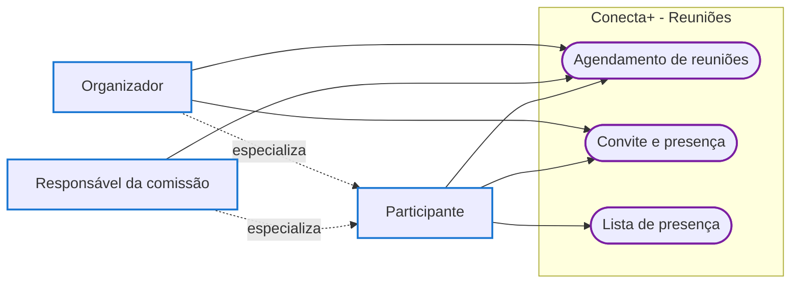
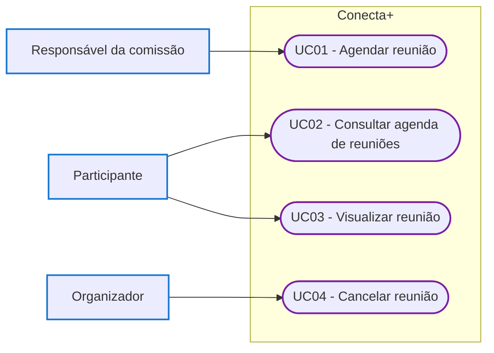
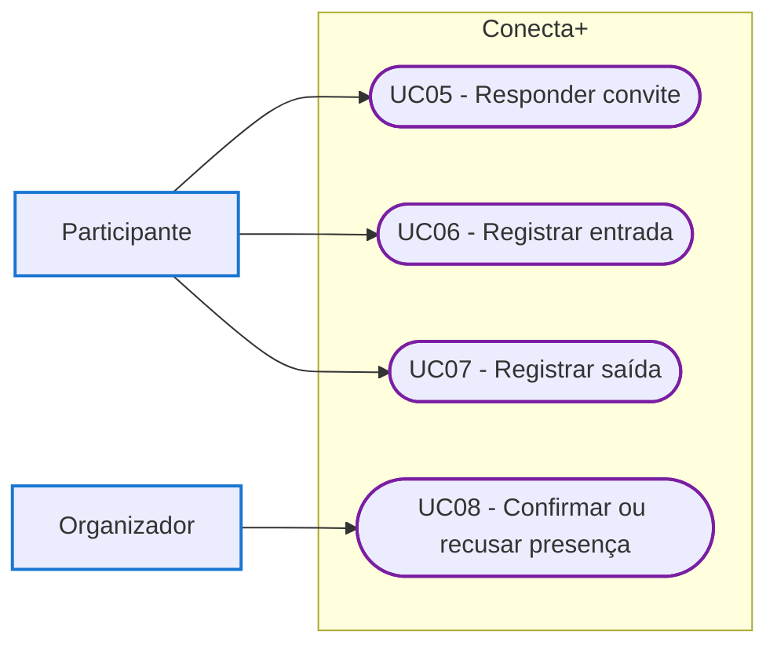
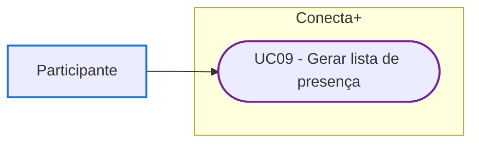

# Diagrama de Casos de Uso - Reuniões

Este documento apresenta os atores e os casos de uso do incremento de reuniões das comissões. A autenticação do usuário é uma pré-condição de todos os casos de uso.

---

## Atores

**Participante:** usuário da plataforma convidado para uma reunião. Consulta a agenda, visualiza a reunião, responde ao convite, registra a própria entrada e saída e consulta a lista de presença.

**Responsável da comissão:** integrante da comissão com papel de responsável, que corresponde ao presidente da comissão descrito no enunciado do incremento. Cada comissão possui exatamente um responsável. Além das ações do participante, agenda reuniões da comissão.

**Organizador:** responsável da comissão que agendou uma reunião específica. Além das ações do participante, cancela a reunião e confirma ou recusa as presenças registradas.

O responsável da comissão e o organizador são especializações do participante. O administrador do sistema não participa das reuniões.

---

## Visão Geral

---

## 1. Agendamento de Reuniões

### Casos de uso

- **UC01 - Agendar reunião:** permite ao responsável da comissão marcar uma reunião e convidar integrantes da comissão.
- **UC02 - Consultar agenda de reuniões:** permite ao participante ver as reuniões para as quais foi convidado, organizadas por dia.
- **UC03 - Visualizar reunião:** permite ao participante ver os dados da reunião, os convidados, as presenças e a pauta.
- **UC04 - Cancelar reunião:** permite ao organizador cancelar uma reunião que ainda não terminou.

---

## 2. Convite e Presença

### Casos de uso

- **UC05 - Responder convite:** permite ao participante aceitar ou recusar o convite para a reunião.
- **UC06 - Registrar entrada:** permite ao participante informar que chegou à reunião.
- **UC07 - Registrar saída:** permite ao participante informar que saiu da reunião.
- **UC08 - Confirmar ou recusar presença:** permite ao organizador validar a presença registrada por cada participante.

---

## 3. Lista de Presença

### Caso de uso

- **UC09 - Gerar lista de presença:** permite ao participante obter a lista com a situação, a entrada, a saída e o tempo de permanência de cada convidado.
