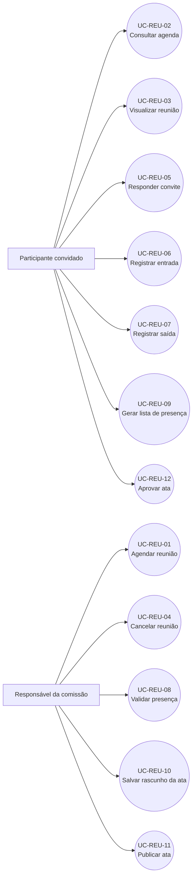

# Casos de uso — Reuniões

> Padrão do Incremento 2 · Fontes: FRONTEND `792fab4` e BACKEND `6f2ffc4`

## Resumo

Este documento descreve como participantes e responsáveis de comissão administram reuniões, convites, presença e atas. Toda operação exige usuário autenticado e ativo; as ações administrativas dependem do papel exercido na comissão.

## Diagrama geral

## Resumo dos casos de uso

| ID        | Nome                          | Ator principal                       | Resultado                                        |
| --------- | ----------------------------- | ------------------------------------ | ------------------------------------------------ |
| UC-REU-01 | Agendar reunião               | Responsável da comissão              | Reunião criada com participantes convidados.     |
| UC-REU-02 | Consultar agenda              | Participante convidado               | Reuniões autorizadas exibidas por período.       |
| UC-REU-03 | Visualizar reunião            | Participante convidado               | Dados atualizados da reunião exibidos.           |
| UC-REU-04 | Cancelar reunião              | Organizador                          | Reunião futura marcada como cancelada.           |
| UC-REU-05 | Responder convite             | Participante convidado               | Convite aceito ou recusado.                      |
| UC-REU-06 | Registrar entrada             | Participante convidado               | Entrada registrada durante a reunião.            |
| UC-REU-07 | Registrar saída               | Participante presente                | Saída registrada sem ultrapassar o término.      |
| UC-REU-08 | Confirmar ou recusar presença | Organizador                          | Situação da presença atualizada.                 |
| UC-REU-09 | Gerar lista de presença       | Participante convidado               | Situação e permanência exibidas.                 |
| UC-REU-10 | Salvar rascunho da ata        | Responsável da comissão              | Ata salva com nova versão.                       |
| UC-REU-11 | Enviar ata para aprovação     | Responsável da comissão              | Texto congelado e aprovadores definidos.         |
| UC-REU-12 | Aprovar ata                   | Participante com presença confirmada | Aprovação registrada; unanimidade conclui a ata. |

## Especificações

### UC-REU-01 — Agendar reunião

| Campo                  | Especificação                                                                                                                                                                                                                                                           |
| ---------------------- | ----------------------------------------------------------------------------------------------------------------------------------------------------------------------------------------------------------------------------------------------------------------------- |
| **Resumo**             | Criar uma reunião futura para uma comissão ativa.                                                                                                                                                                                                                       |
| **Ator principal**     | Responsável da comissão.                                                                                                                                                                                                                                                |
| **Gatilho**            | Seleção de “Nova reunião”.                                                                                                                                                                                                                                              |
| **Pré-condições**      | Usuário ativo, responsável da comissão, vínculo aprovado e organização aprovada.                                                                                                                                                                                        |
| **Fluxo principal**    | 1. Informa comissão, título, local, início, fim, pauta e convidados. 2. Confirma o agendamento. 3. O sistema valida horário, comissão e convidados. 4. Cria a reunião com situação `AGENDADA`; organizador entra aceito e os demais convites ficam `PENDENTE`. |
| **Alternativas/erros** | Horário passado ou invertido, comissão inativa, convidado externo ou usuário sem permissão impedem o cadastro.                                                                                                                                                          |
| **Pós-condições**      | Reunião armazenada e disponível na agenda dos convidados.                                                                                                                                                                                                               |
| **Rastreabilidade**    | RF-REU-01 · SD-REU-01 · CT-REU-01.                                                                                                                                                                                                                                      |

### UC-REU-02 — Consultar agenda

| Campo                  | Especificação                                                                                                                                                 |
| ---------------------- | ------------------------------------------------------------------------------------------------------------------------------------------------------------- |
| **Resumo**             | Listar reuniões das quais o usuário participa.                                                                                                                |
| **Ator principal**     | Participante convidado.                                                                                                                                       |
| **Gatilho**            | Abertura da agenda ou da aba de reuniões da comissão.                                                                                                         |
| **Pré-condições**      | Usuário autenticado e ativo.                                                                                                                                  |
| **Fluxo principal**    | 1. Informa período e, opcionalmente, comissão. 2. O sistema filtra por `participantes.usuario_id`. 3. Ordena por início e apresenta calendário e lista. |
| **Alternativas/erros** | Sem resultados, mostra estado vazio; datas ou ID inválidos retornam erro de validação.                                                                        |
| **Pós-condições**      | Agenda exibida sem alterar dados.                                                                                                                             |
| **Rastreabilidade**    | RF-REU-02 · SD-REU-02 · CT-REU-02.                                                                                                                            |

### UC-REU-03 — Visualizar reunião

| Campo                  | Especificação                                                                                                                                                            |
| ---------------------- | ------------------------------------------------------------------------------------------------------------------------------------------------------------------------ |
| **Resumo**             | Consultar dados, convidados, presença, pauta e situação da ata.                                                                                                          |
| **Ator principal**     | Participante convidado.                                                                                                                                                  |
| **Gatilho**            | Seleção de uma reunião.                                                                                                                                                  |
| **Pré-condições**      | Usuário consta entre os participantes.                                                                                                                                   |
| **Fluxo principal**    | 1. O aplicativo consulta a reunião. 2. A API verifica participação e popula comissão e usuários. 3. A tela apresenta dados e renova a consulta a cada 30 segundos. |
| **Alternativas/erros** | Reunião inexistente retorna 404; usuário externo recebe 403.                                                                                                             |
| **Pós-condições**      | Estado atual exibido sem alteração.                                                                                                                                      |
| **Rastreabilidade**    | RF-REU-03 · SD-REU-03 · CT-REU-03.                                                                                                                                       |

### UC-REU-04 — Cancelar reunião

| Campo                  | Especificação                                                                                                                          |
| ---------------------- | -------------------------------------------------------------------------------------------------------------------------------------- |
| **Resumo**             | Cancelar uma reunião agendada que ainda não terminou.                                                                                  |
| **Ator principal**     | Organizador.                                                                                                                           |
| **Gatilho**            | Confirmação da ação “Cancelar reunião”.                                                                                                |
| **Pré-condições**      | Usuário criou a reunião; situação `AGENDADA`; término futuro.                                                                          |
| **Fluxo principal**    | 1. Solicita cancelamento. 2. Confirma a ação. 3. A API atualiza somente `situacao` para `CANCELADA` com verificação concorrente. |
| **Alternativas/erros** | Cancelamento abortado não altera dados; usuário alheio, reunião encerrada ou estado alterado recusam a operação.                       |
| **Pós-condições**      | Reunião cancelada e bloqueada para novos registros.                                                                                    |
| **Rastreabilidade**    | RF-REU-04 · SD-REU-04 · CT-REU-04.                                                                                                     |

### UC-REU-05 — Responder convite

| Campo                  | Especificação                                                                                                              |
| ---------------------- | -------------------------------------------------------------------------------------------------------------------------- |
| **Resumo**             | Aceitar ou recusar um convite antes do término da reunião.                                                                 |
| **Ator principal**     | Participante convidado.                                                                                                    |
| **Gatilho**            | Seleção de “Aceitar” ou “Recusar”.                                                                                         |
| **Pré-condições**      | Reunião agendada; usuário convidado, não organizador e sem entrada ao recusar.                                             |
| **Fluxo principal**    | 1. Escolhe a resposta. 2. A API valida o participante e o estado. 3. Atualiza o convite para `ACEITO` ou `RECUSADO`. |
| **Alternativas/erros** | O participante pode aceitar depois de recusar; organizador, reunião cancelada ou recusa após entrada são rejeitados.       |
| **Pós-condições**      | Resposta persistida no participante.                                                                                       |
| **Rastreabilidade**    | RF-REU-05 · SD-REU-05 · CT-REU-05.                                                                                         |

### UC-REU-06 — Registrar entrada

| Campo                  | Especificação                                                                                                                                           |
| ---------------------- | ------------------------------------------------------------------------------------------------------------------------------------------------------- |
| **Resumo**             | Registrar a chegada do participante durante a reunião.                                                                                                  |
| **Ator principal**     | Participante convidado.                                                                                                                                 |
| **Gatilho**            | Seleção de “Marcar entrada”.                                                                                                                            |
| **Pré-condições**      | Reunião em andamento, não cancelada; convite não recusado; entrada ainda ausente.                                                                       |
| **Fluxo principal**    | 1. Solicita entrada. 2. A API valida janela e participante. 3. Registra horário e origem; organizador fica confirmado, demais aguardam validação. |
| **Alternativas/erros** | Antes/depois do horário, entrada duplicada ou convite recusado impedem a gravação.                                                                      |
| **Pós-condições**      | Presença criada em `CONFIRMADA` ou `AGUARDANDO`.                                                                                                        |
| **Rastreabilidade**    | RF-REU-06 · SD-REU-06 · CT-REU-06.                                                                                                                      |

### UC-REU-07 — Registrar saída

| Campo                  | Especificação                                                                                               |
| ---------------------- | ----------------------------------------------------------------------------------------------------------- |
| **Resumo**             | Registrar o encerramento da permanência.                                                                    |
| **Ator principal**     | Participante presente.                                                                                      |
| **Gatilho**            | Seleção de “Marcar saída”.                                                                                  |
| **Pré-condições**      | Entrada existente e saída ainda ausente.                                                                    |
| **Fluxo principal**    | 1. Solicita saída. 2. A API usa o menor valor entre o horário atual e o término. 3. Persiste a saída. |
| **Alternativas/erros** | Ausência de entrada ou saída repetida recusam a operação.                                                   |
| **Pós-condições**      | Período de permanência fechado.                                                                             |
| **Rastreabilidade**    | RF-REU-07 · SD-REU-07 · CT-REU-07.                                                                          |

### UC-REU-08 — Confirmar ou recusar presença

| Campo                  | Especificação                                                                                                                                                          |
| ---------------------- | ---------------------------------------------------------------------------------------------------------------------------------------------------------------------- |
| **Resumo**             | Validar o registro de presença de um participante.                                                                                                                     |
| **Ator principal**     | Organizador.                                                                                                                                                           |
| **Gatilho**            | Seleção de confirmar ou recusar na lista de participantes.                                                                                                             |
| **Pré-condições**      | Usuário é organizador e a reunião já começou.                                                                                                                          |
| **Fluxo principal**    | 1. Seleciona participante e situação. 2. A API verifica autoria. 3. Confirma/recusa presença existente ou cria presença confirmada para quem não marcou entrada. |
| **Alternativas/erros** | Usuário alheio, reunião cancelada ou ação antes do início são recusados.                                                                                               |
| **Pós-condições**      | Situação da presença atualizada.                                                                                                                                       |
| **Rastreabilidade**    | RF-REU-08 · SD-REU-08 · CT-REU-08.                                                                                                                                     |

### UC-REU-09 — Gerar lista de presença

| Campo                  | Especificação                                                                                                                                       |
| ---------------------- | --------------------------------------------------------------------------------------------------------------------------------------------------- |
| **Resumo**             | Exibir situação, horários e permanência dos convidados.                                                                                             |
| **Ator principal**     | Participante convidado.                                                                                                                             |
| **Gatilho**            | Abertura da aba “Presença” nos registros da reunião.                                                                                                |
| **Pré-condições**      | Usuário participa da reunião.                                                                                                                       |
| **Fluxo principal**    | 1. Solicita a lista. 2. A API calcula minutos quando há entrada e saída. 3. A tela apresenta presentes, recusados, aguardando e sem registro. |
| **Alternativas/erros** | Pode compartilhar texto pelo recurso nativo; usuário externo recebe 403.                                                                            |
| **Pós-condições**      | Relatório exibido sem criar presença inexistente.                                                                                                   |
| **Rastreabilidade**    | RF-REU-09 · SD-REU-09 · CT-REU-09.                                                                                                                  |

### UC-REU-10 — Salvar rascunho da ata

| Campo                  | Especificação                                                                                                                  |
| ---------------------- | ------------------------------------------------------------------------------------------------------------------------------ |
| **Resumo**             | Criar ou atualizar a ata encerrada com controle de versão.                                                                     |
| **Ator principal**     | Responsável da comissão.                                                                                                       |
| **Gatilho**            | Seleção de “Salvar rascunho”.                                                                                                  |
| **Pré-condições**      | Reunião encerrada e não cancelada; ata inexistente ou em `RASCUNHO`.                                                           |
| **Fluxo principal**    | 1. Informa conteúdo e versão exibida. 2. A API valida autoria, tamanho e versão. 3. Salva o texto e incrementa `versao`. |
| **Alternativas/erros** | Conteúdo inválido, versão obsoleta ou ata já publicada impedem a gravação.                                                     |
| **Pós-condições**      | Ata em `RASCUNHO`, com autor e horário atualizados.                                                                            |
| **Rastreabilidade**    | RF-REU-10 · SD-REU-10 · CT-REU-10.                                                                                             |

### UC-REU-11 — Enviar ata para aprovação

| Campo                  | Especificação                                                                                                                                   |
| ---------------------- | ----------------------------------------------------------------------------------------------------------------------------------------------- |
| **Resumo**             | Congelar o rascunho e definir seus aprovadores.                                                                                                 |
| **Ator principal**     | Responsável da comissão.                                                                                                                        |
| **Gatilho**            | Confirmação de “Enviar para aprovação”.                                                                                                         |
| **Pré-condições**      | Ata em `RASCUNHO`, versão atual e ao menos uma presença confirmada.                                                                             |
| **Fluxo principal**    | 1. Confirma publicação. 2. A API seleciona participantes `CONFIRMADA`. 3. Define `EM_APROVACAO`, aprovadores e lista vazia de aprovações. |
| **Alternativas/erros** | Rascunho ausente, versão divergente ou nenhum presente confirmado impedem a publicação.                                                         |
| **Pós-condições**      | Texto fica imutável e disponível para aprovação.                                                                                                |
| **Rastreabilidade**    | RF-REU-11 · SD-REU-11 · CT-REU-11.                                                                                                              |

### UC-REU-12 — Aprovar ata

| Campo                  | Especificação                                                                                                                                                 |
| ---------------------- | ------------------------------------------------------------------------------------------------------------------------------------------------------------- |
| **Resumo**             | Registrar a aprovação individual da ata publicada.                                                                                                            |
| **Ator principal**     | Participante com presença confirmada.                                                                                                                         |
| **Gatilho**            | Confirmação de “Aprovar ata”.                                                                                                                                 |
| **Pré-condições**      | Ata em `EM_APROVACAO`; usuário pertence a `aprovadores`; versão atual.                                                                                        |
| **Fluxo principal**    | 1. Solicita aprovação. 2. A API valida versão e elegibilidade. 3. Inclui o usuário em `aprovacoes`. 4. Quando todos aprovam, altera para `APROVADA`. |
| **Alternativas/erros** | Repetição é idempotente; usuário externo, versão obsoleta ou estado inválido são recusados.                                                                   |
| **Pós-condições**      | Aprovação registrada e, por unanimidade, ata concluída.                                                                                                       |
| **Rastreabilidade**    | RF-REU-12 · SD-REU-12 · CT-REU-12.                                                                                                                            |
