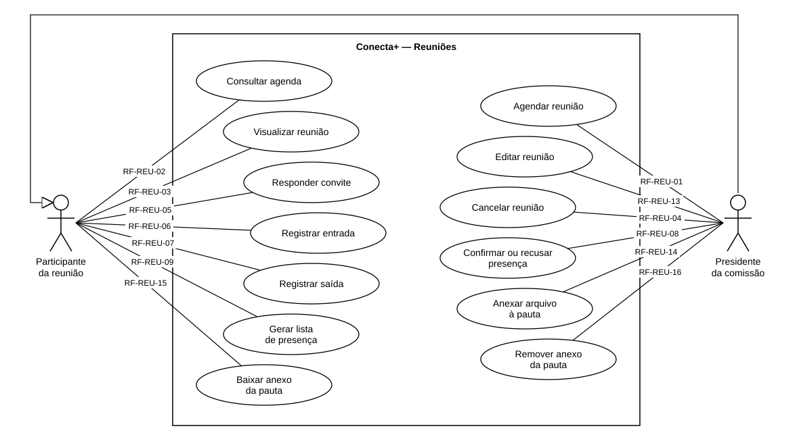

# Casos de uso — Reuniões

> Padrão da disciplina · Módulo REU · Revisado em 10/11/2026 sobre a branch `homolog`

## Resumo

Este documento mostra quem usa as reuniões e o que cada pessoa pode fazer. Cada caso de uso é descrito em detalhe, como requisito funcional no formulário padrão, em [Requisitos funcionais](2%20-%20requisitos-funcionais-reunioes.md).

Os casos de uso da ata saíram deste módulo no Incremento 3 e estão em [Atas de reunião](../../4%20-%20Incremento3/atas/1%20-%20casos-uso-atas.md).

## Diagrama de casos de uso

Figura 1 — Diagrama de casos de uso das reuniões. Fonte: equipe Conecta+.

Cada linha entre um ator e um caso de uso leva o código do requisito funcional que o descreve.

## Atores

**Participante da reunião.** É o usuário que foi convidado para a reunião: seu nome está na lista de participantes. Ele consulta a agenda, abre a reunião, aceita ou recusa o convite, marca a própria entrada e a própria saída, vê a lista de presença e baixa os arquivos anexados à pauta. Não altera os dados da reunião.

**Presidente da comissão.** É o membro da comissão com o papel de responsável. Só ele agenda reuniões para a comissão. Depois de agendar, é ele quem edita ou cancela a reunião, confirma ou recusa a presença dos outros e anexa ou remove arquivos da pauta. A seta de generalização indica que o presidente também é um participante da reunião: ele faz tudo o que o participante faz, com uma diferença, não responde ao convite, porque já entra como confirmado.

## Requisitos funcionais de usuário

| Caso de uso | Requisito | Nome                          | Ator principal          |
| ----------- | --------- | ----------------------------- | ----------------------- |
| UC-REU-01   | RF-REU-01 | Agendar reunião               | Presidente da comissão  |
| UC-REU-02   | RF-REU-02 | Consultar agenda              | Participante da reunião |
| UC-REU-03   | RF-REU-03 | Visualizar reunião            | Participante da reunião |
| UC-REU-04   | RF-REU-04 | Cancelar reunião              | Presidente da comissão  |
| UC-REU-05   | RF-REU-05 | Responder convite             | Participante da reunião |
| UC-REU-06   | RF-REU-06 | Registrar entrada             | Participante da reunião |
| UC-REU-07   | RF-REU-07 | Registrar saída               | Participante da reunião |
| UC-REU-08   | RF-REU-08 | Confirmar ou recusar presença | Presidente da comissão  |
| UC-REU-09   | RF-REU-09 | Gerar lista de presença       | Participante da reunião |
| UC-REU-13   | RF-REU-13 | Editar reunião                | Presidente da comissão  |
| UC-REU-14   | RF-REU-14 | Anexar arquivo à pauta        | Presidente da comissão  |
| UC-REU-15   | RF-REU-15 | Baixar anexo da pauta         | Participante da reunião |
| UC-REU-16   | RF-REU-16 | Remover anexo da pauta        | Presidente da comissão  |

Os números 10, 11 e 12 pertenciam à ata e não foram reaproveitados.

**Requisito RF-REU-01 — Agendar reunião.** O sistema deve permitir ao presidente da comissão agendar uma reunião, informando título, data, horário ou dia inteiro, local opcional, pauta e convidados.

**Requisito RF-REU-02 — Consultar agenda.** O sistema deve mostrar ao usuário as reuniões para as quais ele foi convidado, em ordem de data.

**Requisito RF-REU-03 — Visualizar reunião.** O sistema deve mostrar ao participante os dados da reunião, os convidados, a presença, a pauta e seus anexos.

**Requisito RF-REU-04 — Cancelar reunião.** O sistema deve permitir ao presidente cancelar uma reunião que ainda não terminou, depois de confirmar a intenção.

**Requisito RF-REU-05 — Responder convite.** O sistema deve permitir ao participante aceitar ou recusar o convite enquanto a reunião não terminar.

**Requisito RF-REU-06 — Registrar entrada.** O sistema deve permitir ao participante marcar sua entrada durante o horário da reunião, uma única vez.

**Requisito RF-REU-07 — Registrar saída.** O sistema deve permitir ao participante que marcou entrada marcar também a sua saída.

**Requisito RF-REU-08 — Confirmar ou recusar presença.** O sistema deve permitir ao presidente confirmar ou recusar a presença de cada participante depois que a reunião começar.

**Requisito RF-REU-09 — Gerar lista de presença.** O sistema deve mostrar ao participante quem esteve presente, com horário de entrada, de saída e tempo de permanência, e permitir compartilhar essa lista.

**Requisito RF-REU-13 — Editar reunião.** O sistema deve permitir ao presidente alterar os dados de uma reunião que ainda não terminou.

**Requisito RF-REU-14 — Anexar arquivo à pauta.** O sistema deve permitir ao presidente juntar arquivos à pauta, para a comissão ler antes da reunião.

**Requisito RF-REU-15 — Baixar anexo da pauta.** O sistema deve permitir ao participante abrir os arquivos anexados à pauta.

**Requisito RF-REU-16 — Remover anexo da pauta.** O sistema deve permitir ao presidente retirar um arquivo da pauta, depois de confirmar a intenção.
