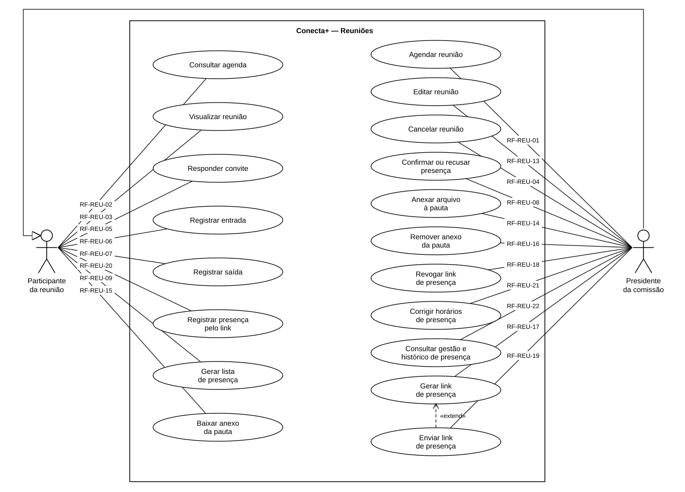

# Casos de uso — Reuniões

> Padrão da disciplina · Módulo REU · Revisado em 26/11/2026

## Resumo

Este documento mostra quem usa as reuniões e o que cada pessoa pode fazer. Cada caso de uso é descrito em detalhe, como requisito funcional no formulário padrão, em [Requisitos funcionais](2%20-%20requisitos-funcionais-reunioes.md). A ata da reunião tem documentação própria, em [Atas de reunião](../../4%20-%20Incremento3/atas/1%20-%20casos-uso-atas.md), e as votações, em [Votação na reunião](../../4%20-%20Incremento3/votacao/1%20-%20casos-uso-votacao.md).

## Diagrama de casos de uso

Figura 1 — Diagrama de casos de uso das reuniões. Fonte: equipe Conecta+.

Cada linha entre um ator e um caso de uso leva o código do requisito funcional que o descreve.

## Atores

**Participante da reunião.** É o usuário que está na lista de participantes da reunião, porque foi convidado ou porque a agendou. Ele consulta a agenda, abre a reunião, aceita ou recusa o convite, marca a própria entrada e a própria saída, registra a presença pelo link que o presidente divulgou, vê a lista de presença, gera o PDF dela e baixa os arquivos da pauta. Não altera os dados da reunião, não confirma a presença de outras pessoas e não corrige horários.

**Presidente da comissão.** É o membro da comissão com o papel de responsável (`RESPONSAVEL`). Só ele agenda reuniões para a comissão. A seta de generalização indica que ele também é um participante da reunião: faz tudo o que o participante faz, com uma diferença, não responde ao convite da reunião que agendou, porque já entra com o convite aceito, e a entrada que ele marca já nasce confirmada. Quem agendou a reunião é quem a edita, cancela, confirma ou recusa presenças e cuida dos anexos. Gerar, enviar e revogar o link de presença, corrigir horários e consultar o histórico de correções cabem ao responsável atual da comissão, que normalmente é a mesma pessoa; se a comissão trocar de responsável, o novo responsável passa a cuidar do link e das correções, e quem agendou continua cuidando do restante.

## Relacionamentos entre casos de uso

- **Generalização entre atores:** o presidente da comissão herda os casos de uso do participante da reunião.
- **«extend» de Enviar link de presença para Gerar link de presença:** os botões "Copiar link", "Notificar convidados no aplicativo" e "Enviar e-mail aos convidados" só aparecem depois que o link é gerado, na mesma tela, e enviar é opcional.

## Requisitos funcionais de usuário

| Caso de uso | Requisito | Nome                                    | Ator principal          |
| ----------- | --------- | --------------------------------------- | ----------------------- |
| UC-REU-01   | RF-REU-01 | Agendar reunião                         | Presidente da comissão  |
| UC-REU-02   | RF-REU-02 | Consultar agenda                        | Participante da reunião |
| UC-REU-03   | RF-REU-03 | Visualizar reunião                      | Participante da reunião |
| UC-REU-04   | RF-REU-04 | Cancelar reunião                        | Presidente da comissão  |
| UC-REU-05   | RF-REU-05 | Responder convite                       | Participante da reunião |
| UC-REU-06   | RF-REU-06 | Registrar entrada                       | Participante da reunião |
| UC-REU-07   | RF-REU-07 | Registrar saída                         | Participante da reunião |
| UC-REU-08   | RF-REU-08 | Confirmar ou recusar presença           | Presidente da comissão  |
| UC-REU-09   | RF-REU-09 | Gerar lista de presença                 | Participante da reunião |
| UC-REU-13   | RF-REU-13 | Editar reunião                          | Presidente da comissão  |
| UC-REU-14   | RF-REU-14 | Anexar arquivo à pauta                  | Presidente da comissão  |
| UC-REU-15   | RF-REU-15 | Baixar anexo da pauta                   | Participante da reunião |
| UC-REU-16   | RF-REU-16 | Remover anexo da pauta                  | Presidente da comissão  |
| UC-REU-17   | RF-REU-17 | Gerar link de presença                  | Presidente da comissão  |
| UC-REU-18   | RF-REU-18 | Revogar link de presença                | Presidente da comissão  |
| UC-REU-19   | RF-REU-19 | Enviar link de presença                 | Presidente da comissão  |
| UC-REU-20   | RF-REU-20 | Registrar presença pelo link            | Participante da reunião |
| UC-REU-21   | RF-REU-21 | Corrigir horários de presença           | Presidente da comissão  |
| UC-REU-22   | RF-REU-22 | Consultar gestão e histórico de presença | Presidente da comissão  |

Os números 10, 11 e 12 não são usados neste módulo.

**Requisito RF-REU-01 — Agendar reunião.** O sistema deve permitir ao presidente da comissão agendar uma reunião, informando título, data, horário ou dia inteiro, local opcional, pauta, convidados e anexos.

**Requisito RF-REU-02 — Consultar agenda.** O sistema deve mostrar ao usuário as reuniões para as quais ele foi convidado, em ordem de data.

**Requisito RF-REU-03 — Visualizar reunião.** O sistema deve mostrar ao participante os dados da reunião, os convidados, a presença de cada um, a pauta e seus anexos.

**Requisito RF-REU-04 — Cancelar reunião.** O sistema deve permitir a quem agendou cancelar uma reunião que ainda não terminou, depois de confirmar a intenção.

**Requisito RF-REU-05 — Responder convite.** O sistema deve permitir ao participante aceitar ou recusar o convite enquanto a reunião não terminar, inclusive avisar que desistiu depois de ter aceitado, desde que ainda não tenha marcado entrada.

**Requisito RF-REU-06 — Registrar entrada.** O sistema deve permitir ao participante marcar sua entrada durante o horário da reunião, uma única vez, confirmando quem ele é no próprio aparelho.

**Requisito RF-REU-07 — Registrar saída.** O sistema deve permitir ao participante que marcou entrada marcar também a sua saída, com a mesma confirmação no aparelho. Se a pessoa não marcar, o sistema registra a saída no horário de término da reunião.

**Requisito RF-REU-08 — Confirmar ou recusar presença.** O sistema deve permitir a quem agendou confirmar ou recusar a entrada marcada por um participante e marcar como presente quem não marcou entrada, depois que a reunião começar.

**Requisito RF-REU-09 — Gerar lista de presença.** O sistema deve mostrar ao participante quem esteve presente, com horário de entrada, de saída e tempo de permanência, e gerar o PDF dessa lista.

**Requisito RF-REU-13 — Editar reunião.** O sistema deve permitir a quem agendou alterar os dados de uma reunião que ainda não terminou.

**Requisito RF-REU-14 — Anexar arquivo à pauta.** O sistema deve permitir a quem agendou juntar arquivos à pauta, para a comissão ler antes da reunião.

**Requisito RF-REU-15 — Baixar anexo da pauta.** O sistema deve permitir ao participante abrir os arquivos anexados à pauta.

**Requisito RF-REU-16 — Remover anexo da pauta.** O sistema deve permitir a quem agendou retirar um arquivo da pauta, depois de confirmar a intenção.

**Requisito RF-REU-17 — Gerar link de presença.** O sistema deve permitir ao presidente gerar um link que vale só durante o horário da reunião, com o qual os convidados registram a presença sem depender da confirmação dele.

**Requisito RF-REU-18 — Revogar link de presença.** O sistema deve permitir ao presidente invalidar o link de presença, mantendo as presenças já registradas.

**Requisito RF-REU-19 — Enviar link de presença.** O sistema deve permitir ao presidente copiar o link gerado ou enviá-lo aos convidados por notificação no aplicativo ou por e-mail.

**Requisito RF-REU-20 — Registrar presença pelo link.** O sistema deve permitir ao participante que aceitou o convite abrir o link, entrar com a própria conta e registrar entrada e saída, que ficam confirmadas sem aprovação individual.

**Requisito RF-REU-21 — Corrigir horários de presença.** O sistema deve permitir ao presidente corrigir a entrada e a saída de um participante, informando o motivo, enquanto a ata não for enviada.

**Requisito RF-REU-22 — Consultar gestão e histórico de presença.** O sistema deve mostrar ao presidente se há link de presença ativo e o histórico das correções de horário, com quem corrigiu, quando, o motivo e os valores anteriores e novos.
