# Diagrama de classes — Reuniões

> Padrão da disciplina · Módulo REU · Revisado em 10/11/2026

## Resumo

O diagrama mostra as classes que participam das reuniões, agrupadas em três pacotes, um por camada do sistema: **Aplicativo** (telas e módulos do aplicativo), **API** (controller, service e objetos de entrada) e **Dados** (documentos guardados no MongoDB e o armazenamento de arquivos). Cada atributo traz o seu tipo, e cada método traz o tipo dos parâmetros e do retorno. Toda classe e todo método do diagrama existem no código.

A classe `Ata` aparece aqui só como parte de `Reuniao`; seus atributos estão no [diagrama de classes das atas](../../4%20-%20Incremento3/atas/3%20-%20diagrama-classes-atas.md).

## Diagrama

```mermaid
classDiagram
    direction LR

    namespace Aplicativo {
        class TelaAgenda {
            -reunioes: Reuniao[]
            +carregar() Promise~void~
            +responder(reuniao: Reuniao, aceito: boolean) Promise~void~
            +escolherDia(dia: Date) void
        }
        class FormularioReuniao {
            -reuniao: Reuniao
            +salvar() Promise~void~
            +calcularHorario(dados: DadosReuniao) Horario
            +alternarDiaInteiro() void
            +alternarConvidado(pessoaId: string) void
            +adicionarAnexos() Promise~void~
        }
        class TelaNovaReuniao {
            +aoSalvar(envio: EnvioReuniao) Promise~string~
        }
        class TelaEditarReuniao {
            -reuniao: Reuniao
            +aoSalvar(envio: EnvioReuniao) Promise~string~
            +aoConcluir() void
        }
        class TelaReuniao {
            -reuniao: Reuniao
            +buscar() Promise~void~
            +executar(chave: string, acao: Function, mensagem: string) Promise~boolean~
            +marcarPresenca(pessoa: Pessoa, situacao: string) void
            +adicionarAnexos() Promise~void~
            +abrir(item: ItemAnexo) Promise~void~
            +confirmarRemocao(item: ItemAnexo) void
        }
        class TelaRegistrosReuniao {
            -lista: Lista
            +carregarLista() Promise~void~
            +compartilhar() void
        }
        class api {
            <<module>>
            +api(caminho: string, metodo: string, corpo: unknown) Promise~Resultado~
        }
        class anexos {
            <<module>>
            +escolherArquivos() Promise~ArquivoEscolhido[]~
            +validarArquivos(novos: ArquivoEscolhido[], jaAnexados: number) string
            +enviarAnexo(reuniaoId: string, arquivo: ArquivoEscolhido) Promise~Resultado~
            +abrirAnexo(reuniaoId: string, anexo: Anexo) Promise~string~
            +removerAnexo(reuniaoId: string, anexoId: string) Promise~Resultado~
        }
    }

    namespace API {
        class ReunioesController {
            -reunioesService: ReunioesService
            +listar(req: RequisicaoAutenticada, de: string, ate: string, comissaoId: string) Promise~Reuniao[]~
            +criar(dto: CreateReuniaoDto, req: RequisicaoAutenticada) Promise~Reuniao~
            +buscarPorId(id: string, req: RequisicaoAutenticada) Promise~Reuniao~
            +atualizar(id: string, dto: UpdateReuniaoDto, req: RequisicaoAutenticada) Promise~Reuniao~
            +responderConvite(id: string, dto: ResponderConviteReuniaoDto, req: RequisicaoAutenticada) Promise~Reuniao~
            +marcarEntrada(id: string, req: RequisicaoAutenticada) Promise~Reuniao~
            +marcarSaida(id: string, req: RequisicaoAutenticada) Promise~Reuniao~
            +atualizarPresenca(id: string, usuarioId: string, dto: AtualizarPresencaDto, req: RequisicaoAutenticada) Promise~Reuniao~
            +gerarListaPresenca(id: string, req: RequisicaoAutenticada) Promise~ListaPresenca~
            +adicionarAnexo(id: string, arquivo: ArquivoRecebido, req: RequisicaoAutenticada) Promise~Reuniao~
            +abrirAnexo(id: string, anexoId: string, req: RequisicaoAutenticada) Promise~StreamableFile~
            +removerAnexo(id: string, anexoId: string, req: RequisicaoAutenticada) Promise~Reuniao~
        }
        class ReunioesService {
            -reuniaoModel: Model~Reuniao~
            -comissaoModel: Model~Comissao~
            -usuarioModel: Model~Usuario~
            +listar(usuarioId: string, filtros: FiltrosReuniao) Promise~Reuniao[]~
            +criar(dto: CreateReuniaoDto, usuarioId: string) Promise~Reuniao~
            +buscarPorId(id: string, usuarioId: string) Promise~Reuniao~
            +atualizar(id: string, dto: UpdateReuniaoDto, usuarioId: string) Promise~Reuniao~
            +responderConvite(id: string, aceito: boolean, usuarioId: string) Promise~Reuniao~
            +marcarEntrada(id: string, usuarioId: string) Promise~Reuniao~
            +marcarSaida(id: string, usuarioId: string) Promise~Reuniao~
            +atualizarPresenca(id: string, participanteId: string, situacao: SituacaoPresenca, usuarioId: string) Promise~Reuniao~
            +gerarListaPresenca(id: string, usuarioId: string) Promise~ListaPresenca~
            +adicionarAnexo(id: string, arquivo: ArquivoRecebido, usuarioId: string) Promise~Reuniao~
            +abrirAnexo(id: string, anexoId: string, usuarioId: string) Promise~AnexoAberto~
            +removerAnexo(id: string, anexoId: string, usuarioId: string) Promise~Reuniao~
            -editar(id: string, dto: UpdateReuniaoDto, usuarioId: string) Promise~Reuniao~
            -cancelar(id: string, usuarioId: string) Promise~Reuniao~
            -carregar(id: string, usuarioId: string) Promise~Carga~
            -carregarComoDono(id: string, usuarioId: string) Promise~Carga~
            -autorizarResponsavel(comissaoId: string, usuarioId: string, acao: string) Promise~Comissao~
            -validarHorario(inicio: Date, fim: Date) void
            -exigirAgendada(reuniao: Reuniao) void
            -exigirAnexosAbertos(reuniao: Reuniao) void
            -buscarAnexo(reuniao: Reuniao, anexoId: string) Anexo
            -arquivos() GridFSBucket
        }
        class CreateReuniaoDto {
            +comissao_id: string
            +titulo: string
            +local: string
            +inicio: string
            +fim: string
            +dia_inteiro: boolean
            +pauta: string
            +convidados_ids: string[]
        }
        class UpdateReuniaoDto {
            +situacao: SituacaoReuniao
            +titulo: string
            +local: string
            +inicio: string
            +fim: string
            +dia_inteiro: boolean
            +pauta: string
            +convidados_ids: string[]
        }
        class ResponderConviteReuniaoDto {
            +aceito: boolean
        }
        class AtualizarPresencaDto {
            +situacao: SituacaoPresenca
        }
    }

    namespace Dados {
        class Reuniao {
            +_id: ObjectId
            +comissao_id: ObjectId
            +titulo: string
            +local: string
            +inicio: Date
            +fim: Date
            +dia_inteiro: boolean
            +horario_alterado_em: Date
            +pauta: string
            +anexos: Anexo[]
            +criada_por: ObjectId
            +situacao: SituacaoReuniao
            +participantes: Participante[]
            +ata: Ata
            +atas_canceladas: Ata[]
            +criado_em: Date
            +atualizado_em: Date
        }
        class Participante {
            +usuario_id: ObjectId
            +convite: RespostaConvite
            +presenca: Presenca
        }
        class Presenca {
            +entrada: Date
            +saida: Date
            +situacao: SituacaoPresenca
            +marcada_por: OrigemPresenca
        }
        class Anexo {
            +_id: ObjectId
            +nome: string
            +tipo: string
            +tamanho: number
            +enviado_em: Date
        }
        class Ata {
            +conteudo: string
            +versao: number
            +situacao: SituacaoAta
        }
        class Comissao {
            +_id: ObjectId
            +organizacao_id: ObjectId
            +ativo: boolean
            +membros: MembroComissao[]
        }
        class Usuario {
            +_id: ObjectId
            +nome: string
            +ativo: boolean
        }
        class GridFSBucket {
            <<MongoDB>>
            +openUploadStream(nome: string, opcoes: object) GridFSBucketWriteStream
            +openDownloadStream(id: ObjectId) GridFSBucketReadStream
            +delete(id: ObjectId) Promise~void~
        }
        class SituacaoReuniao {
            <<enumeration>>
            AGENDADA
            CANCELADA
        }
        class RespostaConvite {
            <<enumeration>>
            PENDENTE
            ACEITO
            RECUSADO
        }
        class SituacaoPresenca {
            <<enumeration>>
            AGUARDANDO
            CONFIRMADA
            RECUSADA
        }
        class OrigemPresenca {
            <<enumeration>>
            PROPRIO
            RESPONSAVEL
        }
    }

    TelaNovaReuniao ..> FormularioReuniao : usa
    TelaEditarReuniao ..> FormularioReuniao : usa
    TelaAgenda ..> api : usa
    TelaNovaReuniao ..> api : usa
    TelaEditarReuniao ..> api : usa
    TelaReuniao ..> api : usa
    TelaReuniao ..> anexos : usa
    TelaRegistrosReuniao ..> api : usa
    FormularioReuniao ..> anexos : usa
    anexos ..> api : usa
    api ..> ReunioesController : requisição HTTP

    ReunioesController --> "1" ReunioesService : reunioesService
    ReunioesController ..> CreateReuniaoDto : recebe
    ReunioesController ..> UpdateReuniaoDto : recebe
    ReunioesController ..> ResponderConviteReuniaoDto : recebe
    ReunioesController ..> AtualizarPresencaDto : recebe
    ReunioesService ..> Reuniao : lê e grava
    ReunioesService ..> Comissao : confere o presidente
    ReunioesService ..> Usuario : confere a conta
    ReunioesService ..> GridFSBucket : grava e lê arquivos

    Reuniao "1" *-- "1..*" Participante : participantes
    Participante "1" *-- "0..1" Presenca : presenca
    Reuniao "1" *-- "0..10" Anexo : anexos
    Reuniao "1" *-- "0..1" Ata : ata
    Reuniao "1" *-- "0..*" Ata : atas_canceladas
    Reuniao "0..*" --> "1" Comissao : comissao_id
    Reuniao "0..*" --> "1" Usuario : criada_por
    Participante "0..*" --> "1" Usuario : usuario_id
    Anexo "1" --> "1" GridFSBucket : conteúdo, pelo mesmo _id
    Reuniao ..> SituacaoReuniao : situacao
    Participante ..> RespostaConvite : convite
    Presenca ..> SituacaoPresenca : situacao
    Presenca ..> OrigemPresenca : marcada_por
```

Figura 2 — Diagrama de classes das reuniões, por camada. Fonte: equipe Conecta+.

## Como ler as ligações

| Ligação                      | Significado                                                             | Exemplo no diagrama                                                                              |
| ---------------------------- | ----------------------------------------------------------------------- | ------------------------------------------------------------------------------------------------ |
| Losango cheio (composição)   | A parte só existe dentro do todo e é apagada junto com ele.             | `Reuniao *-- Participante`: o participante é gravado dentro do documento da reunião.             |
| Seta cheia (associação)      | Uma classe guarda uma referência a outra, que existe por conta própria. | `Participante --> Usuario`: `usuario_id` guarda o identificador de um documento de `usuarios`.   |
| Seta tracejada (dependência) | Uma classe usa a outra em uma chamada, sem guardá-la como atributo.     | `ReunioesService ..> Comissao`.                                                                  |

Os números nas pontas são as multiplicidades. Por exemplo, uma `Reuniao` tem ao menos um `Participante` (`1..*`), que é quem a agendou, e de zero a dez anexos (`0..10`).

No código, os atributos opcionais são `horario_alterado_em` e `ata`, em `Reuniao`; `presenca`, em `Participante`; e `saida`, em `Presenca`. Nos objetos de entrada, só `comissao_id`, `titulo`, `inicio` e `fim` são obrigatórios em `CreateReuniaoDto`, e todos os campos de `UpdateReuniaoDto` são opcionais. A obrigatoriedade de cada atributo está no [dicionário de classes](3%20-%20dicionario-dados-classes-reunioes.md).

## Regras representadas

- `Participante`, `Presenca`, `Anexo` e `Ata` são gravados dentro do documento de `Reuniao`, por isso a composição;
- `Anexo` guarda só a identificação do arquivo; o conteúdo fica no `GridFSBucket`, com o mesmo identificador;
- `Usuario` e `Comissao` ficam em coleções próprias, por isso as associações são feitas por identificador;
- quem agendou a reunião é identificado por `criada_por`;
- `FormularioReuniao` é o mesmo componente nas telas de criar e de editar.

## Rastreabilidade

RF-REU-01 a RF-REU-09 e RF-REU-13 a RF-REU-16; [dicionário de classes](3%20-%20dicionario-dados-classes-reunioes.md) e [diagramas de sequência](6%20-%20diagramas-sequencia-reunioes.md).
