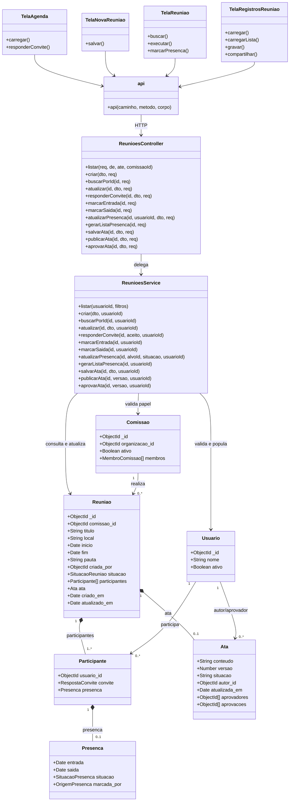

# Diagrama de classes — Reuniões

> Padrão do Incremento 2 · Classes confirmadas no código auditado

## Resumo

`ReunioesController` expõe as rotas, `ReunioesService` concentra autorização e regras, e `Reuniao` persiste participantes, presenças e ata como subdocumentos no MongoDB. As telas Expo consomem a API por meio do módulo `api`.

## Diagrama

## Regras representadas

- `Participante`, `Presenca` e `Ata` são subdocumentos de `Reuniao`;
- o organizador é identificado por `criada_por` e deve ser o responsável da comissão no agendamento;
- a presença do participante comum começa em `AGUARDANDO`; a do organizador, em `CONFIRMADA`;
- a ata usa versão para impedir sobrescrita concorrente;
- após a publicação, o texto não muda e somente os IDs congelados em `aprovadores` podem aprovar;
- todas as aprovações são necessárias para a situação `APROVADA`.

## Rastreabilidade

RF-REU-01 a RF-REU-12; dicionário de classes e diagramas de sequência do módulo.
