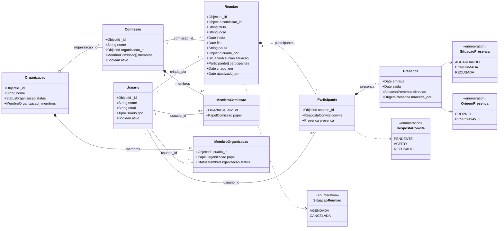
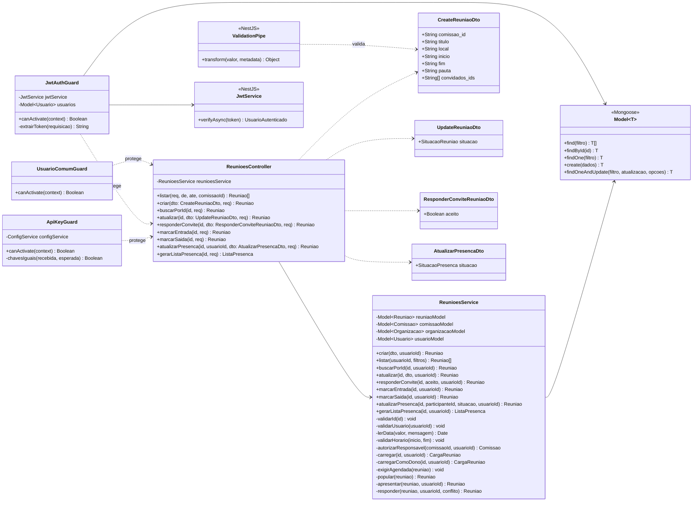
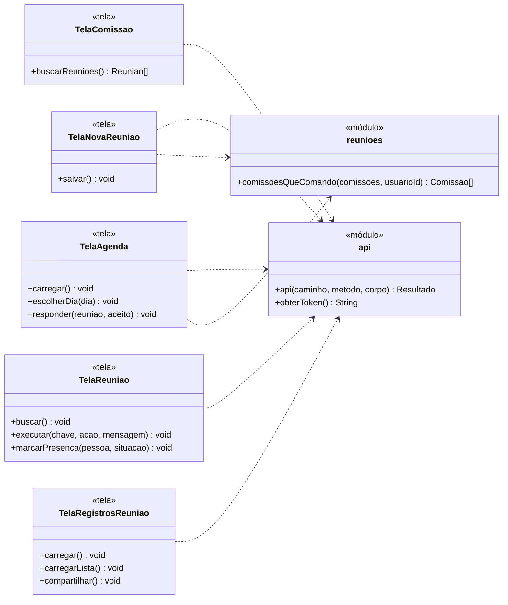

# Diagrama de Classes - Reuniões

O diagrama está dividido em três partes: as classes de dados armazenadas no banco, as classes do servidor que atendem às requisições e as classes do aplicativo usadas pelas telas de reunião.

---

## 1. Classes de Dados

`Participante` e `Presenca` só existem dentro de uma `Reuniao`. `Comissao`, `MembroComissao`, `Organizacao`, `MembroOrganizacao` e `Usuario` pertencem ao Incremento 1 e aparecem apenas com os atributos usados pelas reuniões.

---

## 2. Classes do Servidor

---

## 3. Classes do Aplicativo

