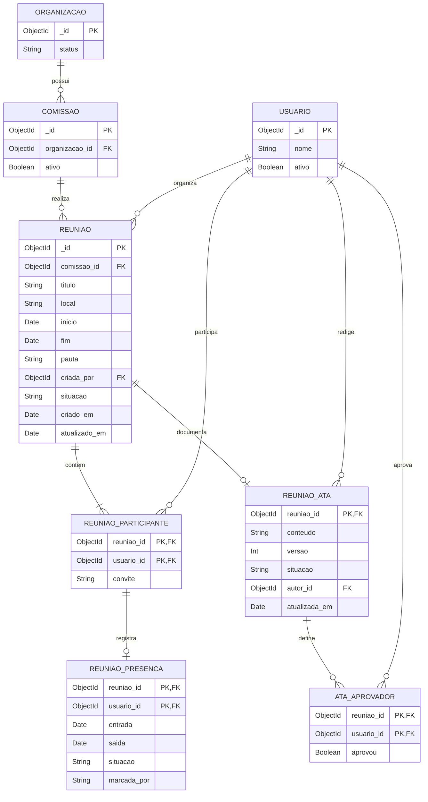

# Diagrama relacional — Reuniões

> Padrão do Incremento 2 · Visão lógica relacional de documentos MongoDB

## Resumo

No MongoDB, participantes, presenças e ata ficam embutidos no documento de `reunioes`. O diagrama os separa logicamente para explicitar cardinalidades, chaves e restrições.

## Diagrama

## Mapeamento físico

| Visão lógica           | MongoDB                                       |
| ---------------------- | --------------------------------------------- |
| `REUNIAO`              | coleção `reunioes`                            |
| `REUNIAO_PARTICIPANTE` | `reunioes.participantes[]`                    |
| `REUNIAO_PRESENCA`     | `reunioes.participantes[].presenca`           |
| `REUNIAO_ATA`          | `reunioes.ata`                                |
| `ATA_APROVADOR`        | `reunioes.ata.aprovadores[]` e `aprovacoes[]` |

## Rastreabilidade

RF-REU-01, RF-REU-05 a RF-REU-12.
