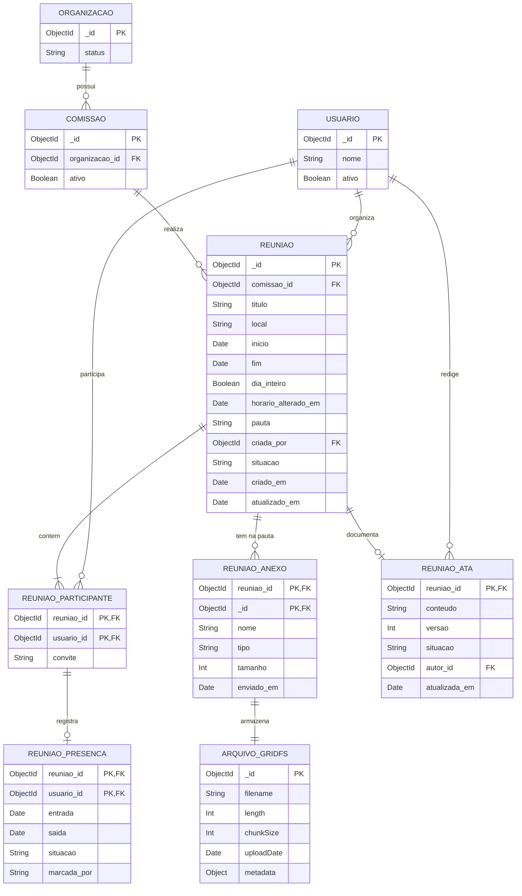

# Diagrama relacional — Reuniões

> Padrão da disciplina · Módulo REU · Visão lógica dos documentos MongoDB · Revisado em 10/11/2026

## Resumo

No MongoDB, participantes, presenças, anexos e ata ficam embutidos no documento de `reunioes`. O diagrama os separa logicamente para explicitar cardinalidades, chaves e restrições. O conteúdo dos arquivos anexados fica no GridFS, nas coleções `anexos.files` e `anexos.chunks`, e é ligado ao anexo pelo mesmo identificador.

A ata aparece aqui apenas como ligação; seus campos estão no [diagrama relacional das atas](../../4%20-%20Incremento3/atas/4%20-%20diagrama-relacional-atas.md).

## Diagrama

## Mapeamento físico

| Visão lógica           | MongoDB                                                     |
| ---------------------- | ----------------------------------------------------------- |
| `REUNIAO`              | coleção `reunioes`                                          |
| `REUNIAO_PARTICIPANTE` | `reunioes.participantes[]`                                  |
| `REUNIAO_PRESENCA`     | `reunioes.participantes[].presenca`                         |
| `REUNIAO_ANEXO`        | `reunioes.anexos[]`                                         |
| `ARQUIVO_GRIDFS`       | coleções `anexos.files` e `anexos.chunks`, criadas pelo GridFS |
| `REUNIAO_ATA`          | `reunioes.ata` e `reunioes.atas_canceladas[]`               |

`REUNIAO_ANEXO._id` e `ARQUIVO_GRIDFS._id` são o mesmo valor: é assim que o sistema acha o conteúdo do arquivo a partir da reunião. O GridFS divide o arquivo em pedaços de 255 KB em `anexos.chunks`; o aplicativo nunca acessa essas coleções diretamente.

## Rastreabilidade

RF-REU-01, RF-REU-05 a RF-REU-09 e RF-REU-13 a RF-REU-16. Os campos da ata estão no [dicionário relacional das atas](../../4%20-%20Incremento3/atas/4%20-%20dicionario-dados-relacional-atas.md).
