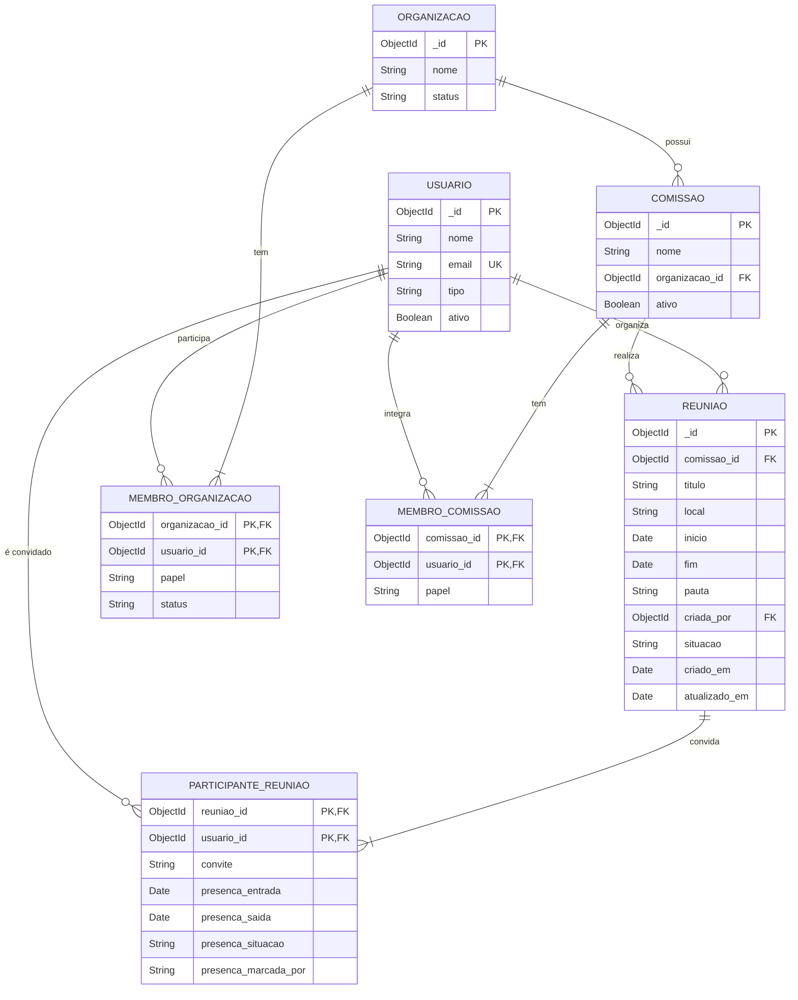

# Diagrama Relacional - Reuniões

O banco do sistema é o MongoDB, que guarda os participantes e as presenças dentro do documento da reunião. Este diagrama representa esses dados como tabelas relacionais, para mostrar as chaves e os relacionamentos entre eles.

As tabelas `COMISSAO`, `MEMBRO_COMISSAO`, `ORGANIZACAO`, `MEMBRO_ORGANIZACAO` e `USUARIO` pertencem ao Incremento 1 e aparecem apenas com as colunas usadas pelas reuniões.
