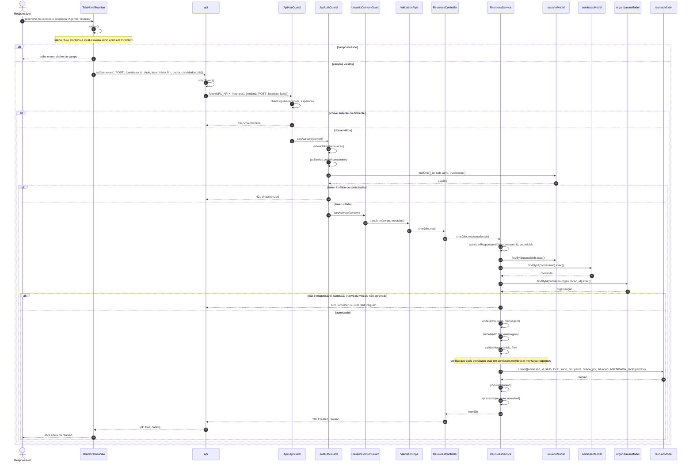
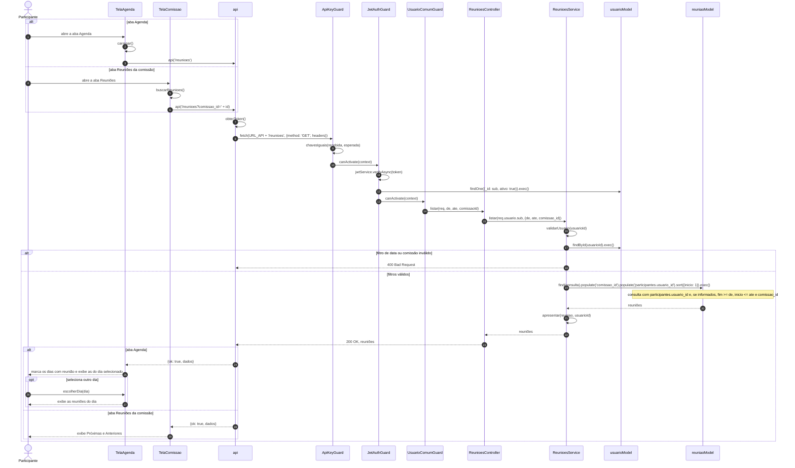
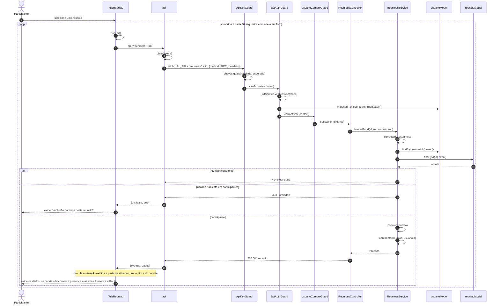
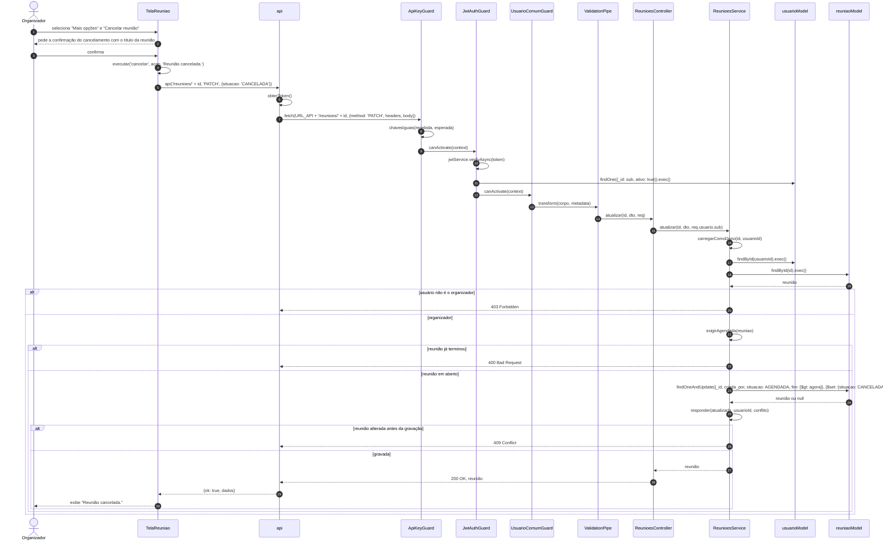
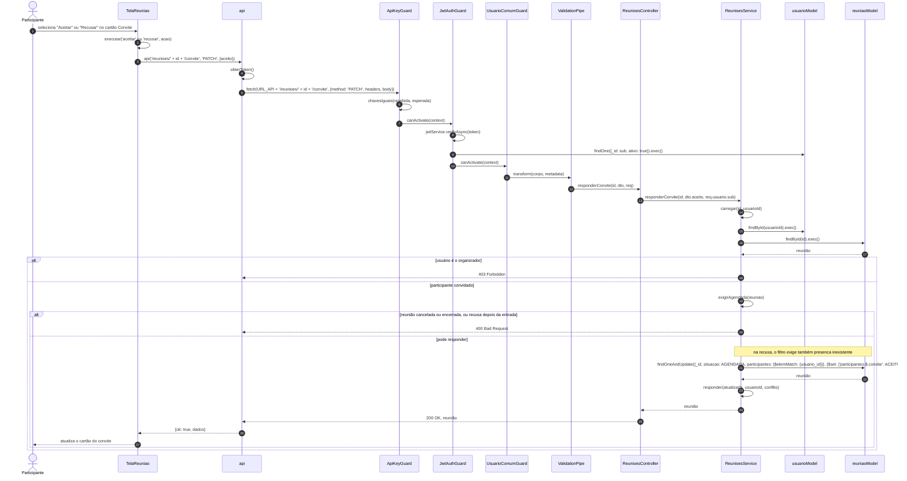
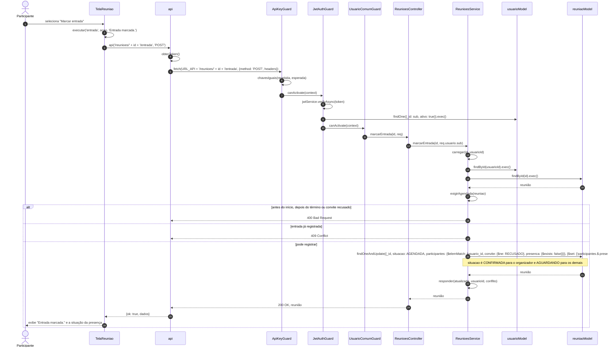
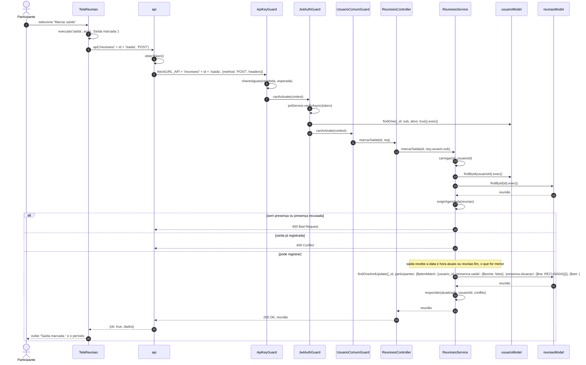
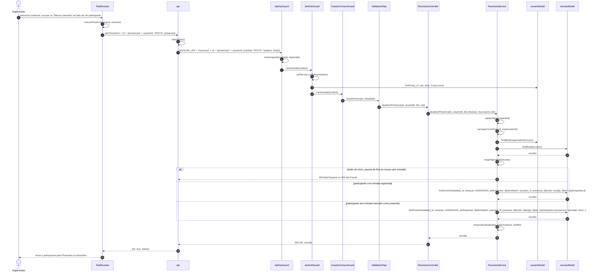
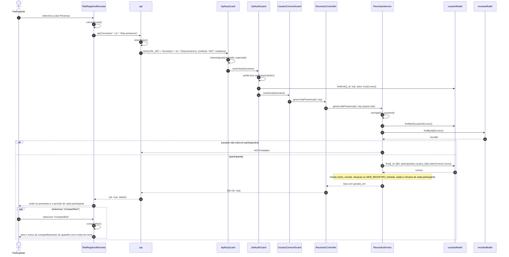

# Diagramas de Sequência - Reuniões

Os participantes de cada diagrama são classes do sistema, e as mensagens são as chamadas de métodos entre elas. Os objetos `reuniaoModel`, `comissaoModel`, `organizacaoModel` e `usuarioModel` são as instâncias de `Model` usadas pelo `ReunioesService` para acessar as coleções `reunioes`, `comissoes`, `organizacoes` e `usuarios`. As notas descrevem o processamento feito dentro de um método.

---

## RF-01 - Agendar reunião

---

## RF-02 - Consultar agenda de reuniões

---

## RF-03 - Visualizar reunião

---

## RF-04 - Cancelar reunião

---

## RF-05 - Responder convite

Na agenda, o método `TelaAgenda.responder(reuniao, aceito)` envia a mesma requisição a partir do item da lista.

---

## RF-06 - Registrar entrada

---

## RF-07 - Registrar saída

---

## RF-08 - Confirmar ou recusar presença

---

## RF-09 - Gerar lista de presença

