# Diagramas de sequência — Reuniões

> Padrão do Incremento 2 · Módulo REU

## Resumo

Cada diagrama usa participantes e métodos confirmados no código: telas Expo, `ReunioesController`, `ReunioesService` e models Mongoose. `ApiKeyGuard`, `JwtAuthGuard` e `UsuarioComumGuard` protegem todas as rotas do módulo.

## SD-REU-01 — Agendar reunião

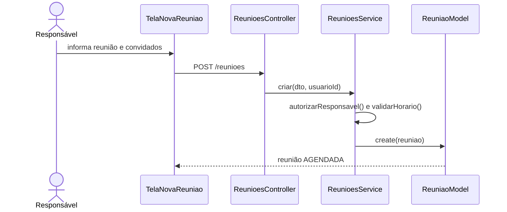

## SD-REU-02 — Consultar agenda

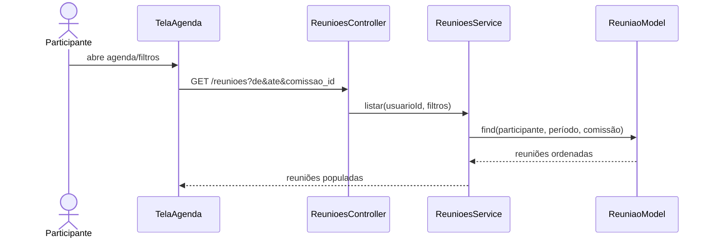

## SD-REU-03 — Visualizar reunião

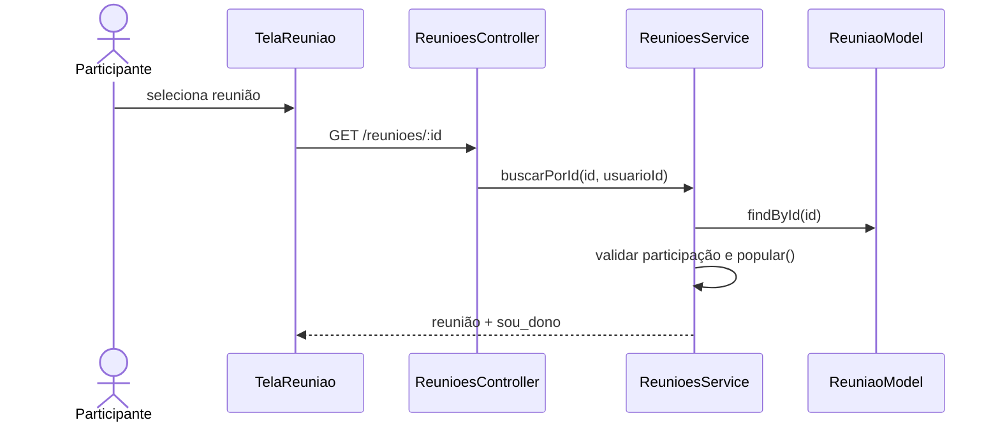

## SD-REU-04 — Cancelar reunião

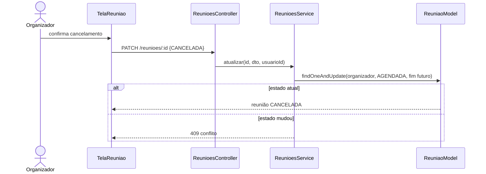

## SD-REU-05 — Responder convite

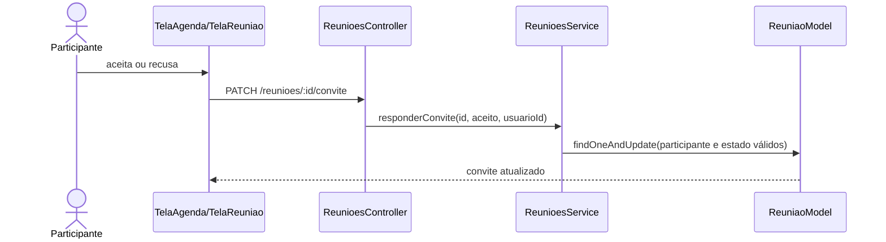

## SD-REU-06 — Registrar entrada

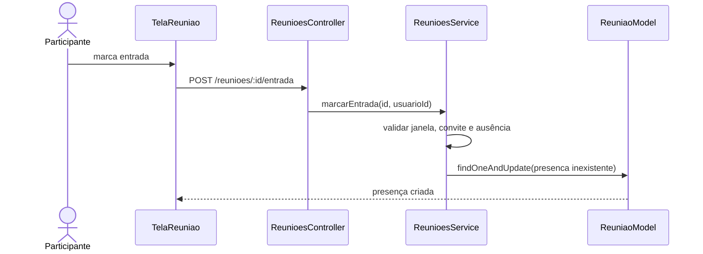

## SD-REU-07 — Registrar saída

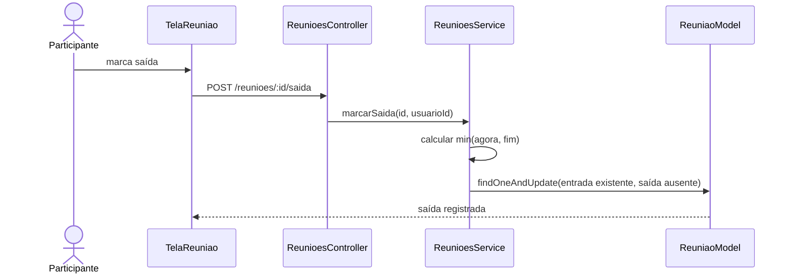

## SD-REU-08 — Confirmar ou recusar presença

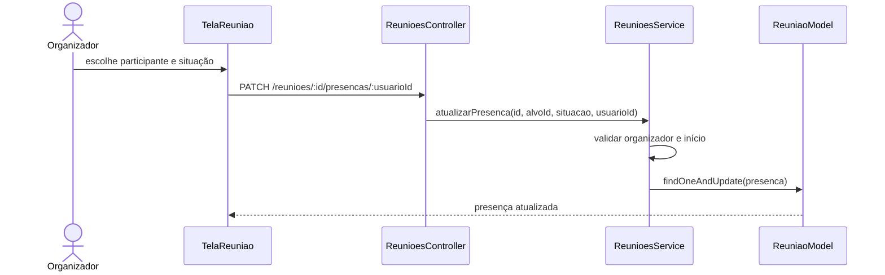

## SD-REU-09 — Gerar lista de presença

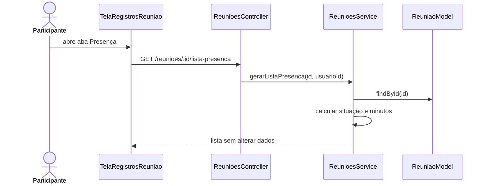

## SD-REU-10 — Salvar rascunho da ata

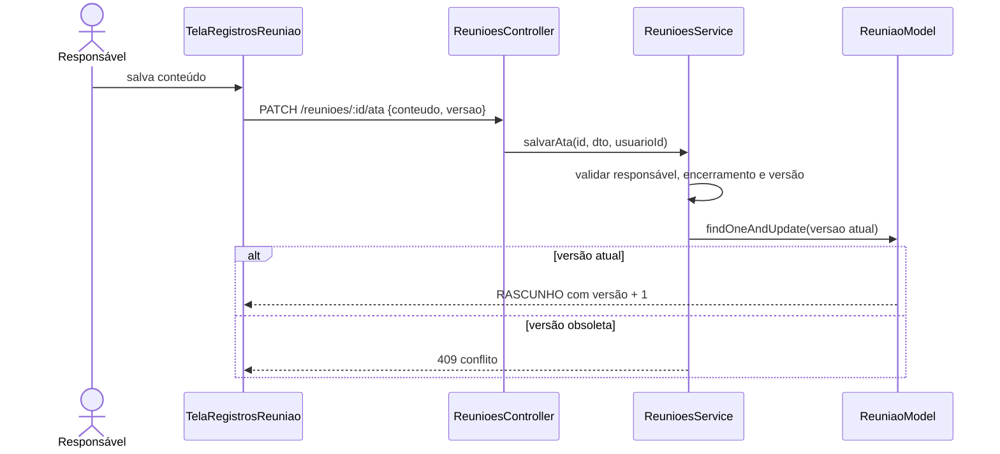

## SD-REU-11 — Enviar ata para aprovação

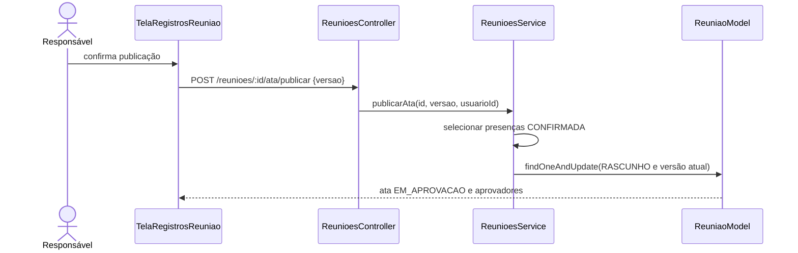

## SD-REU-12 — Aprovar ata

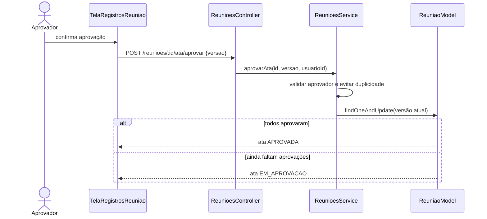

## Rastreabilidade

SD-REU-01 a SD-REU-12 correspondem, na mesma ordem, a UC-REU-01 a UC-REU-12 e RF-REU-01 a RF-REU-12.
