# Diagramas de sequência — Reuniões

> Padrão da disciplina · Módulo REU · Revisado em 10/11/2026

## Resumo

Há um diagrama para cada requisito funcional, com o mesmo número. As linhas de vida são classes e módulos que existem no código: as telas do aplicativo, o módulo `api`, o `ReunioesController`, o `ReunioesService` e os models do Mongoose. Toda mensagem é a chamada de um método existente, com seus parâmetros, e as mensagens são numeradas na ordem em que acontecem. Regras que não são métodos, como comparações de horário, aparecem em notas.

Em todos os diagramas, a chamada do módulo `api` ao controller é uma requisição HTTP que passa antes por `ApiKeyGuard`, `JwtAuthGuard` e `UsuarioComumGuard`; a rota está indicada na nota.

## SD-REU-01 — Agendar reunião

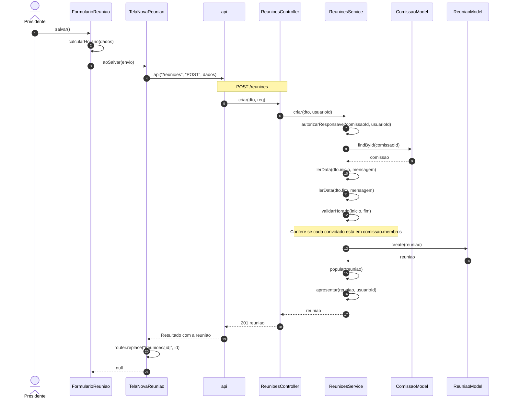

## SD-REU-02 — Consultar agenda

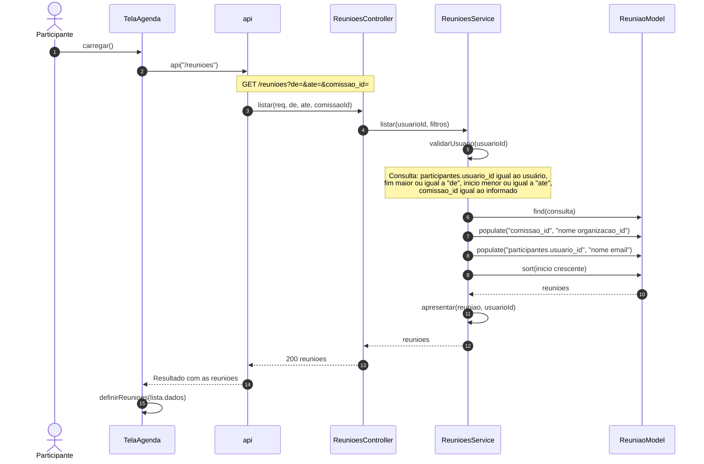

## SD-REU-03 — Visualizar reunião

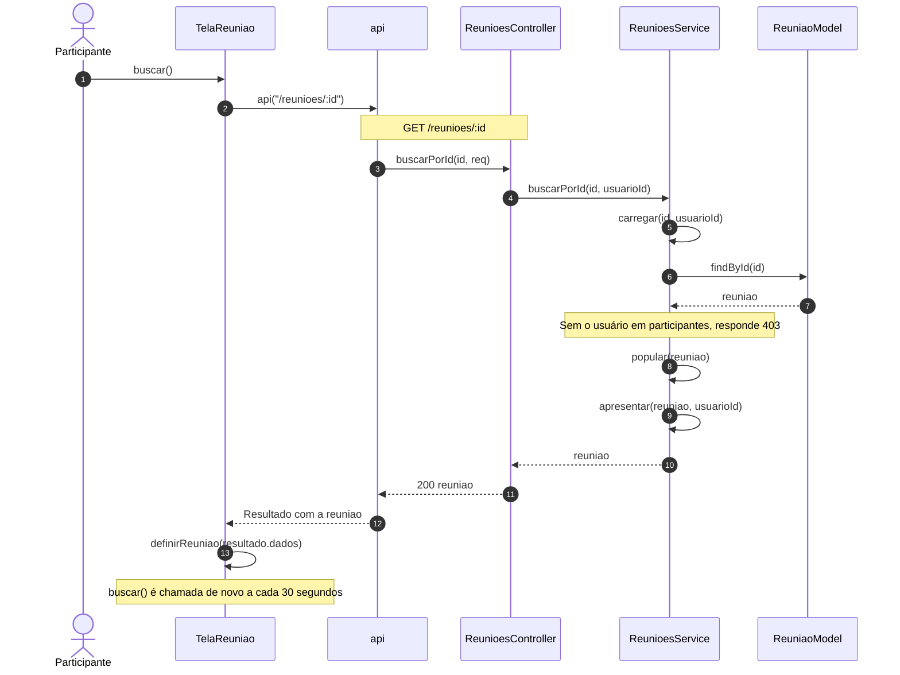

## SD-REU-04 — Cancelar reunião

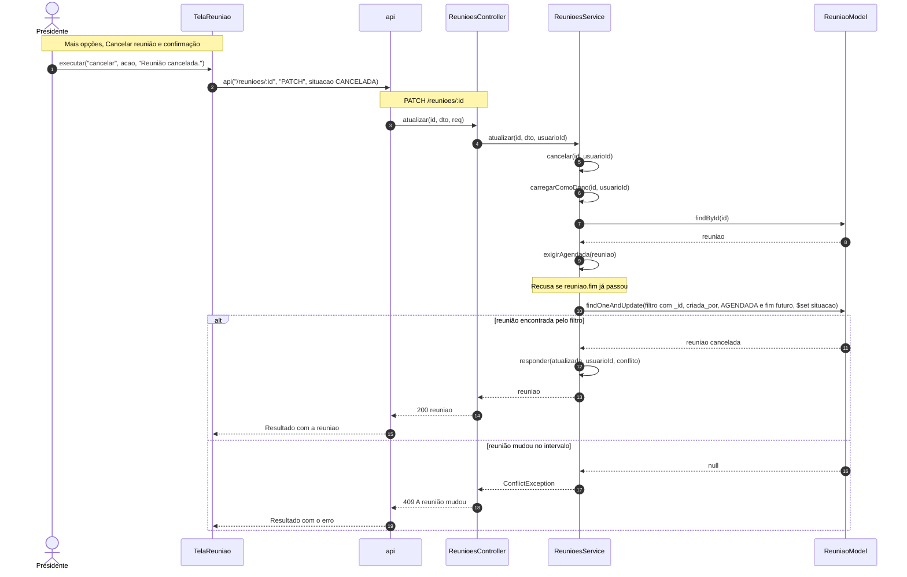

## SD-REU-05 — Responder convite

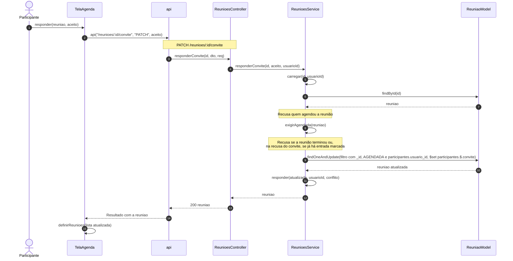

## SD-REU-06 — Registrar entrada

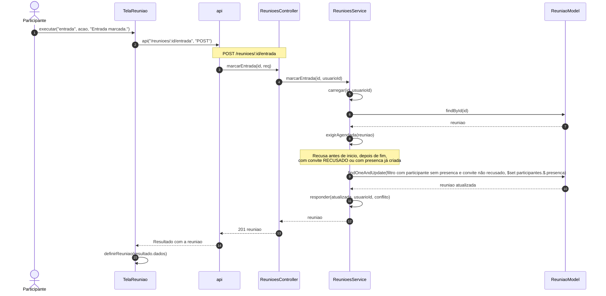

## SD-REU-07 — Registrar saída

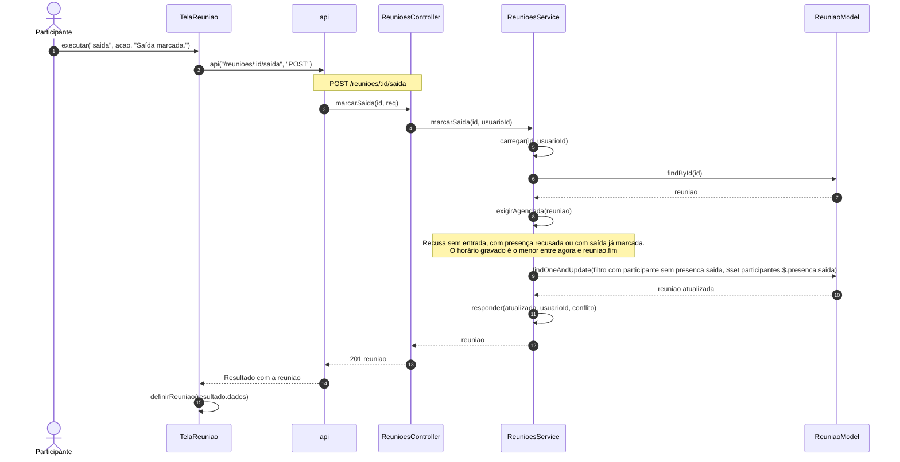

## SD-REU-08 — Confirmar ou recusar presença

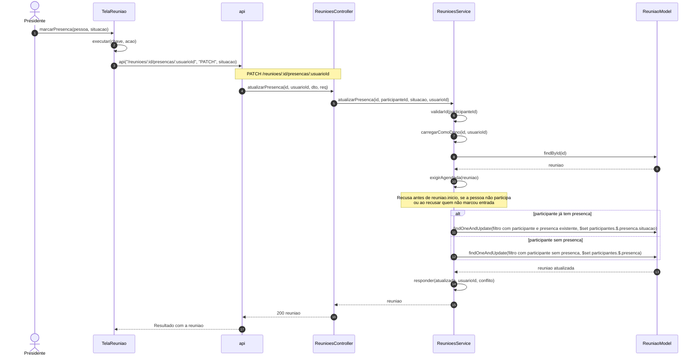

## SD-REU-09 — Gerar lista de presença

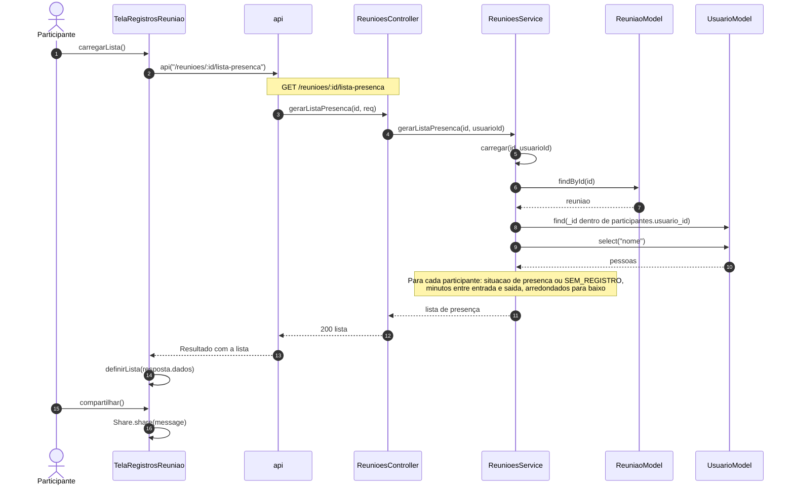

## SD-REU-13 — Editar reunião

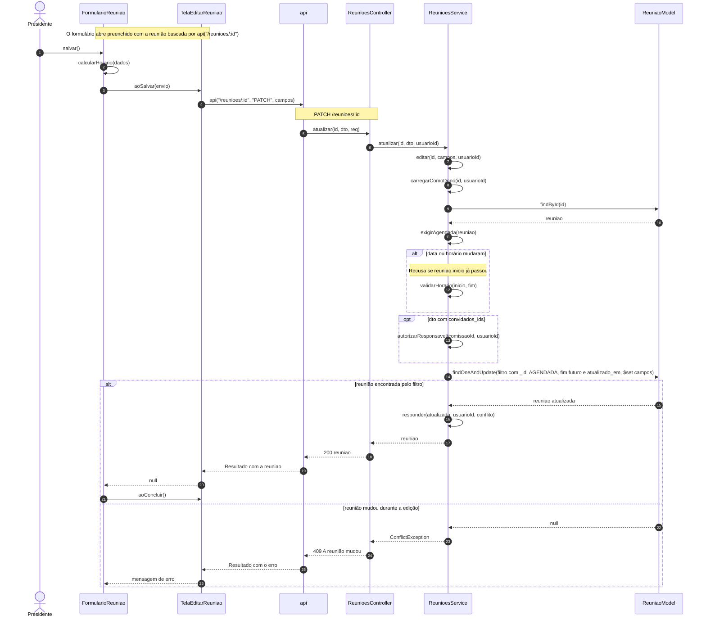

## SD-REU-14 — Anexar arquivo à pauta

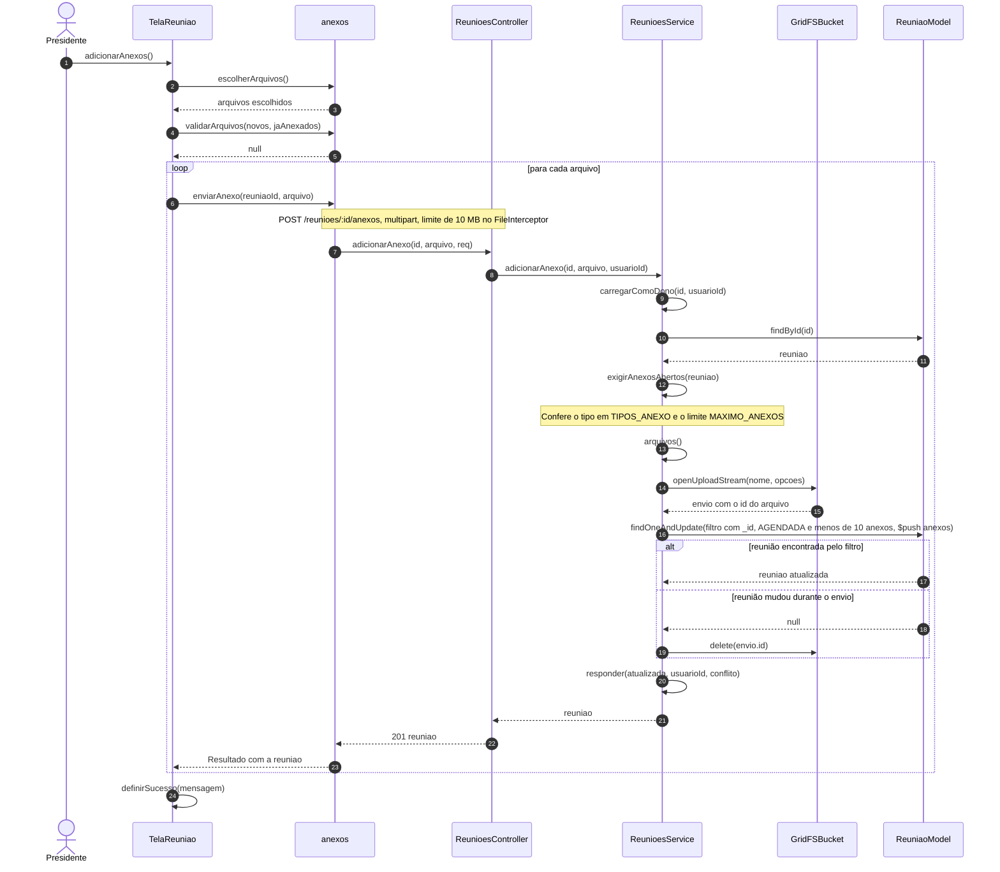

## SD-REU-15 — Baixar anexo da pauta

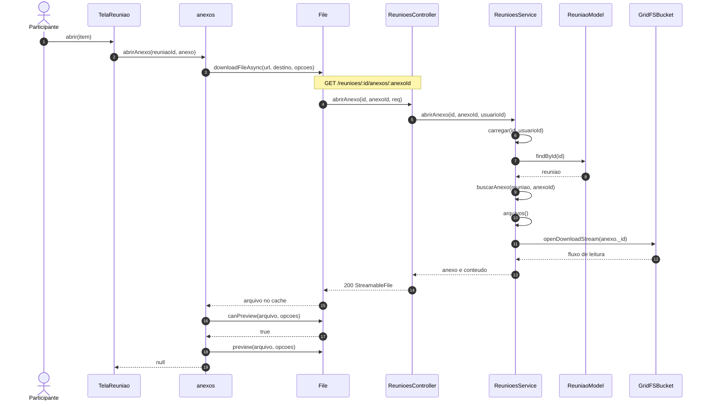

## SD-REU-16 — Remover anexo da pauta

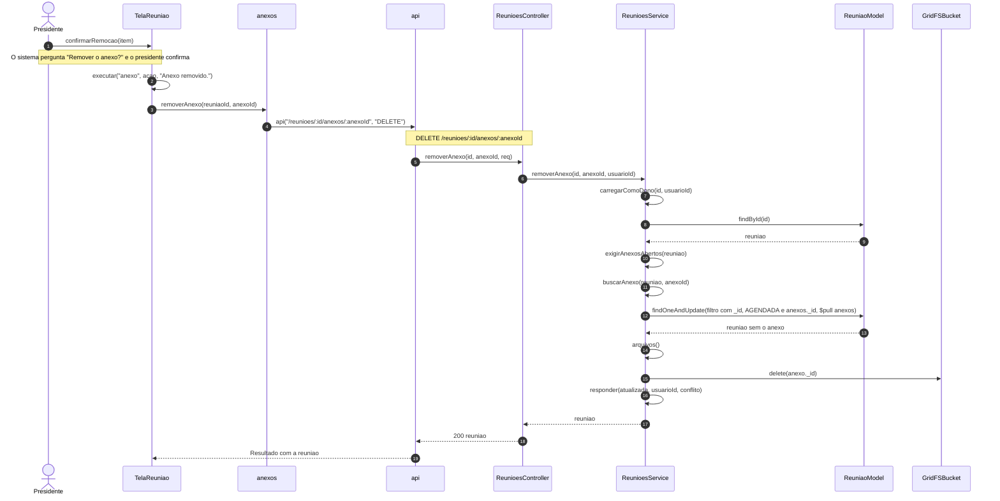

## Rastreabilidade

SD-REU-01 a SD-REU-09 e SD-REU-13 a SD-REU-16 correspondem aos requisitos funcionais de mesmo número. Os diagramas da ata estão em [SD-ATA-01 a SD-ATA-08](../../4%20-%20Incremento3/atas/6%20-%20diagramas-sequencia-atas.md).
