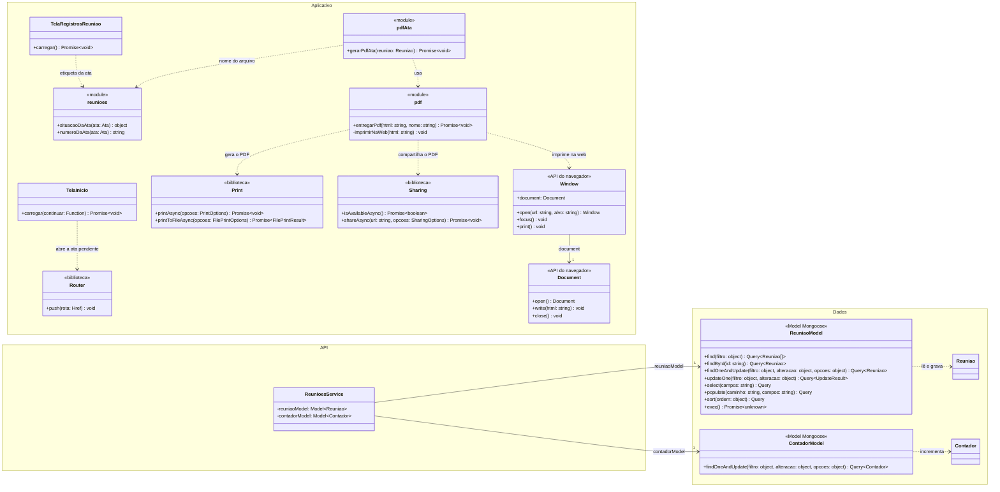

# Diagrama de classes — Atas de reunião

> Padrão da disciplina · Módulo ATA · Revisado em 27/11/2026

## Resumo

O diagrama mostra as classes que participam das atas, agrupadas em três pacotes, um por camada do sistema: **Aplicativo** (telas e módulos do aplicativo), **API** (controller, service e objetos de entrada) e **Dados** (documentos guardados no MongoDB). Cada atributo traz o seu tipo, e cada método traz o tipo dos parâmetros e do retorno. Toda classe e todo método do diagrama existem no código.

Para que nenhuma linha passe por cima de uma classe, o diagrama está dividido em duas partes. A primeira mostra as telas, os módulos, o controller, o service, os objetos de entrada e os documentos. A segunda mostra os models do Mongoose e as bibliotecas que o service, as telas e o módulo `pdf` chamam. Toda linha de vida e todo método dos [Diagramas de sequência](6%20-%20diagramas-sequencia-atas.md) estão em uma das duas partes, inclusive os atualizadores de estado das telas (`definir*`). As classes que aparecem nas duas partes estão completas na primeira e, na segunda, só com os membros que ela usa.

## Diagrama

### 1. Telas, API e documentos

```mermaid
classDiagram
    direction LR

    namespace Aplicativo {
        class TelaRegistrosReuniao {
            -reuniao: Reuniao
            -responsavel: boolean
            -aba: Aba
            -prazo: number
            -trecho: string
            -justificativa: string
            -reprovacaoAberta: boolean
            -confirmacao: Pendente
            -gerandoPdf: boolean
            +carregar() Promise~void~
            +gravar(caminho: string, metodo: string, corpo: unknown, mensagem: string) Promise~boolean~
            +abrirEnvio() void
            +enviar() Promise~void~
            +aprovar() Promise~void~
            +reprovar() Promise~void~
            +refazer() void
            +baixarPdf() Promise~void~
            +handleSubmit(aoValidar: Function) Function
            +definirReuniao(valor: Reuniao) void
            +definirResponsavel(valor: boolean) void
            +definirPrazo(valor: number) void
            +definirTrecho(valor: string) void
            +definirReprovacaoAberta(valor: boolean) void
            +definirJustificativa(valor: string) void
            +definirConfirmacao(valor: Pendente) void
            +definirGerandoPdf(valor: boolean) void
            +definirSucesso(valor: string) void
            +definirErro(valor: string) void
        }
        class TelaInicio {
            -atas: AtaPendente[]
            +carregar(continuar: Function) Promise~void~
            +definirAtas(valor: AtaPendente[]) void
        }
        class api {
            <<module>>
            +api(caminho: string, metodo: string, corpo: unknown) Promise~Resultado~
        }
        class pdfAta {
            <<module>>
            +gerarPdfAta(reuniao: Reuniao) Promise~void~
            -htmlDaAta(reuniao: Reuniao) string
        }
        class pdf {
            <<module>>
            +entregarPdf(html: string, nome: string) Promise~void~
            +pdfPelaImpressao() boolean
            -imprimirNaWeb(html: string) void
        }
        class diferenca {
            <<module>>
            +mudancas(antes: string, depois: string) Mudanca[]
            +paragrafos(texto: string) string[]
        }
        class autenticacaoLocal {
            <<module>>
            +autenticarComDispositivo() Promise~boolean~
            +dispositivoProtegido() Promise~boolean~
        }
    }

    namespace API {
        class ReunioesController {
            -reunioesService: ReunioesService
            +buscarPorId(id: string, req: RequisicaoAutenticada) Promise~Reuniao~
            +salvarAta(id: string, dto: SalvarAtaDto, req: RequisicaoAutenticada) Promise~Reuniao~
            +publicarAta(id: string, dto: EnviarAtaDto, req: RequisicaoAutenticada) Promise~Reuniao~
            +aprovarAta(id: string, dto: VersaoAtaDto, req: RequisicaoAutenticada) Promise~Reuniao~
            +reprovarAta(id: string, dto: ReprovarAtaDto, req: RequisicaoAutenticada) Promise~Reuniao~
            +refazerAta(id: string, req: RequisicaoAutenticada) Promise~Reuniao~
            +atasPendentes(req: RequisicaoAutenticada) Promise~Reuniao[]~
        }
        class ReunioesService {
            -reuniaoModel: Model~Reuniao~
            -contadorModel: Model~Contador~
            +buscarPorId(id: string, usuarioId: string) Promise~Reuniao~
            +salvarAta(id: string, dto: SalvarAtaDto, usuarioId: string) Promise~Reuniao~
            +publicarAta(id: string, dto: EnviarAtaDto, usuarioId: string) Promise~Reuniao~
            +aprovarAta(id: string, versao: number, usuarioId: string) Promise~Reuniao~
            +reprovarAta(id: string, dto: ReprovarAtaDto, usuarioId: string) Promise~Reuniao~
            +refazerAta(id: string, usuarioId: string) Promise~Reuniao~
            +atasPendentes(usuarioId: string) Promise~Reuniao[]~
            +onApplicationBootstrap() Promise~void~
            -executarRotinas() Promise~void~
            +aprovarAtasVencidas(agora: Date) Promise~number~
            -avaliarAta(id: string, versao: number, usuarioId: string, avaliacao: Omit~AvaliacaoAta~) Promise~Reuniao~
            -concluirSeAprovada(reuniao: Reuniao, ata: Ata) Promise~Ata~
            -proximoNumeroAta(comissaoId: ObjectId, ano: number) Promise~number~
            -gravarAta(reuniao: Reuniao, ata: Ata, usuarioId: string) Promise~Reuniao~
            -exigirEncerrada(reuniao: Reuniao) void
            -autorizarResponsavel(comissaoId: string, usuarioId: string, acao: string) Promise~Comissao~
            -carregar(id: string, usuarioId: string) Promise~Carga~
            -validarUsuario(usuarioId: string) Promise~void~
            -popular(reuniao: Reuniao) Promise~Reuniao~
            -apresentar(reuniao: Reuniao, usuarioId: string) Reuniao
            -responder(reuniao: Reuniao, usuarioId: string, conflito: string) Promise~Reuniao~
        }
        class VersaoAtaDto {
            +versao: number
        }
        class SalvarAtaDto {
            +conteudo: string
        }
        class EnviarAtaDto {
            +prazo_horas: number
        }
        class ReprovarAtaDto {
            +trecho: string
            +justificativa: string
        }
    }

    namespace Dados {
        class Reuniao {
            +_id: ObjectId
            +comissao_id: ObjectId
            +titulo: string
            +fim: Date
            +situacao: SituacaoReuniao
            +presencas_revisao: number
            +participantes: Participante[]
            +ata: Ata
            +atas_canceladas: Ata[]
        }
        class Ata {
            +conteudo: string
            +versao: number
            +situacao: SituacaoAta
            +autor_id: ObjectId
            +atualizada_em: Date
            +enviada_em: Date
            +prazo: Date
            +aprovadores: ObjectId[]
            +avaliacoes: AvaliacaoAta[]
            +numero: number
            +ano: number
            +aprovada_em: Date
            +cancelada_em: Date
        }
        class AvaliacaoAta {
            +usuario_id: ObjectId
            +decisao: DecisaoAta
            +trecho: string
            +justificativa: string
            +em: Date
            +automatica: boolean
        }
        class Participante {
            +usuario_id: ObjectId
            +convite: RespostaConvite
            +presenca: Presenca
        }
        class Presenca {
            +entrada: Date
            +saida: Date
            +situacao: SituacaoPresenca
        }
        class Contador {
            +_id: string
            +valor: number
        }
        class Usuario {
            +_id: ObjectId
            +nome: string
            +ativo: boolean
        }
        class Comissao {
            +_id: ObjectId
            +ativo: boolean
            +membros: MembroComissao[]
        }
        class SituacaoAta {
            <<enumeration>>
            RASCUNHO
            EM_APROVACAO
            APROVADA
            REPROVADA
            CANCELADA
        }
        class DecisaoAta {
            <<enumeration>>
            APROVADA
            REPROVADA
        }
    }

    TelaRegistrosReuniao ..> api : usa
    TelaRegistrosReuniao ..> pdfAta : usa
    pdfAta ..> pdf : usa
    TelaRegistrosReuniao ..> diferenca : usa
    TelaRegistrosReuniao ..> autenticacaoLocal : usa
    TelaInicio ..> api : usa
    api ..> ReunioesController : requisição HTTP

    ReunioesController --> "1" ReunioesService : reunioesService
    ReunioesController ..> VersaoAtaDto : recebe
    ReunioesController ..> SalvarAtaDto : recebe
    ReunioesController ..> EnviarAtaDto : recebe
    ReunioesController ..> ReprovarAtaDto : recebe
    VersaoAtaDto <|-- SalvarAtaDto
    VersaoAtaDto <|-- EnviarAtaDto
    VersaoAtaDto <|-- ReprovarAtaDto
    ReunioesService ..> Reuniao : lê e grava
    ReunioesService ..> Contador : numera a ata
    ReunioesService ..> Comissao : confere o presidente
    ReunioesService ..> Usuario : confere a conta

    Reuniao "1" *-- "0..1" Ata : ata
    Reuniao "1" *-- "0..*" Ata : atas_canceladas
    Reuniao "1" *-- "1..*" Participante : participantes
    Participante "1" *-- "0..1" Presenca : presenca
    Ata "1" *-- "0..*" AvaliacaoAta : avaliacoes
    Ata "0..*" --> "1" Usuario : autor_id
    Ata "0..*" --> "0..*" Usuario : aprovadores
    AvaliacaoAta "0..*" --> "1" Usuario : usuario_id
    Participante "0..*" --> "1" Usuario : usuario_id
    Reuniao "0..*" --> "1" Comissao : comissao_id
    Ata ..> SituacaoAta : situacao
    AvaliacaoAta ..> DecisaoAta : decisao
```

Figura 2 — Diagrama de classes das atas, parte 1, por camada. Fonte: equipe Conecta+.

### 2. Models do Mongoose e bibliotecas

Figura 3 — Diagrama de classes das atas, parte 2: models do Mongoose e bibliotecas. Fonte: equipe Conecta+.

## Como ler as ligações

| Ligação                         | Significado                                                                 | Exemplo no diagrama                                                                                  |
| ------------------------------- | --------------------------------------------------------------------------- | ---------------------------------------------------------------------------------------------------- |
| Losango cheio (composição)      | A parte só existe dentro do todo e é apagada junto com ele.                 | `Reuniao *-- Ata`: a ata é gravada dentro do documento da reunião e não tem identificador próprio.   |
| Seta cheia (associação)         | Uma classe guarda uma referência a outra, que existe por conta própria.     | `Ata --> Usuario`: `autor_id` e `aprovadores` guardam identificadores de documentos de `usuarios`.   |
| Triângulo vazio (herança)       | A classe filha tem tudo o que a mãe tem.                                    | `SalvarAtaDto`, `EnviarAtaDto` e `ReprovarAtaDto` herdam o campo `versao` de `VersaoAtaDto`.         |
| Seta tracejada (dependência)    | Uma classe usa a outra em uma chamada, sem guardá-la como atributo.         | `ReunioesService ..> Contador`.                                                                      |

Os números nas pontas são as multiplicidades. Por exemplo, uma `Reuniao` tem no máximo uma `Ata` vigente (`0..1`) e qualquer quantidade de atas canceladas (`0..*`); cada `Ata` tem exatamente um autor (`1`).

No código, os atributos opcionais são `enviada_em`, `prazo`, `numero`, `ano`, `aprovada_em` e `cancelada_em`, em `Ata`; `trecho`, `justificativa` e `automatica`, em `AvaliacaoAta`; `ata`, em `Reuniao`; e `presenca` e `saida`. A obrigatoriedade de cada um está no [dicionário de classes](3%20-%20dicionario-dados-classes-atas.md).

Em `TelaInicio.carregar`, o parâmetro `continuar` é do tipo `() => boolean`, com padrão `() => true`: a tela o usa para descartar a resposta quando deixa de estar em foco. Em `api` e `gravar`, `metodo` aceita só `'GET'`, `'POST'`, `'PATCH'` ou `'DELETE'` (em `gravar`, só `'PATCH'` ou `'POST'`), e `Resultado` é `Resultado<T>`, com `ok` e `dados` ou `erro`. Em `avaliarAta`, o tipo completo do parâmetro `avaliacao` é `Omit<AvaliacaoAta, 'usuario_id' | 'em'>`: a avaliação sem o usuário e sem o horário, que o próprio método preenche. O Mermaid só aceita um tipo dentro de `~`, por isso o diagrama mostra `Omit~AvaliacaoAta~`. Em `reunioes.situacaoDaAta`, o retorno `object` é `{ texto: string; tom: TomEtiqueta }`, o texto e a cor da etiqueta da ata, e o parâmetro aceita também `undefined`, quando não há ata.

Na parte 2, `<<Model Mongoose>>` marca o `Model` que o NestJS injeta no service com `@InjectModel`, guardado nos atributos `reuniaoModel` e `contadorModel`. `select`, `populate`, `sort` e `exec` são da `Query` que `find`, `findById` e `findOneAndUpdate` devolvem; estão na classe do model porque os diagramas de sequência os chamam na linha de vida dele, na ordem do encadeamento do código. `<<biblioteca>>` marca as bibliotecas externas do aplicativo (`expo-router`, `expo-print` e `expo-sharing`), só com os membros chamados, e `<<API do navegador>>`, os objetos `Window` e `Document` que `imprimirNaWeb` usa na web. A dependência `ReunioesService ..> Reuniao` da parte 1 passa, no código, pelo `ReuniaoModel`, e `ReunioesService ..> Contador`, pelo `ContadorModel`.

## Rotas atendidas pelo controller

As rotas HTTP não são métodos; por isso ficam nesta tabela, e não no diagrama.

| Método do controller | Rota HTTP                         |
| -------------------- | --------------------------------- |
| `buscarPorId`        | `GET /reunioes/:id`               |
| `salvarAta`          | `PATCH /reunioes/:id/ata`         |
| `publicarAta`        | `POST /reunioes/:id/ata/publicar` |
| `aprovarAta`         | `POST /reunioes/:id/ata/aprovar`  |
| `reprovarAta`        | `POST /reunioes/:id/ata/reprovar` |
| `refazerAta`         | `POST /reunioes/:id/ata/nova`     |
| `atasPendentes`      | `GET /reunioes/atas/pendentes`    |

## Regras representadas

- `Ata` e `AvaliacaoAta` não existem fora de `Reuniao`;
- cada usuário tem no máximo uma avaliação por versão da ata;
- `aprovadores` é fixado no envio e não muda enquanto a versão estiver aberta; a gravação da ata (`gravarAta`) só acontece se `presencas_revisao` não mudou desde a leitura;
- no fim do `prazo`, cada aprovador sem avaliação recebe uma `AvaliacaoAta` `APROVADA` com `automatica` verdadeiro, gravada pelo próprio servidor;
- `Contador` existe fora da reunião: um documento por comissão e ano, com o último número de ata usado;
- o aplicativo nunca decide a situação da ata: ele mostra o que a API devolve.

## Rastreabilidade

RF-ATA-01 a RF-ATA-08; complementado por [Dicionário de classes](3%20-%20dicionario-dados-classes-atas.md) e [Diagramas de sequência](6%20-%20diagramas-sequencia-atas.md).
