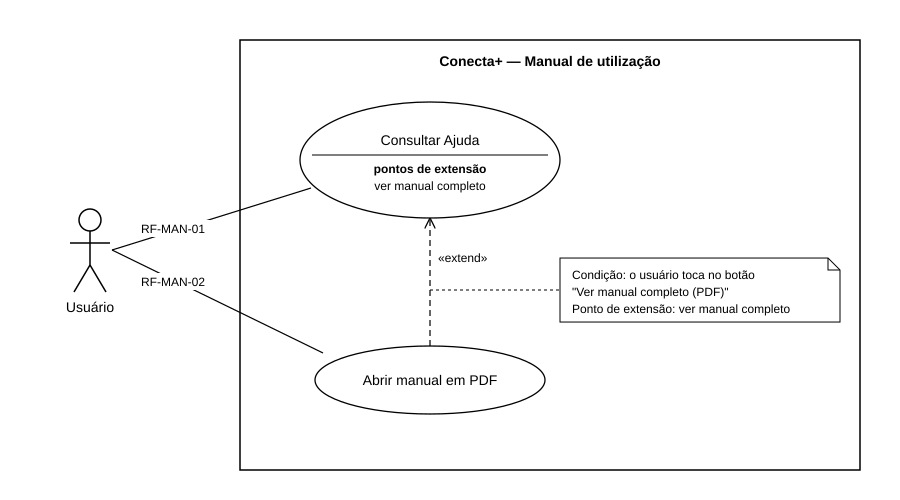

# Casos de uso — Manual de utilização

> Padrão da disciplina · Módulo MAN · Requisito R4 do Incremento 3 · Revisado em 25/11/2026

## Resumo

Este documento mostra quem usa o manual de utilização do Conecta+ e o que essa pessoa pode fazer. O manual tem duas partes, as duas dentro do aplicativo: a tela Ajuda e o manual completo em PDF, aberto a partir dela na tela "Manual de utilização", mesmo sem internet. Cada caso de uso é descrito em detalhe, como requisito funcional no formulário padrão, em [Requisitos funcionais](2%20-%20requisitos-funcionais-manual-de-utilizacao.md).

## Diagrama de casos de uso

Figura 1 — Diagrama de casos de uso do manual de utilização. Fonte: equipe Conecta+.

Cada linha entre o ator e um caso de uso leva o código do requisito funcional que o descreve. A seta tracejada «extend» mostra que "Abrir manual em PDF" só pode ser iniciado de dentro de "Consultar Ajuda".

## Atores

**Usuário.** É qualquer pessoa que usa o aplicativo, tenha ou não entrado na conta. O papel dele neste módulo é consultar: ler as perguntas frequentes, abrir e fechar as respostas, buscar uma pergunta por palavra e abrir e ler o manual completo em PDF dentro do aplicativo. Quem ainda não entrou na conta chega à Ajuda pelo link "Precisa de ajuda?" da tela Entrar; quem já entrou chega tocando no avatar e depois em Ajuda, na seção Suporte do Perfil.

O usuário não pode alterar, incluir nem apagar perguntas, e não pode trocar o arquivo do manual: o conteúdo é o mesmo para todos e só muda quando a equipe publica uma nova versão.

Não existe um segundo ator. O membro, o responsável pela comissão e o administrador veem exatamente as mesmas perguntas. O selo "Responsável", exibido em 9 das 42 perguntas, apenas avisa que aquela pergunta trata de uma ação que só o responsável pela comissão consegue fazer no aplicativo; ele não esconde a pergunta de ninguém. O responsável pela comissão é a mesma pessoa que o módulo de [Atas](../atas/README.md) chama de presidente da comissão.

## Relacionamentos entre casos de uso

**«extend» de Abrir manual em PDF para Consultar Ajuda.** Abrir o manual é uma opção que aparece dentro da consulta à Ajuda. A relação é de extensão, e não de inclusão, pelos motivos abaixo:

1. **É opcional.** Uma inclusão acontece toda vez que o caso de uso base é executado. Aqui, o usuário pode consultar a Ajuda, achar a resposta e sair sem nunca abrir o PDF. "Consultar Ajuda" está completo sem "Abrir manual em PDF".
2. **Acontece em um ponto definido e depende de uma decisão do usuário.** O manual só é aberto quando o usuário toca no botão "Ver manual completo (PDF)", no fim da tela Ajuda. Esse botão é o ponto de extensão.
3. **Tem uma condição.** A extensão só acontece quando o usuário toca no botão. O botão é sempre exibido, porque o manual vai junto com o aplicativo: não há endereço a cadastrar nem conexão a conferir antes.
4. **A seta aponta para o caso de uso base.** Na extensão, a seta sai do caso de uso que estende (Abrir manual em PDF) e aponta para o caso de uso estendido (Consultar Ajuda), que não depende do outro.

| Elemento | Valor |
| --- | --- |
| Caso de uso base | UC-MAN-01 — Consultar Ajuda |
| Caso de uso que estende | UC-MAN-02 — Abrir manual em PDF |
| Ponto de extensão | Botão "Ver manual completo (PDF)", no fim da tela Ajuda |
| Condição | O usuário toca no botão "Ver manual completo (PDF)" |

## Requisitos funcionais de usuário

| Caso de uso | Requisito | Nome | Ator principal |
| --- | --- | --- | --- |
| UC-MAN-01 | RF-MAN-01 | Consultar Ajuda | Usuário |
| UC-MAN-02 | RF-MAN-02 | Abrir manual em PDF | Usuário |

**Requisito RF-MAN-01 — Consultar Ajuda.** O sistema deve permitir a qualquer usuário, mesmo sem entrar na conta e sem internet, ler perguntas frequentes sobre o uso do aplicativo, organizadas por assunto, abrir e fechar cada resposta e buscar uma pergunta por palavra.

**Requisito RF-MAN-02 — Abrir manual em PDF.** O sistema deve permitir ao usuário que está na tela Ajuda, mesmo sem entrar na conta e sem internet, abrir e ler o manual completo do aplicativo, em PDF, dentro do próprio aplicativo, rolando as páginas e ampliando-as com o gesto de pinça.

## Limitações conhecidas

- **Atualizar o manual exige uma nova versão do aplicativo.** O PDF faz parte do aplicativo instalado. Quem já instalou continua com o manual da sua versão até atualizar o aplicativo. Ao trocar o manual, a equipe precisa substituir o arquivo em dois lugares: `FRONTEND/assets/manual/manual.pdf`, que vai para o aplicativo, e `manual-usuario/manual.pdf`, neste repositório (ver RNF-MAN-03).
- **O texto do manual não pode ser selecionado nem pesquisado.** Cada página é convertida em imagem para ser exibida. Também não há sumário clicável, busca dentro do PDF nem opção de baixar, compartilhar ou imprimir o arquivo pelo aplicativo.
- **A primeira abertura demora mais que as seguintes.** Na primeira vez, o aplicativo lê o PDF e o leitor PDF.js e monta a página do manual, com cerca de 3,1 MB. Nas aberturas seguintes, enquanto o aplicativo continuar aberto, essa página é reaproveitada. Ao fechar o aplicativo, ela é descartada.
- **No Expo Go, os arquivos vêm do computador de desenvolvimento.** Pelo Expo Go, o aplicativo e os seus arquivos são servidos pelo Metro, que roda no computador da equipe pela rede local. O manual não precisa de internet, mas precisa que o Metro esteja acessível na primeira abertura. Sem nenhuma rede, só o aplicativo instalado (build Android ou iOS) comprova o funcionamento offline (CT-MAN-19 e CT-MAN-20).
