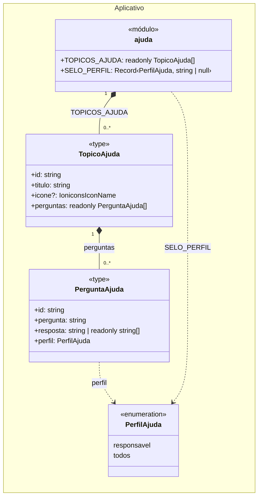
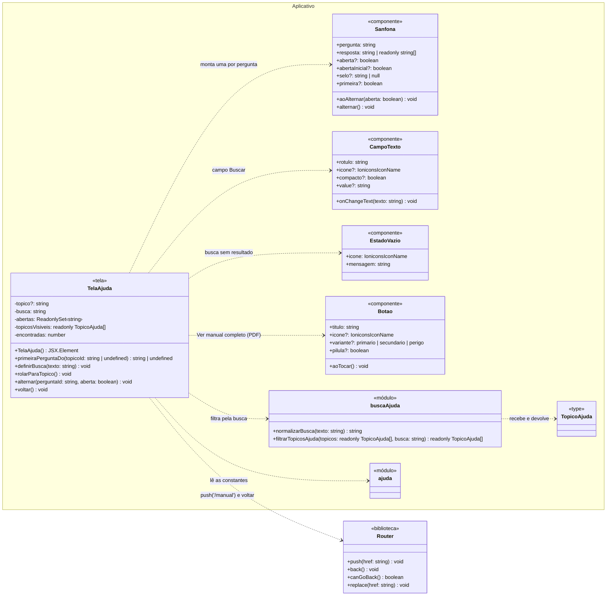
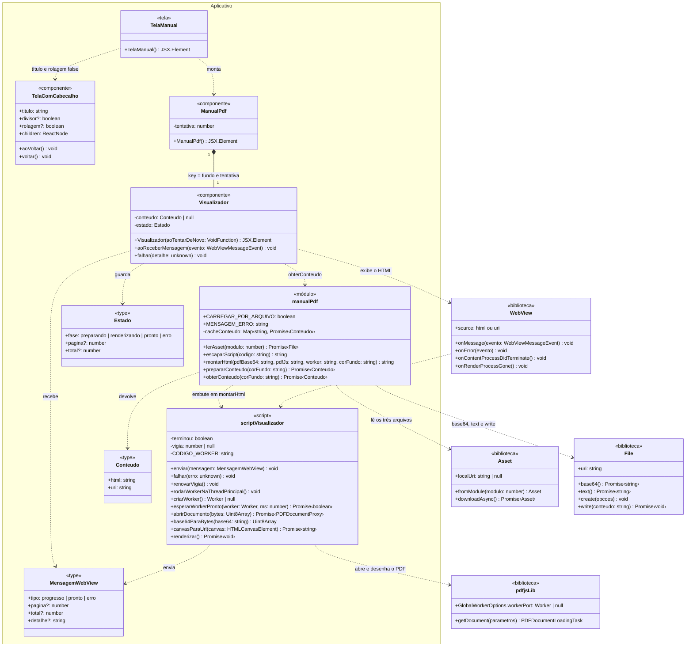

# Diagrama de classes — Manual de utilização

> Padrão da disciplina · Módulo MAN · Revisado em 25/11/2026

## Resumo

O conteúdo da Ajuda é estático: ele é escrito no próprio aplicativo, em `src/constants/ajuda.ts`, e não vem do servidor. O manual em PDF também vai dentro do aplicativo, em `assets/manual/manual.pdf`, e é exibido pelo componente `ManualPdf` com o leitor PDF.js embutido. Por isso o R4 só tem classes no pacote **Aplicativo**; os pacotes **API** e **Dados**, usados nos outros módulos, ficam vazios, porque não há controller, service, rota da API nem documento no banco. Cada atributo traz o seu tipo, e cada método traz o tipo dos parâmetros e do retorno. Toda classe e todo método do diagrama existem no código, e são os mesmos chamados nos [Diagramas de sequência](6%20-%20diagramas-sequencia-manual-de-utilizacao.md).

Os tipos são os do TypeScript. `readonly T[]` é uma lista que não pode ser alterada, e `?` indica um campo opcional. As bibliotecas externas aparecem fora do pacote Aplicativo, com o estereótipo `<<biblioteca>>`, e só com os métodos que o R4 usa.

## Diagrama

O diagrama está dividido em três partes para que nenhuma linha passe por cima de uma classe. A primeira mostra a estrutura do conteúdo da Ajuda, como está declarada em `src/constants/ajuda.ts`. A segunda mostra a tela Ajuda e os componentes que leem esse conteúdo e o apresentam. A terceira mostra a tela do manual e o visualizador do PDF. Uma classe já detalhada em uma parte aparece só com o nome nas outras.

### 1. Conteúdo da Ajuda

### 2. Tela Ajuda e componentes

### 3. Tela do manual e visualizador do PDF

## Como ler as ligações

| Ligação | Significado | Exemplo no diagrama |
| --- | --- | --- |
| Losango cheio (composição) | A parte só existe dentro do todo e some junto com ele. | `TopicoAjuda *-- PerguntaAjuda`: a pergunta é escrita dentro da lista `perguntas` do seu tópico e não existe fora dela. `ManualPdf *-- Visualizador`: o visualizador só existe dentro do `ManualPdf`, que o recria quando a chave muda. |
| Seta tracejada (dependência) | Uma classe usa a outra em uma chamada, sem guardá-la como atributo. | `TelaAjuda ..> buscaAjuda`: a tela chama `filtrarTopicosAjuda` a cada mudança da busca. `manualPdf ..> Asset`: `lerAsset` usa `Asset.fromModule` e `downloadAsync` a cada preparação. |

Os números nas pontas das composições são as multiplicidades: o módulo `ajuda` tem uma lista com qualquer quantidade de tópicos (hoje, 7), e cada tópico tem qualquer quantidade de perguntas (hoje, de 4 a 7). A multiplicidade `0..*` é a que os tipos `readonly TopicoAjuda[]` e `readonly PerguntaAjuda[]` permitem. O `ManualPdf` monta exatamente um `Visualizador` por vez.

`Conteudo` é declarado como `{ html: string } | { uri: string }`: tem **um** dos dois campos, nunca os dois. `MensagemWebView` e `Estado` também são uniões; o diagrama mostra os campos de todas as variantes, e `?` marca os que só existem em algumas (`pagina` e `total` em `progresso` e `renderizando`, `detalhe` em `erro`).

Este módulo não tem associação (seta cheia) nem herança (triângulo vazio): nenhuma classe guarda o identificador de um documento de outra coleção, e nenhuma classe estende outra.

## Onde está cada classe

| Classe no diagrama | Arquivo | Observação |
| --- | --- | --- |
| `TelaAjuda` | `src/app/ajuda.tsx` | `primeiraPerguntaDo` é uma função do mesmo arquivo, declarada fora do componente. `definirBusca` é a função que altera o estado `busca`. |
| `Sanfona` | `src/components/Sanfona.tsx` | Criada para o R4. |
| `CampoTexto`, `EstadoVazio`, `Botao` | `src/components/CampoTexto.tsx`, `EstadoVazio.tsx`, `Botao.tsx` | Compartilhados com outras telas. O diagrama mostra só as propriedades usadas pelo R4. `EstadoVazio` e `Botao` também são usados pelo `Visualizador`, na tela de erro. |
| `buscaAjuda` | `src/utils/busca-ajuda.ts` | O hífen foi retirado do nome porque o diagrama não o aceita. |
| `ajuda`, `TopicoAjuda`, `PerguntaAjuda`, `PerfilAjuda` | `src/constants/ajuda.ts` | `PerfilAjuda` é declarado como o tipo `'responsavel' \| 'todos'`; aparece como enumeração porque só aceita esses dois valores. |
| `TelaManual` | `src/app/manual.tsx` | Criada para o R4. |
| `TelaComCabecalho` | `src/components/TelaComCabecalho.tsx` | Compartilhado com as outras telas. A propriedade `rolagem` foi criada para o manual; o diagrama mostra só as propriedades usadas pela `TelaManual`. `voltar` é a função interna usada quando `aoVoltar` não é informada. |
| `ManualPdf`, `Visualizador`, `manualPdf`, `Conteudo`, `MensagemWebView`, `Estado` | `src/components/ManualPdf.tsx` | `ManualPdf` é o único componente exportado. `Visualizador`, as funções e os tipos são internos ao arquivo. `manualPdf` (com inicial minúscula) representa as constantes e funções declaradas no nível do arquivo, fora dos componentes. |
| `scriptVisualizador` | Dentro de `montarHtml`, em `src/components/ManualPdf.tsx` | É o código JavaScript escrito no HTML montado e executado dentro da `WebView`, não no React Native. O nome é só para o diagrama; no código ele é uma função anônima executada imediatamente. |
| `Router` | biblioteca `expo-router` (`useRouter()`) | Fica fora do pacote Aplicativo porque não é código do projeto. |
| `WebView` | biblioteca `react-native-webview` 14.0.1 | Idem. |
| `Asset` | biblioteca `expo-asset` ~58.0.21 | Idem. |
| `File` | biblioteca `expo-file-system` ~58.0.14 (API `File`/`Paths`) | Idem. `create` e `write` só são usados com `CARREGAR_POR_ARQUIVO` igual a `true`. |
| `pdfjsLib` | PDF.js 3.11.174, embutido em `assets/pdfjs/pdf.min.js.txt` | Não é dependência do `package.json`: o arquivo foi copiado do pacote `pdfjs-dist` e vai junto com o aplicativo. |

## Rastreabilidade

| Requisito | Classes envolvidas |
| --- | --- |
| RF-MAN-01 — Consultar Ajuda | `TelaAjuda`, `ajuda`, `TopicoAjuda`, `PerguntaAjuda`, `PerfilAjuda`, `buscaAjuda`, `Sanfona`, `CampoTexto`, `EstadoVazio`, `Router` |
| RF-MAN-02 — Abrir manual em PDF | `TelaAjuda`, `Botao`, `Router`, `TelaManual`, `TelaComCabecalho`, `ManualPdf`, `Visualizador`, `manualPdf`, `scriptVisualizador`, `Conteudo`, `MensagemWebView`, `Estado`, `EstadoVazio`, `WebView`, `Asset`, `File`, `pdfjsLib` |
