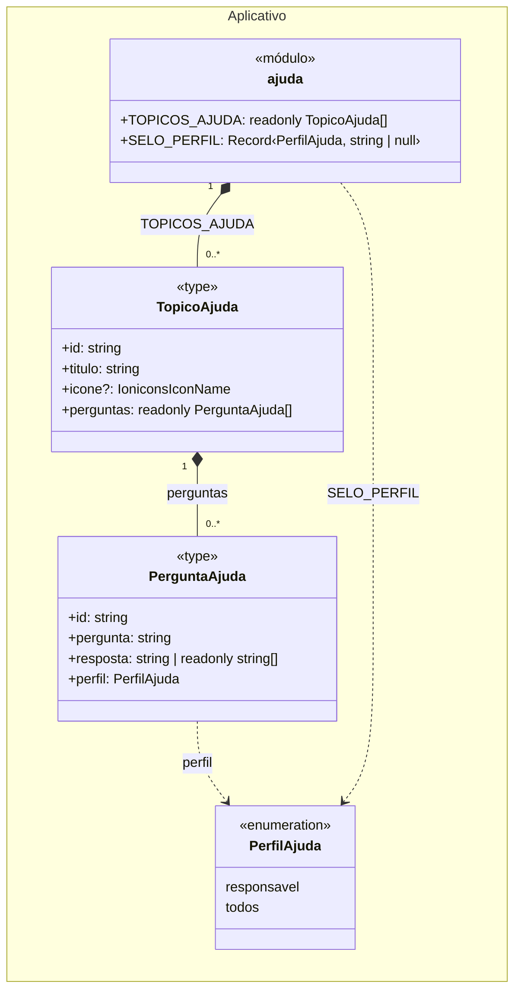
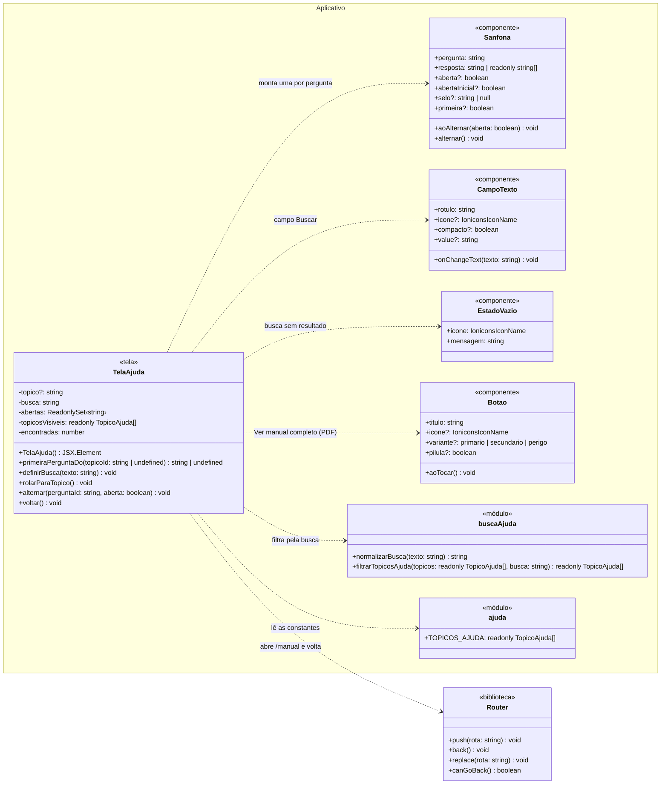
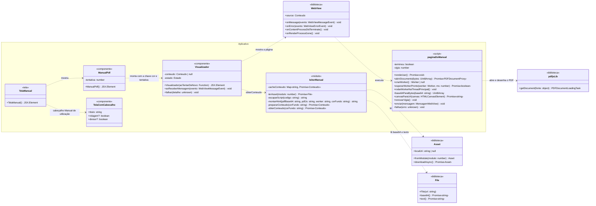

# Diagrama de classes — Manual de utilização

> Padrão da disciplina · Módulo MAN · Revisado em 26/11/2026

## Resumo

O conteúdo da Ajuda e o manual em PDF são estáticos: fazem parte do pacote do aplicativo e não vêm do servidor. Por isso o R4 só tem classes no pacote **Aplicativo**; os pacotes **API** e **Dados**, usados nos outros módulos, ficam vazios, porque não há controller, service, rota nem documento no banco. As bibliotecas externas usadas aparecem fora do pacote, marcadas como `<<biblioteca>>`. Cada atributo traz o seu tipo, e cada método traz o tipo dos parâmetros e do retorno. Toda classe e todo método do diagrama existem no código e são os mesmos chamados nos [Diagramas de sequência](6%20-%20diagramas-sequencia-manual-de-utilizacao.md).

Os tipos são os do TypeScript. `readonly T[]` é uma lista que não pode ser alterada, e `?` indica um campo opcional.

## Diagrama

O diagrama está dividido em três partes, para que nenhuma linha passe por cima de uma classe. A primeira mostra a estrutura do conteúdo da Ajuda, como está declarada em `src/constants/ajuda.ts`. A segunda mostra a tela Ajuda e os componentes que leem esse conteúdo. A terceira mostra a tela do manual e o leitor de PDF. Nas partes 2 e 3, as classes já detalhadas antes aparecem só com o que é usado ali.

### 1. Conteúdo da Ajuda

Figura 2 — Diagrama de classes do conteúdo da Ajuda. Fonte: equipe Conecta+.

### 2. Tela Ajuda e componentes

Figura 3 — Diagrama de classes da tela Ajuda. Fonte: equipe Conecta+.

### 3. Manual em PDF

Figura 4 — Diagrama de classes do leitor do manual. Fonte: equipe Conecta+.

## Como ler as ligações

| Ligação                      | Significado                                                         | Exemplo no diagrama                                                                                                     |
| ---------------------------- | ------------------------------------------------------------------- | ----------------------------------------------------------------------------------------------------------------------- |
| Losango cheio (composição)   | A parte só existe dentro do todo e some junto com ele.              | `TopicoAjuda *-- PerguntaAjuda`: a pergunta é escrita dentro da lista `perguntas` do seu tópico e não existe fora dela. |
| Seta tracejada (dependência) | Uma classe usa a outra numa chamada, sem guardá-la como atributo.   | `TelaAjuda ..> buscaAjuda`: a tela chama `filtrarTopicosAjuda` a cada mudança da busca.                                 |

Os números nas pontas das composições são as multiplicidades: o módulo `ajuda` tem uma lista com qualquer quantidade de tópicos (hoje, 7), e cada tópico tem qualquer quantidade de perguntas (hoje, de 4 a 7). A multiplicidade `0..*` é a que os tipos `readonly TopicoAjuda[]` e `readonly PerguntaAjuda[]` permitem.

Este módulo não tem associação (seta cheia) nem herança (triângulo vazio): nenhuma classe guarda o identificador de um documento de outra coleção, e nenhuma classe estende outra.

## Onde está cada classe

| Classe no diagrama                                      | Arquivo                                                                 | Observação                                                                                                                                         |
| ------------------------------------------------------- | ----------------------------------------------------------------------- | -------------------------------------------------------------------------------------------------------------------------------------------------- |
| `TelaAjuda`                                             | `src/app/ajuda.tsx`                                                     | `primeiraPerguntaDo` é uma função do mesmo arquivo, declarada fora do componente. `definirBusca` é a função que altera o estado `busca`.          |
| `Sanfona`                                               | `src/components/Sanfona.tsx`                                            | Criada para o R4.                                                                                                                                  |
| `CampoTexto`, `EstadoVazio`, `Botao`, `TelaComCabecalho` | `src/components/`                                                      | Compartilhados com outras telas. O diagrama mostra só as propriedades usadas aqui.                                                                 |
| `buscaAjuda`                                            | `src/utils/busca-ajuda.ts`                                              | O hífen foi retirado do nome porque o diagrama não o aceita.                                                                                       |
| `ajuda`, `TopicoAjuda`, `PerguntaAjuda`, `PerfilAjuda`  | `src/constants/ajuda.ts`                                                | `PerfilAjuda` é declarado como o tipo `'responsavel' \| 'todos'`; aparece como enumeração porque só aceita esses dois valores.                    |
| `TelaManual`                                            | `src/app/manual.tsx`                                                    | Rota `/manual`.                                                                                                                                    |
| `ManualPdf`, `Visualizador`                             | `src/components/ManualPdf.tsx`                                          | `Visualizador` é um componente interno do arquivo; só `ManualPdf` é exportado.                                                                    |
| `leitorManual`                                          | `src/components/ManualPdf.tsx`                                          | Nome dado no diagrama às funções e ao cache declarados no nível do arquivo, fora dos componentes.                                                 |
| `paginaDoManual`                                        | `src/components/ManualPdf.tsx`, dentro do texto montado por `montarHtml` | Funções JavaScript da página HTML que roda dentro da `WebView`.                                                                                   |
| `Router`, `WebView`, `Asset`, `File`, `pdfjsLib`        | bibliotecas `expo-router`, `react-native-webview`, `expo-asset`, `expo-file-system` e PDF.js 3.11.174 (`assets/pdfjs/`) | Ficam fora do pacote Aplicativo porque não são código do projeto.                                                       |

## Rastreabilidade

| Requisito                         | Classes envolvidas                                                                                                                           |
| --------------------------------- | -------------------------------------------------------------------------------------------------------------------------------------------- |
| RF-MAN-01 — Consultar Ajuda       | `TelaAjuda`, `ajuda`, `TopicoAjuda`, `PerguntaAjuda`, `PerfilAjuda`, `buscaAjuda`, `Sanfona`, `CampoTexto`, `EstadoVazio`, `Router`          |
| RF-MAN-02 — Abrir manual em PDF   | `TelaAjuda`, `Botao`, `Router`, `TelaManual`, `TelaComCabecalho`, `ManualPdf`, `Visualizador`, `leitorManual`, `paginaDoManual`, `WebView`, `Asset`, `File`, `pdfjsLib` |
