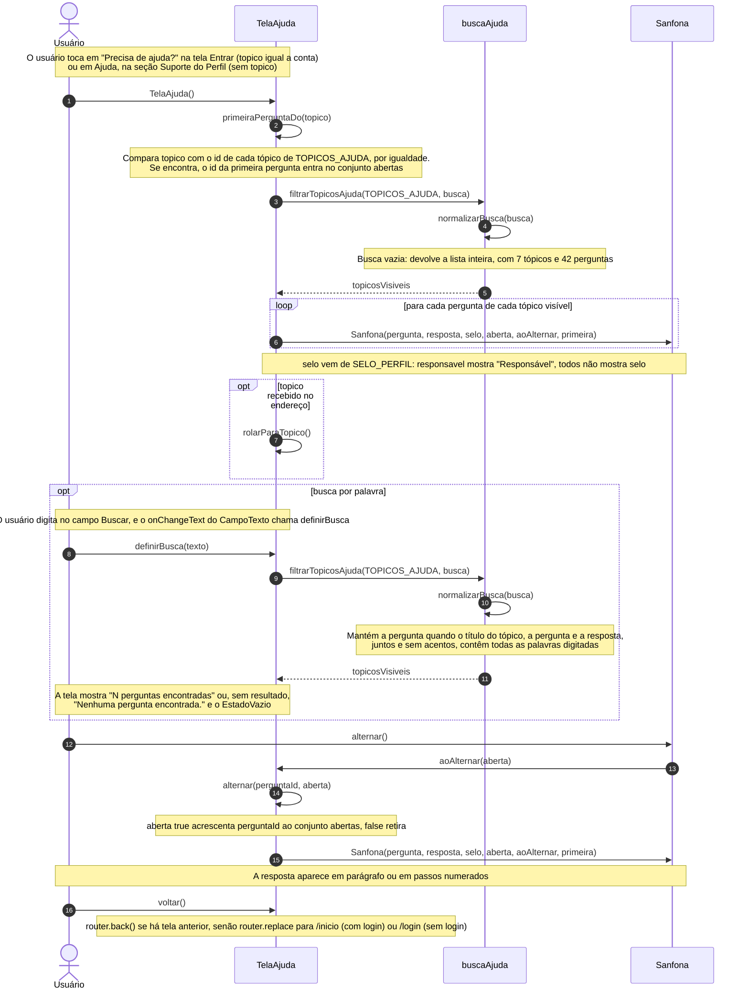
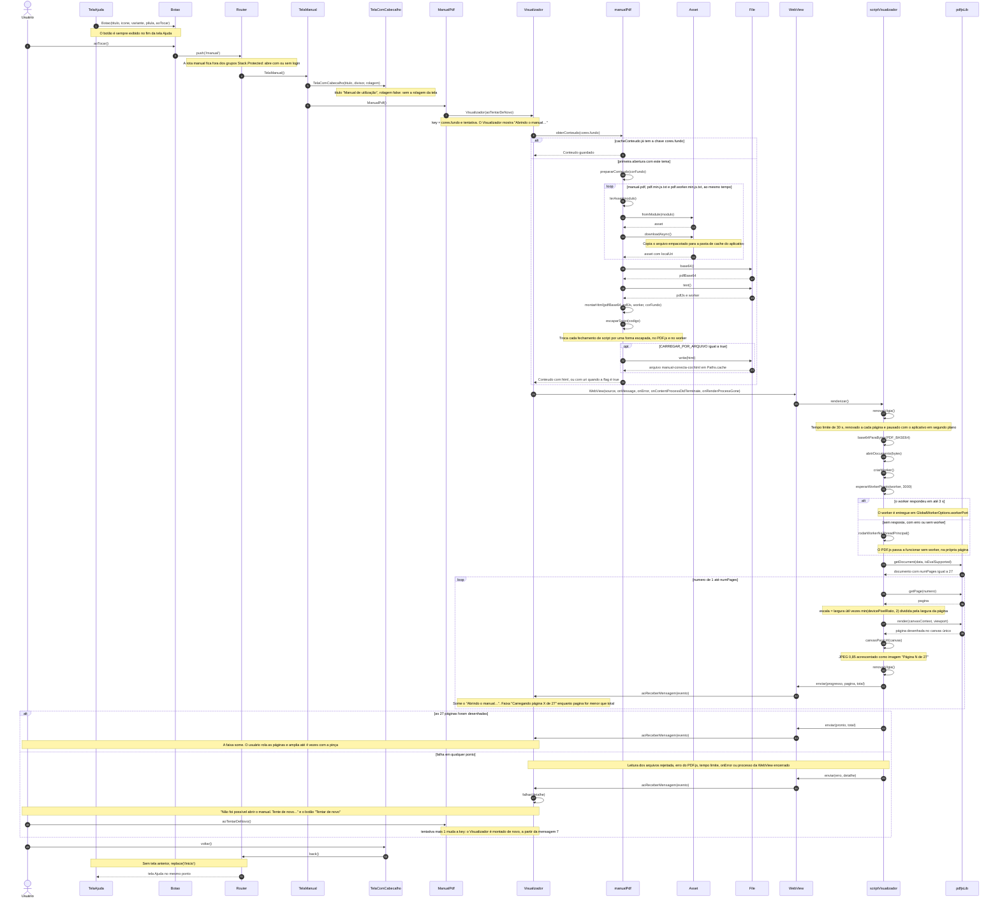

# Diagramas de sequência — Manual de utilização

> Padrão da disciplina · Módulo MAN · Revisado em 25/11/2026

## Resumo

Há um diagrama para cada requisito de [Requisitos funcionais](2%20-%20requisitos-funcionais-manual-de-utilizacao.md), com o mesmo número. As linhas de vida são telas, componentes e módulos que existem no código do aplicativo. Toda mensagem é a chamada de uma função existente, com seus parâmetros, e as mensagens são numeradas na ordem em que acontecem. O que não é uma função, como a leitura de uma constante, uma regra de comparação ou uma condição do código, aparece em notas. Todas as funções chamadas estão no [Diagrama de classes](3%20-%20diagrama-classes-manual-de-utilizacao.md), com os tipos dos parâmetros e do retorno.

Nem a tela Ajuda nem a tela do manual enviam requisições à API do Conecta+. Por isso nenhum diagrama tem `api`, guards, controller, service ou model. No SD-MAN-02, `scriptVisualizador` é o código executado dentro da `WebView`, e as mensagens que ele envia ao aplicativo (`enviar`) chegam como chamadas de `aoReceberMensagem`.

| Linha de vida | Origem no código |
| --- | --- |
| `TelaAjuda` | `src/app/ajuda.tsx` (`TelaAjuda`, `primeiraPerguntaDo`, `definirBusca`, `rolarParaTopico`, `alternar` e `voltar`) |
| `buscaAjuda` | `src/utils/busca-ajuda.ts` (`filtrarTopicosAjuda` e `normalizarBusca`) |
| `Sanfona` | `src/components/Sanfona.tsx` (`alternar` e a propriedade `aoAlternar`) |
| `Botao` | `src/components/Botao.tsx` (propriedade `aoTocar`) |
| `Router` | biblioteca `expo-router`, obtido com `useRouter()` (`push`, `back` e `replace`) |
| `TelaManual` | `src/app/manual.tsx` (`TelaManual`) |
| `TelaComCabecalho` | `src/components/TelaComCabecalho.tsx` (o próprio componente, com a opção `rolagem`, e `voltar`) |
| `ManualPdf` | `src/components/ManualPdf.tsx` (componente `ManualPdf` e a função `aoTentarDeNovo` que ele entrega) |
| `Visualizador` | `src/components/ManualPdf.tsx` (componente interno `Visualizador`, `aoReceberMensagem` e `falhar`) |
| `manualPdf` | `src/components/ManualPdf.tsx`, nível do arquivo (`obterConteudo`, `prepararConteudo`, `lerAsset`, `montarHtml`, `escaparScript` e `cacheConteudo`) |
| `Asset` | biblioteca `expo-asset` (`fromModule` e `downloadAsync`) |
| `File` | biblioteca `expo-file-system` (`base64`, `text` e `write`) |
| `WebView` | biblioteca `react-native-webview` (componente `WebView` e `onMessage`) |
| `scriptVisualizador` | Script escrito por `montarHtml` e executado na `WebView` (`renderizar`, `renovarVigia`, `base64ParaBytes`, `abrirDocumento`, `criarWorker`, `esperarWorkerPronto`, `rodarWorkerNaThreadPrincipal`, `canvasParaUrl` e `enviar`) |
| `pdfjsLib` | PDF.js 3.11.174, embutido em `assets/pdfjs/` (`getDocument`, `getPage` e `render`) |

## SD-MAN-01 — Consultar Ajuda

Para fechar a resposta, o usuário toca de novo na pergunta: as mensagens a partir de `alternar()` se repetem com `aberta` igual a `false`.

## SD-MAN-02 — Abrir manual em PDF

O manual é lido só de arquivos empacotados no aplicativo: não há chamada à API nem a nenhum endereço da internet. Na primeira abertura com um tema, os passos do bloco "primeira abertura" leem os três arquivos e montam a página HTML; nas aberturas seguintes, enquanto o aplicativo estiver aberto, `obterConteudo` devolve a página guardada em `cacheConteudo`, e o fluxo segue direto para a `WebView`. Quando a falha acontece já na leitura dos arquivos, a promessa de `obterConteudo` é rejeitada, a chave sai do cache e o `Visualizador` passa para o erro sem chegar a montar a `WebView`.

## Rastreabilidade

SD-MAN-01 e SD-MAN-02 correspondem, na mesma ordem, a UC-MAN-01 e UC-MAN-02 e a RF-MAN-01 e RF-MAN-02.
