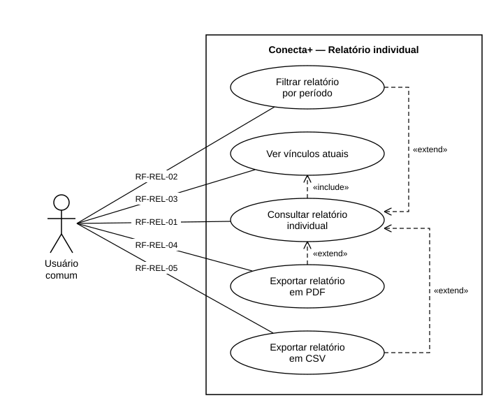

# Casos de uso — Relatório individual

> Padrão da disciplina · Módulo REL · Revisado em 27/11/2026

## Resumo

Este documento mostra quem usa o relatório individual e o que essa pessoa pode fazer. Cada caso de uso é descrito em detalhe, como requisito funcional no formulário padrão, em [Requisitos funcionais](2%20-%20requisitos-funcionais-relatorio-individual.md).

## Diagrama de casos de uso

Figura 1 — Diagrama de casos de uso do relatório individual. Fonte: equipe Conecta+.

Cada linha entre o ator e um caso de uso leva o código do requisito funcional que o descreve.

## Atores

**Usuário comum.** É a pessoa com uma conta ativa de usuário comum que entrou no aplicativo. Pode abrir a aba "Relatório", ver as reuniões em que a presença dela foi confirmada, escolher o período, ver as organizações e comissões de que faz parte e exportar o relatório em PDF ou em CSV. Não pode ver o relatório de outra pessoa nem escolher de quem é o relatório: o sistema usa sempre a conta que está conectada. Também não pode alterar nada pelo relatório: presenças, saídas e vínculos são apenas lidos. O papel que a pessoa tem nas organizações e comissões (administrador, responsável ou membro) não muda o que ela pode fazer neste módulo; ele só aparece como informação nos vínculos.

O **administrador do sistema** (a conta que administra o sistema inteiro) não aparece no diagrama porque não tem acesso a este módulo: o aplicativo não mostra a aba "Relatório" para a conta dele e, se a consulta chegar à API, ela é recusada com a mensagem "O administrador do sistema não pode realizar esta operação".

## Relacionamentos entre casos de uso

- **«include» de Consultar relatório individual para Ver vínculos atuais:** toda consulta do relatório traz os vínculos atuais; não há como consultar o histórico sem eles.
- **«extend» de Filtrar relatório por período para Consultar relatório individual:** escolher o período é opcional; sem escolha, o relatório mostra todo o período.
- **«extend» de Exportar relatório em PDF e de Exportar relatório em CSV para Consultar relatório individual:** os botões de exportação aparecem dentro da consulta, depois que o relatório é carregado, e exportam exatamente o que está na tela.

## Requisitos funcionais de usuário

| Caso de uso | Requisito | Nome                           | Ator principal |
| ----------- | --------- | ------------------------------ | -------------- |
| UC-REL-01   | RF-REL-01 | Consultar relatório individual | Usuário comum  |
| UC-REL-02   | RF-REL-02 | Filtrar relatório por período  | Usuário comum  |
| UC-REL-03   | RF-REL-03 | Ver vínculos atuais            | Usuário comum  |
| UC-REL-04   | RF-REL-04 | Exportar relatório em PDF      | Usuário comum  |
| UC-REL-05   | RF-REL-05 | Exportar relatório em CSV      | Usuário comum  |

**Requisito RF-REL-01 — Consultar relatório individual.** O sistema deve permitir ao usuário comum ver a lista das reuniões já iniciadas e não canceladas em que a presença dele foi confirmada, com organização, comissão, horários, entrada, saída e duração de cada uma, e o total de reuniões e de horas de participação.

**Requisito RF-REL-02 — Filtrar relatório por período.** O sistema deve permitir ao usuário comum limitar o relatório a todo o período, ao mês atual ou ao ano atual, considerando a data de início da reunião.

**Requisito RF-REL-03 — Ver vínculos atuais.** O sistema deve mostrar ao usuário comum, junto do relatório, as organizações aprovadas de que ele é membro aprovado e as comissões ativas dessas organizações de que ele faz parte, com o papel em cada uma, sem depender do período escolhido.

**Requisito RF-REL-04 — Exportar relatório em PDF.** O sistema deve permitir ao usuário comum gerar um PDF do relatório, com identificação, vínculos, resumo e reuniões, e compartilhá-lo ou salvá-lo pelo aparelho, ou imprimi-lo no Expo Go e na web.

**Requisito RF-REL-05 — Exportar relatório em CSV.** O sistema deve permitir ao usuário comum gerar um arquivo CSV do relatório, com uma linha por reunião e uma linha por vínculo, para abrir em planilhas.
