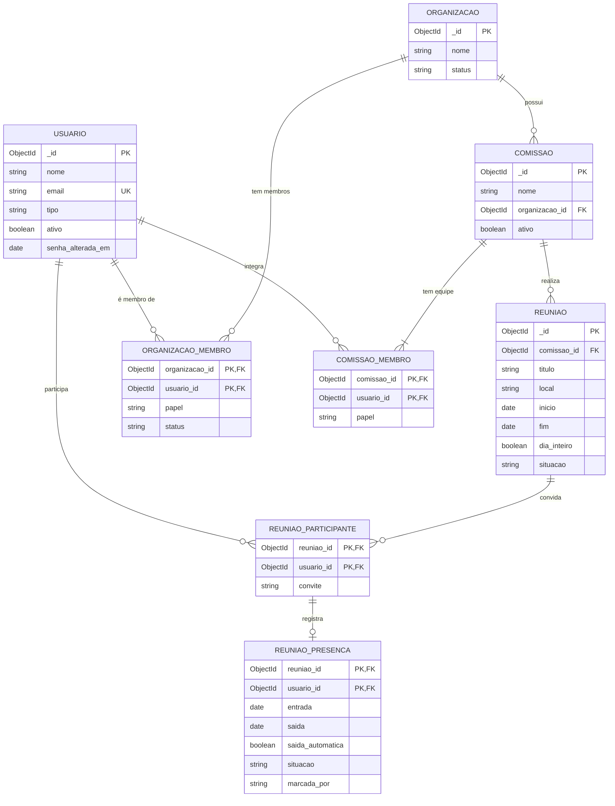

# Diagrama relacional — Relatório individual

> Padrão da disciplina · Módulo REL · Visão lógica dos documentos MongoDB · Revisado em 27/11/2026

## Resumo

O relatório individual não tem coleção própria e não grava nada: ele lê quatro coleções do MongoDB (`usuarios`, `reunioes`, `organizacoes` e `comissoes`) e monta a resposta na hora. O banco não tem tabelas; os participantes e as presenças ficam dentro do documento da reunião, e os membros ficam dentro do documento da organização ou da comissão. O diagrama abaixo é uma **visão lógica**: ele separa esses dados embutidos em entidades para deixar claras as chaves, as cardinalidades e as restrições usadas pelo relatório. Só aparecem os campos que o relatório lê.

## Diagrama

Figura 3 — Visão lógica relacional dos dados lidos pelo relatório individual. Fonte: equipe Conecta+.

## Como as entidades lógicas viram documentos

| Entidade lógica        | Onde fica de verdade                  | Observação                                                                                         |
| ---------------------- | ------------------------------------- | -------------------------------------------------------------------------------------------------- |
| `USUARIO`              | coleção `usuarios`                    | Documento principal da conta.                                                                      |
| `ORGANIZACAO`          | coleção `organizacoes`                | Documento principal.                                                                               |
| `ORGANIZACAO_MEMBRO`   | `organizacoes.membros[]`              | Subdocumento sem `_id` próprio; a chave lógica é a organização mais o usuário.                     |
| `COMISSAO`             | coleção `comissoes`                   | Documento principal; `organizacao_id` aponta para `organizacoes`.                                  |
| `COMISSAO_MEMBRO`      | `comissoes.membros[]`                 | Subdocumento sem `_id` próprio; a chave lógica é a comissão mais o usuário.                        |
| `REUNIAO`              | coleção `reunioes`                    | Documento principal; `comissao_id` aponta para `comissoes`.                                        |
| `REUNIAO_PARTICIPANTE` | `reunioes.participantes[]`            | Subdocumento sem `_id` próprio; a chave lógica é a reunião mais o usuário.                         |
| `REUNIAO_PRESENCA`     | `reunioes.participantes[].presenca`   | Subdocumento opcional de um participante; tem a mesma chave do participante.                       |

Nas entidades que moram dentro de outro documento, o identificador do documento que as contém (`organizacao_id`, `comissao_id` ou `reuniao_id`) aparece no diagrama como parte da chave, mas não é um campo gravado: ele vem do documento pai. O resultado do relatório (`ParticipacaoIndividual`, resumo e vínculos) não aparece no diagrama porque não é gravado; ele é calculado a partir destas entidades a cada consulta.

## Regras de integridade usadas pelo relatório

- uma reunião entra no relatório só quando é `AGENDADA`, já começou e tem, num mesmo `REUNIAO_PARTICIPANTE`, o usuário com `REUNIAO_PRESENCA` `CONFIRMADA` e entrada até o horário da consulta;
- um usuário aparece no máximo uma vez entre os participantes de uma reunião e entre os membros de uma organização ou de uma comissão: o módulo de reuniões monta a lista de participantes sem repetição, o módulo de organizações só acrescenta um membro que ainda não está na lista e o schema da comissão recusa membro repetido; por isso o relatório lê um único papel e uma única presença por usuário em cada documento;
- `COMISSAO_MEMBRO` tem exatamente um item com papel `RESPONSAVEL` por comissão, garantido pelo schema; a cardinalidade `||--|{` representa esse mínimo de um membro;
- um vínculo de organização só vale quando `ORGANIZACAO.status` é `APROVADA` e `ORGANIZACAO_MEMBRO.status` é `APROVADO`; um vínculo de comissão só vale quando `COMISSAO.ativo` é verdadeiro e a organização da comissão tem vínculo válido;
- `REUNIAO_PRESENCA.saida`, quando existe, só gera duração se não for anterior a `entrada` nem posterior ao horário da consulta;
- as referências `comissao_id`, `organizacao_id` e `usuario_id` não são verificadas pelo MongoDB: se o documento apontado foi apagado, o relatório mostra "Comissão indisponível" ou "Organização indisponível" em vez de falhar.

## Rastreabilidade

RF-REL-01 a RF-REL-03, que leem os dados; RF-REL-04 e RF-REL-05 usam o resultado já calculado. Detalhado em [Dicionário relacional](4%20-%20dicionario-dados-relacional-relatorio-individual.md).
