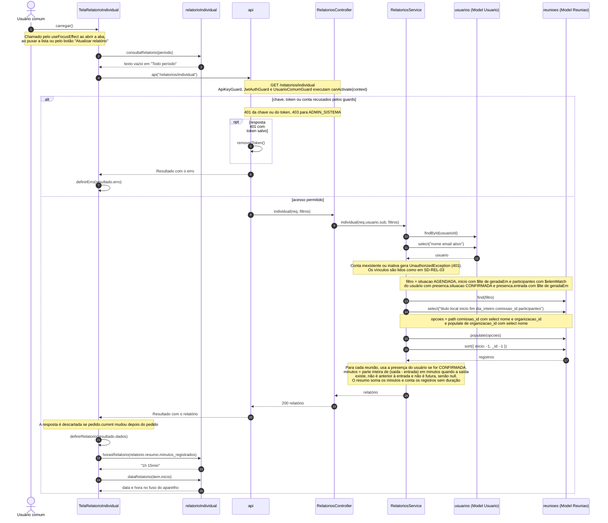
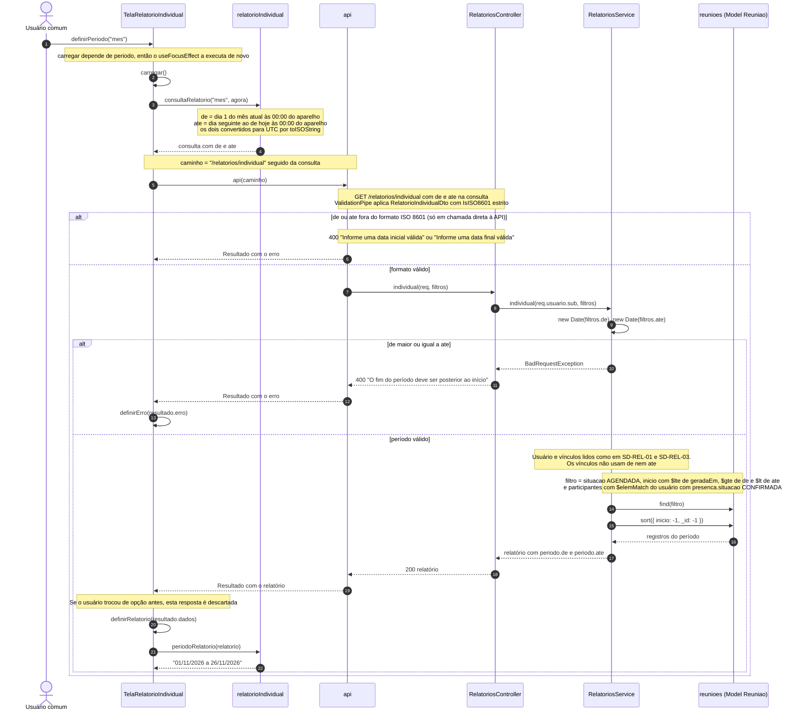
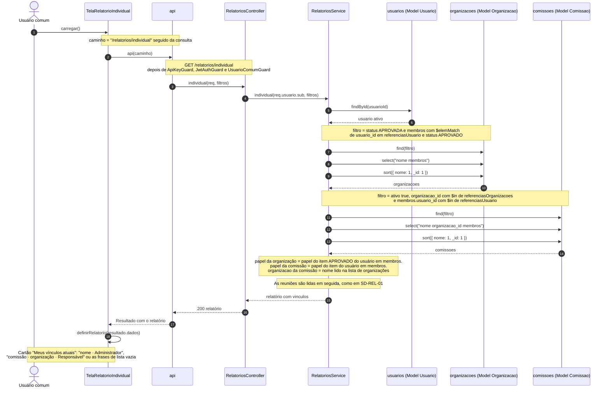
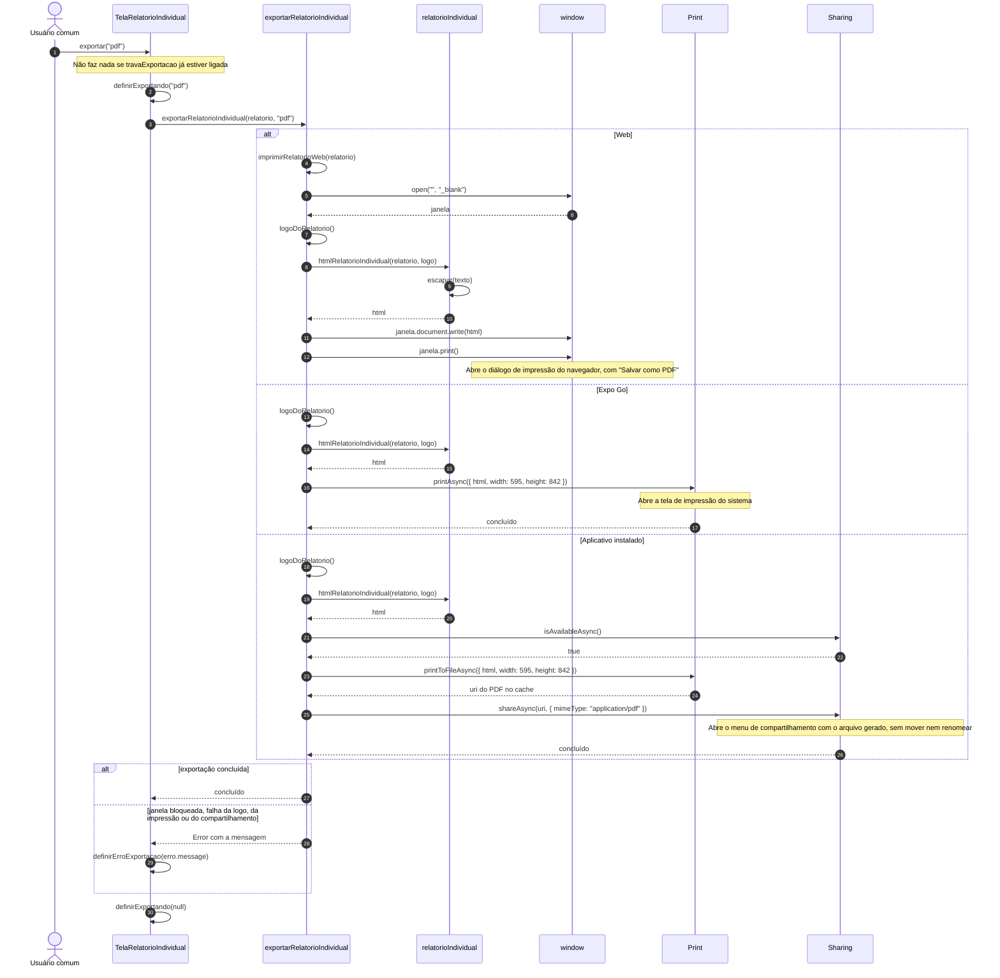
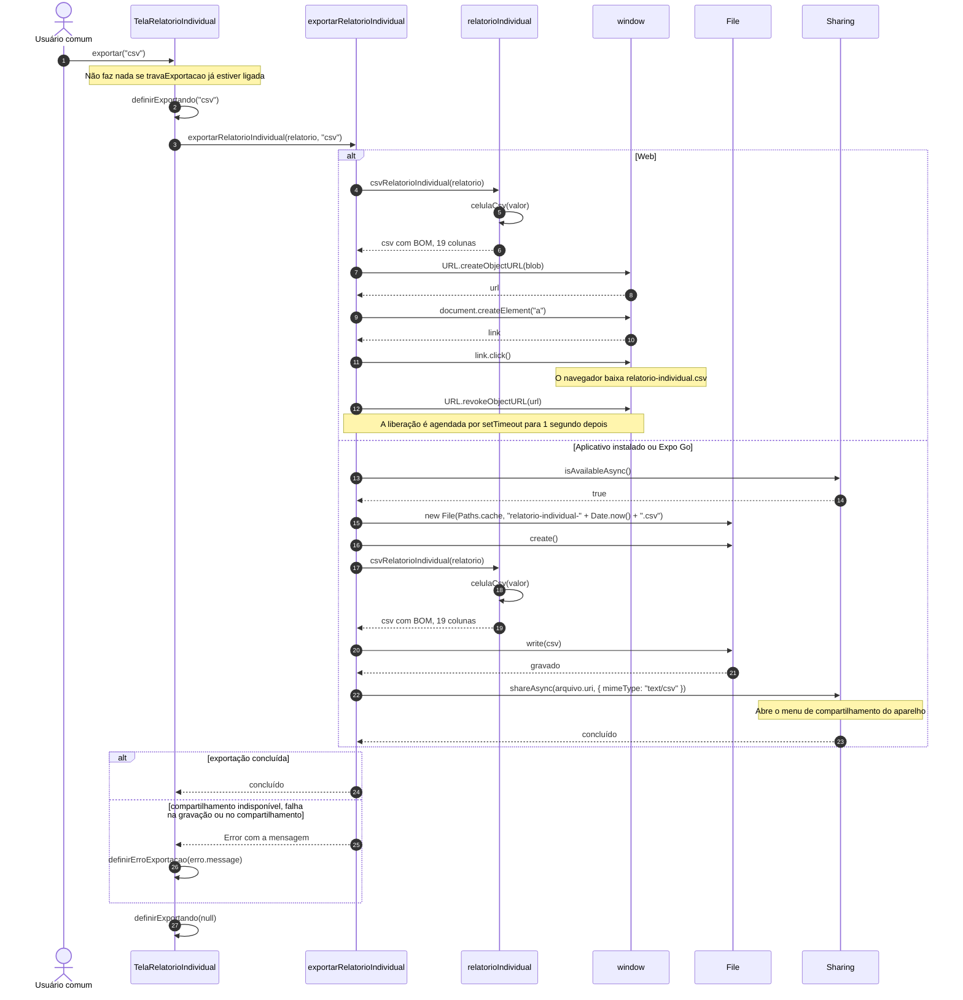

# Diagramas de sequência — Relatório individual

> Padrão da disciplina · Módulo REL · Revisado em 26/11/2026

## Resumo

Há um diagrama para cada requisito de [Requisitos funcionais](2%20-%20requisitos-funcionais-relatorio-individual.md), com o mesmo número. As linhas de vida são classes e módulos que existem no código e no [diagrama de classes](3%20-%20diagrama-classes-relatorio-individual.md): a `TelaRelatorioIndividual`, os módulos `relatorioIndividual`, `api` e `exportarRelatorioIndividual`, o `RelatoriosController`, o `RelatoriosService`, os models do Mongoose guardados nos atributos `usuarios`, `reunioes`, `organizacoes` e `comissoes` do serviço, e as bibliotecas `Print`, `Sharing`, `File` e `window`. As chamadas `select`, `populate` e `sort` são feitas na `Query` devolvida por `find` ou `findById` e aparecem na mesma linha de vida do model. Toda mensagem é a chamada de um método existente, com seus parâmetros, e as mensagens são numeradas na ordem em que acontecem. Regras que não são métodos, como os filtros da consulta, aparecem em notas.

Nos diagramas que chamam a API, a requisição passa antes pelos guards `ApiKeyGuard`, `JwtAuthGuard` e `UsuarioComumGuard`, que o NestJS executa pelo método `canActivate(context)`; a rota e os guards estão indicados na nota.

## SD-REL-01 — Consultar relatório individual

## SD-REL-02 — Filtrar relatório por período

## SD-REL-03 — Ver vínculos atuais

## SD-REL-04 — Exportar relatório em PDF

## SD-REL-05 — Exportar relatório em CSV

## Rastreabilidade

SD-REL-01 a SD-REL-05 correspondem, na mesma ordem, a UC-REL-01 a UC-REL-05 e a RF-REL-01 a RF-REL-05.
