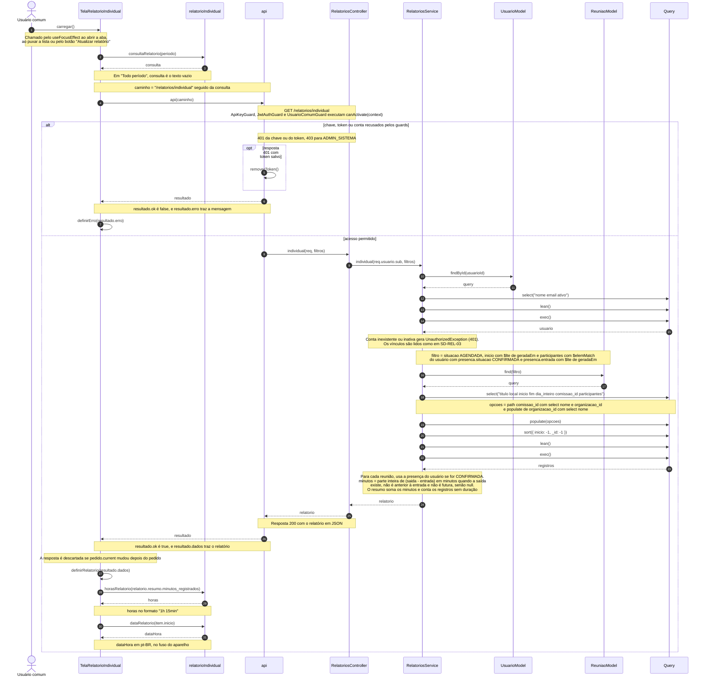
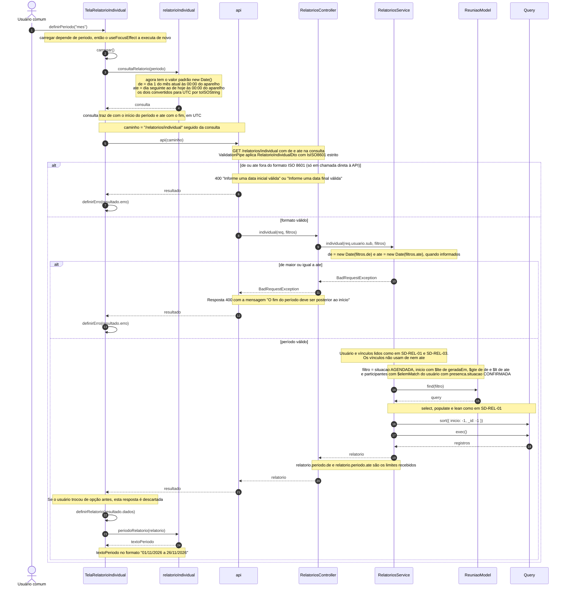
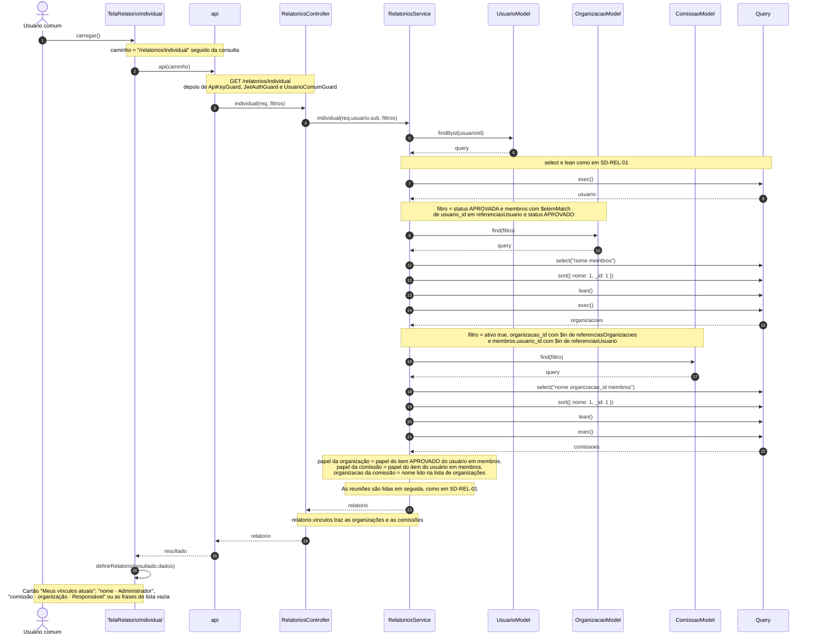
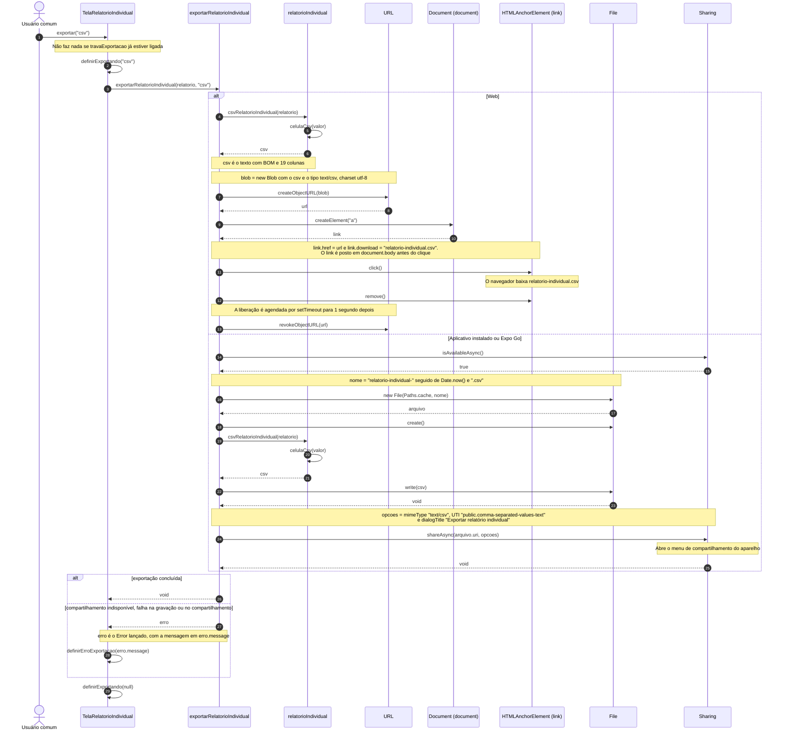

# Diagramas de sequência — Relatório individual

> Padrão da disciplina · Módulo REL · Revisado em 27/11/2026

## Resumo

Há um diagrama para cada requisito de [Requisitos funcionais](2%20-%20requisitos-funcionais-relatorio-individual.md), com o mesmo número. As linhas de vida são classes e módulos que existem no código e no [diagrama de classes](3%20-%20diagrama-classes-relatorio-individual.md): a `TelaRelatorioIndividual`, os módulos `relatorioIndividual`, `api` e `exportarRelatorioIndividual`, o `RelatoriosController`, o `RelatoriosService`, os models do Mongoose `UsuarioModel`, `ReuniaoModel`, `OrganizacaoModel` e `ComissaoModel`, guardados nos atributos `usuarios`, `reunioes`, `organizacoes` e `comissoes` do serviço, a `Query` do Mongoose, as bibliotecas `Print`, `Sharing`, `File` e `jsPDF`, os módulos `baixarPdfRelatorio` e `pdfRelatorioIndividual`, que geram e baixam o PDF na web desde o FRONTEND `299afc2`, e as classes do navegador `Document`, `URL` e `HTMLAnchorElement`. Cada mensagem vai para a linha de vida dona do método: `find` e `findById` vão para o model, e `select`, `populate`, `sort`, `lean` e `exec`, para a `Query` que eles devolvem; a linha de vida `Query` representa a consulta montada em cada leitura. O nome da instância aparece entre parênteses quando ajuda a identificá-la, como em `Document (document)` e `HTMLAnchorElement (link)`. Toda mensagem é a chamada de um método existente, com seus parâmetros, e as mensagens são numeradas na ordem em que acontecem. Cada retorno é o nome do valor devolvido, e `void` indica que o método não devolve valor. Regras que não são métodos, como os filtros da consulta, a conversão das datas e o código HTTP da resposta, aparecem em notas.

Nos diagramas que chamam a API, a requisição passa antes pelos guards `ApiKeyGuard`, `JwtAuthGuard` e `UsuarioComumGuard`, que o NestJS executa pelo método `canActivate(context)`; a rota e os guards estão indicados na nota.

## SD-REL-01 — Consultar relatório individual



## SD-REL-02 — Filtrar relatório por período



## SD-REL-03 — Ver vínculos atuais



## SD-REL-04 — Exportar relatório em PDF

```mermaid
sequenceDiagram
    autonumber
    actor U as Usuário comum
    participant T as TelaRelatorioIndividual
    participant E as exportarRelatorioIndividual
    participant F as relatorioIndividual
    participant B as baixarPdfRelatorio
    participant G as pdfRelatorioIndividual
    participant JP as jsPDF
    participant UR as URL
    participant D as Document (document)
    participant L as HTMLAnchorElement (link)
    participant P as Print
    participant H as Sharing
    U->>T: exportar("pdf")
    Note over T: Não faz nada se travaExportacao já estiver ligada
    T->>T: definirExportando("pdf")
    T->>E: exportarRelatorioIndividual(relatorio, "pdf")
    alt Web
        E->>E: logoDoRelatorio()
        Note over E: Na web, a logo é lida por fetch e FileReader e vira data:image/png;base64
        E->>B: baixarPdfRelatorio(relatorio, logo)
        B->>B: fonteBase64(modulo)
        Note over B: Busca as fontes Poppins Regular e SemiBold por fetch, com limite de 15 s cada,<br/>e as converte em base64. Falha: "Não foi possível carregar a fonte do relatório."
        B->>G: gerarPdfRelatorioIndividual(relatorio, recursos)
        Note over B,G: recursos = logo, fonteRegular e fonteNegrito
        G->>JP: addFont(arquivo, "Poppins", estilo)
        G->>JP: text(texto, x, y)
        Note over G,JP: Monta o A4 com a logo, a identificação, os vínculos, o resumo e um bloco por reunião;<br/>abre página nova quando o bloco não cabe e numera as páginas
        G-->>B: pdf
        B->>JP: output("blob")
        JP-->>B: blob
        B->>UR: createObjectURL(blob)
        UR-->>B: url
        B->>D: createElement("a")
        D-->>B: link
        Note over B,L: link.href = url e link.download = "relatorio-individual.pdf".<br/>O link é posto em document.body antes do clique
        B->>L: click()
        Note over L: O navegador baixa relatorio-individual.pdf, sem janela nem diálogo de impressão
        B->>L: remove()
        Note over B,UR: A liberação é agendada por setTimeout para 10 segundos depois
        B->>UR: revokeObjectURL(url)
        B-->>E: void
    else Expo Go
        E->>E: logoDoRelatorio()
        E->>F: htmlRelatorioIndividual(relatorio, logo)
        F-->>E: html
        E->>P: printAsync({ html, width: 595, height: 842 })
        Note over P: Abre a tela de impressão do sistema
        P-->>E: void
    else Aplicativo instalado
        E->>E: logoDoRelatorio()
        E->>F: htmlRelatorioIndividual(relatorio, logo)
        F-->>E: html
        E->>H: isAvailableAsync()
        H-->>E: true
        E->>P: printToFileAsync({ html, width: 595, height: 842 })
        P-->>E: uri
        Note over E,P: uri é o campo do FilePrintResult com o endereço do PDF gerado no cache
        Note over E,H: opcoes = mimeType "application/pdf", UTI "com.adobe.pdf"<br/>e dialogTitle "Exportar relatório individual"
        E->>H: shareAsync(uri, opcoes)
        Note over H: Abre o menu de compartilhamento com o arquivo gerado, sem mover nem renomear
        H-->>E: void
    end
    alt exportação concluída
        E-->>T: void
    else falha da logo, da fonte, da impressão ou do compartilhamento
        E-->>T: erro
        Note over T,E: erro é o Error lançado, com a mensagem em erro.message
        T->>T: definirErroExportacao(erro.message)
    end
    T->>T: definirExportando(null)
```

## SD-REL-05 — Exportar relatório em CSV



## Rastreabilidade

SD-REL-01 a SD-REL-05 correspondem, na mesma ordem, a UC-REL-01 a UC-REL-05 e a RF-REL-01 a RF-REL-05.
