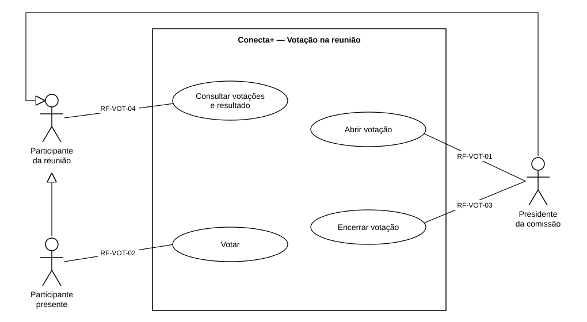

# Casos de uso — Votação na reunião

> Padrão da disciplina · Módulo VOT · Revisado em 27/11/2026

## Resumo

Este documento mostra quem usa a votação e o que cada pessoa pode fazer. Cada caso de uso é descrito em detalhe, como requisito funcional no formulário padrão, em [Requisitos funcionais](2%20-%20requisitos-funcionais-votacao.md).

No aplicativo, o cartão mostra a etiqueta "Em andamento" enquanto a votação recebe votos e "Encerrada" depois. O tipo "Aberta", escolhido ao abrir a votação, diz que todos verão quem votou em quê depois do encerramento. Como uma votação que ainda recebe votos também está, no sentido comum, "aberta", neste documento o tipo aparece sempre como *votação do tipo aberta*, e o seu oposto, como *votação do tipo fechada*.

## Diagrama de casos de uso

Figura 1 — Diagrama de casos de uso da votação. Fonte: equipe Conecta+.

Cada linha entre um ator e um caso de uso leva o código do requisito funcional que o descreve.

## Atores

**Participante da reunião.** É qualquer usuário que consta na lista de participantes da reunião, tenha ele comparecido ou não. Pode abrir a aba "Votações" da reunião, ver as votações abertas e encerradas, o tipo de cada uma e, nas encerradas, o resultado de cada opção, dos votos em branco e dos nulos. Não vota se não estiver presente. Na votação do tipo fechada, não vê em quem as outras pessoas votaram; na do tipo aberta, vê, depois do encerramento, a lista de quem votou em quê.

**Participante presente.** É o participante que marcou entrada, cuja presença não foi recusada (está aguardando a confirmação do presidente ou já confirmada) e que ainda não marcou saída. A seta de generalização indica que ele faz tudo o que o participante da reunião faz e, além disso, vota nas votações ainda não encerradas, uma vez em cada uma: em uma das opções, em branco ou nulo. Quem marca saída, ou recebe a saída automática no término, deixa de votar.

**Presidente da comissão.** É o membro responsável pela comissão, numa comissão ativa. Também é um participante da reunião (generalização). Só ele abre e encerra votações e, ao abrir, escolhe se a votação é do tipo fechada ou aberta; o tipo não muda depois. Se marcou entrada, também é um participante presente e vota como os demais. Ele vê em quem cada pessoa votou só na votação do tipo aberta, depois do encerramento, como todos os participantes.

## Relacionamentos entre casos de uso

- **Generalização entre atores:** participante presente e presidente herdam o caso de uso do participante da reunião (consultar votações e resultado).
- **Encerramento pelo fim da reunião:** quando a reunião termina, a votação ainda aberta passa a ser apresentada como encerrada, sem ação de nenhum ator. Isso faz parte de RF-VOT-04, e não de "Encerrar votação", que é sempre uma ação do presidente.

## Requisitos funcionais de usuário

| Caso de uso | Requisito | Nome                            | Ator principal          |
| ----------- | --------- | ------------------------------- | ----------------------- |
| UC-VOT-01   | RF-VOT-01 | Abrir votação                   | Presidente da comissão  |
| UC-VOT-02   | RF-VOT-02 | Votar                           | Participante presente   |
| UC-VOT-03   | RF-VOT-03 | Encerrar votação                | Presidente da comissão  |
| UC-VOT-04   | RF-VOT-04 | Consultar votações e resultado  | Participante da reunião |

**Requisito RF-VOT-01 — Abrir votação.** O sistema deve permitir ao presidente da comissão abrir, enquanto a reunião acontece, uma votação com um assunto, uma descrição opcional, de 2 a 10 opções de voto diferentes entre si e o tipo da votação: fechada, em que ninguém vê quem votou em quê, ou aberta, em que todos os participantes veem quem votou em quê depois do encerramento. Sem escolha, a votação é fechada.

**Requisito RF-VOT-02 — Votar.** O sistema deve permitir a cada participante presente votar uma única vez numa votação ainda não encerrada, escolhendo uma das opções, o voto em branco ou o voto nulo. O voto não pode ser alterado depois de confirmado.

**Requisito RF-VOT-03 — Encerrar votação.** O sistema deve permitir ao presidente encerrar uma votação ainda não encerrada. Depois do encerramento, ninguém mais vota e o resultado fica visível.

**Requisito RF-VOT-04 — Consultar votações e resultado.** O sistema deve mostrar a qualquer participante da reunião as votações abertas e encerradas, o tipo de cada uma, quantos votos cada uma recebeu e o seu próprio voto. O resultado de cada opção, com os votos em branco e os nulos contados à parte, só aparece depois do encerramento. Na votação do tipo fechada, ninguém vê em quem as outras pessoas votaram; na do tipo aberta, depois do encerramento, todos veem a lista de quem votou em quê.
