# Diagrama de classes — Votação na reunião

> Padrão da disciplina · Módulo VOT · Revisado em 27/11/2026

## Resumo

O diagrama mostra as classes que participam da votação, agrupadas em três pacotes, um por camada do sistema: **Aplicativo** (tela, componentes, o tipo da confirmação pendente e o módulo de acesso à API), **API** (controller, service e objetos de entrada e de saída) e **Dados** (os models do Mongoose, marcados `<<Model Mongoose>>`, e os documentos guardados no MongoDB). Cada atributo traz o seu tipo, e cada método traz o tipo dos parâmetros e do retorno. Toda classe e todo método do diagrama existem no código. Toda linha de vida e todo método chamado nos [Diagramas de sequência](6%20-%20diagramas-sequencia-votacao.md) aparecem aqui, inclusive as funções de estado `definir…` da tela e do componente, que são as funções de atualização criadas por `useState`, e os models `ReuniaoModel` e `ComissaoModel`. Cada classe está descrita no [Dicionário de classes](3%20-%20dicionario-dados-classes-votacao.md).

## Diagrama

```mermaid
classDiagram
    direction LR

    namespace Aplicativo {
        class TelaReuniao {
            -reuniao: Reuniao
            -aba: Aba
            -presidente: boolean
            -salvando: string
            +buscar() Promise~void~
            +executar(chave: string, acao: Function, mensagem: string) Promise~boolean~
            -definirReuniao(valor: Reuniao | null) void
            -definirAba(valor: Aba) void
            -definirErro(valor: string) void
            -definirSucesso(valor: string) void
            -definirPresidente(valor: boolean) void
        }
        class VotacoesReuniao {
            -formulario: boolean
            -titulo: string
            -descricao: string
            -opcoes: string[]
            -modo: ModoVotacao
            -erroFormulario: string
            -confirmacao: Pendente | null
            +VotacoesReuniao(reuniao: Reuniao, presidente: boolean, emAndamento: boolean, motivoSemVoto: string | null, salvando: string | null, executar: Executar) JSX.Element
            -definirFormulario(valor: boolean) void
            -definirModo(valor: ModoVotacao) void
            -definirErroFormulario(valor: string) void
            -definirConfirmacao(valor: Pendente | null) void
            +abrirFormulario() void
            +validar() string
            +enviar() Promise~void~
            +pedirVoto(votacao: VotacaoApresentada, voto: EscolhaVoto) void
            +pedirEncerramento(votacao: VotacaoApresentada) void
            +renderizarAberta(votacao: VotacaoApresentada) Element
            +renderizarResultado(votacao: VotacaoApresentada) Element
            +descreverVoto(votacao: VotacaoApresentada, voto: EscolhaVoto) string$
        }
        class api {
            <<module>>
            +api(caminho: string, metodo: string, corpo: unknown) Promise~Resultado~
        }
        class Confirmacao {
            <<componente>>
            +mensagem?: string
            +rotuloConfirmar?: string
            +perigo?: boolean
            +carregando: boolean
            +confirmar() void
            +cancelar() void
        }
        class Pendente {
            <<tipo>>
            +mensagem: string
            +rotulo: string
            +perigo?: boolean
            +acao() Promise~unknown~
        }
    }

    namespace API {
        class ReunioesController {
            -reunioesService: ReunioesService
            +abrirVotacao(id: string, dto: AbrirVotacaoDto, req: RequisicaoAutenticada) Promise~Reuniao~
            +votar(id: string, votacaoId: string, dto: VotarDto, req: RequisicaoAutenticada) Promise~Reuniao~
            +encerrarVotacao(id: string, votacaoId: string, req: RequisicaoAutenticada) Promise~Reuniao~
            +buscarPorId(id: string, req: RequisicaoAutenticada) Promise~Reuniao~
        }
        class ReunioesService {
            -reuniaoModel: Model~Reuniao~
            -comissaoModel: Model~Comissao~
            -usuarioModel: Model~Usuario~
            +abrirVotacao(id: string, dto: AbrirVotacaoDto, usuarioId: string) Promise~Reuniao~
            +votar(id: string, votacaoId: string, voto: VotarDto, usuarioId: string) Promise~Reuniao~
            +encerrarVotacao(id: string, votacaoId: string, usuarioId: string) Promise~Reuniao~
            +buscarPorId(id: string, usuarioId: string) Promise~Reuniao~
            -carregar(id: string, usuarioId: string) Promise~Carga~
            -exigirAgendada(reuniao: Reuniao) void
            -exigirPresidente(reuniao: Reuniao, usuarioId: string) Promise~void~
            -buscarVotacao(reuniao: Reuniao, votacaoId: string) Votacao
            -popular(reuniao: Reuniao) Promise~Reuniao~
            -apresentar(reuniao: Reuniao, usuarioId: string) Reuniao
            -apresentarVotacao(votacao: Votacao, fim: Date, usuarioId: string, nomes: Map) VotacaoApresentada
            -responder(reuniao: Reuniao, usuarioId: string, conflito: string) Promise~Reuniao~
        }
        class AbrirVotacaoDto {
            +titulo: string
            +descricao: string
            +opcoes: string[]
            +modo: ModoVotacao
        }
        class VotarDto {
            +tipo: TipoVoto
            +opcao: number
        }
        class VotacaoApresentada {
            <<tipo>>
            +_id: ObjectId
            +titulo: string
            +descricao: string
            +opcoes: string[]
            +modo: ModoVotacao
            +situacao: SituacaoVotacao
            +aberta_em: Date
            +encerrada_em: Date
            +total_votos: number
            +meu_voto: EscolhaVoto
            +resultado: number[]
            +brancos: number
            +nulos: number
            +votos_nominais: VotoNominal[]
        }
        class VotoNominal {
            <<tipo>>
            +usuario_id: ObjectId
            +nome: string
            +voto: EscolhaVoto
        }
    }

    namespace Dados {
        class ReuniaoModel {
            <<Model Mongoose>>
            +findById(id: string) Query~ReuniaoDocument~
            +findOneAndUpdate(filtro: FilterQuery, alteracao: UpdateQuery, opcoes: QueryOptions) Query~ReuniaoDocument~
        }
        class ComissaoModel {
            <<Model Mongoose>>
            +findById(id: ObjectId) Query~ComissaoDocument~
        }
        class UsuarioModel {
            <<Model Mongoose>>
            +findById(id: string) Query~UsuarioDocument~
        }
        class Reuniao {
            +_id: ObjectId
            +comissao_id: ObjectId
            +inicio: Date
            +fim: Date
            +situacao: SituacaoReuniao
            +participantes: Participante[]
            +votacoes: Votacao[]
        }
        class Votacao {
            +_id: ObjectId
            +titulo: string
            +descricao: string
            +opcoes: string[]
            +modo: ModoVotacao
            +situacao: SituacaoVotacao
            +aberta_por: ObjectId
            +aberta_em: Date
            +encerrada_em: Date
            +votos: Voto[]
        }
        class Voto {
            +usuario_id: ObjectId
            +tipo: TipoVoto
            +opcao: number
            +votado_em: Date
        }
        class Participante {
            +usuario_id: ObjectId
            +convite: RespostaConvite
            +presenca: Presenca
        }
        class Presenca {
            +entrada: Date
            +saida: Date
            +situacao: SituacaoPresenca
        }
        class Comissao {
            +_id: ObjectId
            +ativo: boolean
            +membros: MembroComissao[]
        }
        class Usuario {
            +_id: ObjectId
            +nome: string
            +ativo: boolean
        }
        class SituacaoVotacao {
            <<enumeration>>
            ABERTA
            ENCERRADA
        }
        class ModoVotacao {
            <<enumeration>>
            ABERTA
            FECHADA
        }
        class TipoVoto {
            <<enumeration>>
            OPCAO
            BRANCO
            NULO
        }
    }

    TelaReuniao ..> VotacoesReuniao : mostra na aba Votações
    TelaReuniao ..> api : usa
    VotacoesReuniao ..> api : usa
    VotacoesReuniao ..> TelaReuniao : chama executar
    VotacoesReuniao ..> Confirmacao : pede a confirmação
    VotacoesReuniao ..> Pendente : guarda em confirmacao
    api ..> ReunioesController : requisição HTTP

    ReunioesController --> "1" ReunioesService : reunioesService
    ReunioesController ..> AbrirVotacaoDto : recebe
    ReunioesController ..> VotarDto : recebe
    ReunioesService ..> VotacaoApresentada : monta
    ReunioesService "1" --> "1" ReuniaoModel : reuniaoModel
    ReunioesService "1" --> "1" ComissaoModel : comissaoModel
    ReunioesService "1" --> "1" UsuarioModel : usuarioModel
    ReuniaoModel ..> Reuniao : documentos do schema
    ComissaoModel ..> Comissao : documentos do schema
    UsuarioModel ..> Usuario : documentos do schema
    VotacaoApresentada "1" *-- "0..*" VotoNominal : votos_nominais

    Reuniao "1" *-- "0..*" Votacao : votacoes
    Votacao "1" *-- "0..*" Voto : votos
    Reuniao "1" *-- "1..*" Participante : participantes
    Participante "1" *-- "0..1" Presenca : presenca
    Reuniao "0..*" --> "1" Comissao : comissao_id
    Votacao "0..*" --> "1" Usuario : aberta_por
    Voto "0..*" --> "1" Usuario : usuario_id
    Participante "0..*" --> "1" Usuario : usuario_id
    Votacao ..> SituacaoVotacao : situacao
    Votacao ..> ModoVotacao : modo
    Voto ..> TipoVoto : tipo
    VotacaoApresentada ..> SituacaoVotacao : situacao
    VotacaoApresentada ..> ModoVotacao : modo
    AbrirVotacaoDto ..> ModoVotacao : modo
    VotarDto ..> TipoVoto : tipo
```

Figura 2 — Diagrama de classes da votação, por camada. Fonte: equipe Conecta+.

## Como ler as ligações

| Ligação                      | Significado                                                             | Exemplo no diagrama                                                                                                              |
| ---------------------------- | ----------------------------------------------------------------------- | -------------------------------------------------------------------------------------------------------------------------------- |
| Losango cheio (composição)   | A parte só existe dentro do todo e é apagada junto com ele.             | `Reuniao *-- Votacao`: a votação é gravada dentro do documento da reunião. `Votacao *-- Voto`: o voto é gravado dentro da votação. |
| Seta cheia (associação)      | Uma classe guarda uma referência a outra, que existe por conta própria. | `Voto --> Usuario`: `usuario_id` guarda o identificador de um documento de `usuarios`.                                           |
| Seta tracejada (dependência) | Uma classe usa a outra numa chamada, sem guardá-la como atributo.       | `ComissaoModel ..> Comissao`: o model lê a comissão, para o serviço saber quem é o presidente.                                   |

Os números nas pontas são as multiplicidades. Por exemplo, uma `Reuniao` tem qualquer quantidade de votações (`0..*`), e cada `Votacao` tem de nenhum a vários votos (`0..*`), no máximo um por usuário. O `ReunioesService` guarda exatamente um model de cada coleção (`1`), injetado pelo NestJS nos atributos `reuniaoModel`, `comissaoModel` e `usuarioModel`; cada model mostra só os métodos que a votação chama: `findById` e `findOneAndUpdate` em `ReuniaoModel`, e `findById` em `ComissaoModel` (por `exigirPresidente`) e em `UsuarioModel` (por `validarUsuario`, dentro de `carregar`). Esses métodos devolvem uma `Query`, na qual o serviço chama `exec()`.

`Confirmacao` é o diálogo de confirmação (`FRONTEND/src/components/Confirmacao.tsx`), e `Pendente` é o tipo, declarado em `VotacoesReuniao.tsx`, do estado `confirmacao`: guarda a mensagem, o rótulo do botão e a função `acao`, que envia o voto ou o encerramento. O botão de confirmar do diálogo chama `confirmar`, função passada pelo `VotacoesReuniao` que executa `confirmacao.acao()`.

`VotacaoApresentada` está marcada como `<<tipo>>` porque não é gravada nem declarada como classe: é o objeto que `apresentarVotacao` monta para a resposta da API, sem a lista de votos. No aplicativo, esse formato é declarado como o tipo `Votacao` em `FRONTEND/src/services/api.ts`; o diagrama usa o nome `VotacaoApresentada` nos parâmetros de `VotacoesReuniao` para não confundi-lo com o subdocumento gravado. `VotoNominal` também é `<<tipo>>`: é cada item de `votos_nominais`, a lista de quem votou em quê, que só existe na resposta. `EscolhaVoto` é o tipo declarado em `FRONTEND/src/services/api.ts` como `number | 'BRANCO' | 'NULO'`, isto é, a posição de uma opção, o voto em branco ou o voto nulo; ele aparece em `meu_voto`, em `VotoNominal.voto` e no parâmetro `voto` de `pedirVoto` e de `descreverVoto`.

`descreverVoto` aparece sublinhada porque é uma função do arquivo `VotacoesReuniao.tsx` declarada fora do componente, que não depende do estado dele: transforma a escolha no trecho de texto usado na confirmação e na faixa do voto.

`TelaReuniao` e `VotacoesReuniao` se ligam por dependência, e não por composição: o componente não é um dado gravado dentro da tela. A tela entrega a ele a reunião, as condições de exibição e a própria função `executar`.

O parâmetro `nomes` de `apresentarVotacao` é um `Map` de texto para texto (`usuario_id` do participante para o `nome`), montado por `apresentar`.

No código, os atributos opcionais são `_id` (gerado na abertura) e `encerrada_em`, em `Votacao`; `opcao`, em `Voto`; `descricao` e `modo`, em `AbrirVotacaoDto`; `tipo` e `opcao`, em `VotarDto`; e `presenca` e `saida`. `Votacao.modo` e `Voto.tipo` não são obrigatórios no schema, mas têm valor padrão. A obrigatoriedade de cada um está no [dicionário de classes](3%20-%20dicionario-dados-classes-votacao.md).

## Rotas atendidas pelo controller

As rotas HTTP não são métodos; por isso ficam nesta tabela, e não no diagrama.

| Método do controller | Rota HTTP                                           |
| -------------------- | --------------------------------------------------- |
| `abrirVotacao`       | `POST /reunioes/:id/votacoes`                       |
| `votar`              | `POST /reunioes/:id/votacoes/:votacaoId/votos`      |
| `encerrarVotacao`    | `POST /reunioes/:id/votacoes/:votacaoId/encerrar`   |
| `buscarPorId`        | `GET /reunioes/:id`                                 |

## Regras representadas

- `Votacao` e `Voto` não existem fora de `Reuniao`;
- cada usuário tem no máximo um `Voto` por `Votacao`;
- `Voto.opcao` é a posição da opção em `Votacao.opcoes`, começando em 0, e só existe quando `Voto.tipo` é `OPCAO`;
- `Votacao.modo` é escolhido na abertura e não muda depois;
- só o membro `RESPONSAVEL` da `Comissao` da reunião, com a comissão ativa, abre e encerra votações;
- a lista `votos` nunca sai da API; o aplicativo recebe o total, o próprio voto e, depois do encerramento, o resultado por opção, os brancos, os nulos e, só no modo `ABERTA`, os itens de `VotoNominal`;
- o aplicativo nunca decide se a votação está encerrada nem se mostra quem votou em quê: ele mostra a situação e a lista que a API devolve.

## Rastreabilidade

RF-VOT-01 a RF-VOT-04; complementado por [Dicionário de classes](3%20-%20dicionario-dados-classes-votacao.md) e [Diagramas de sequência](6%20-%20diagramas-sequencia-votacao.md).
