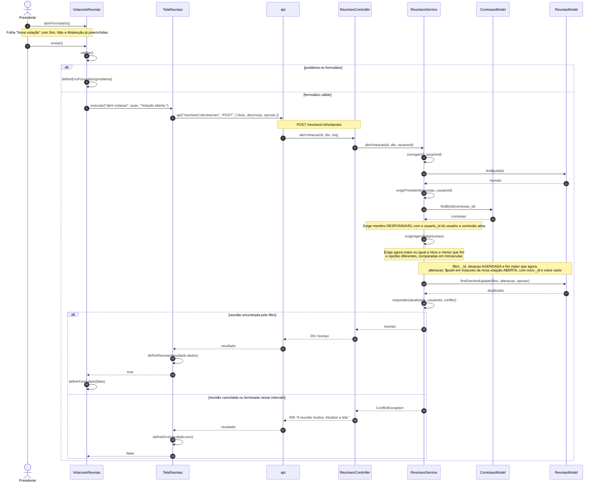
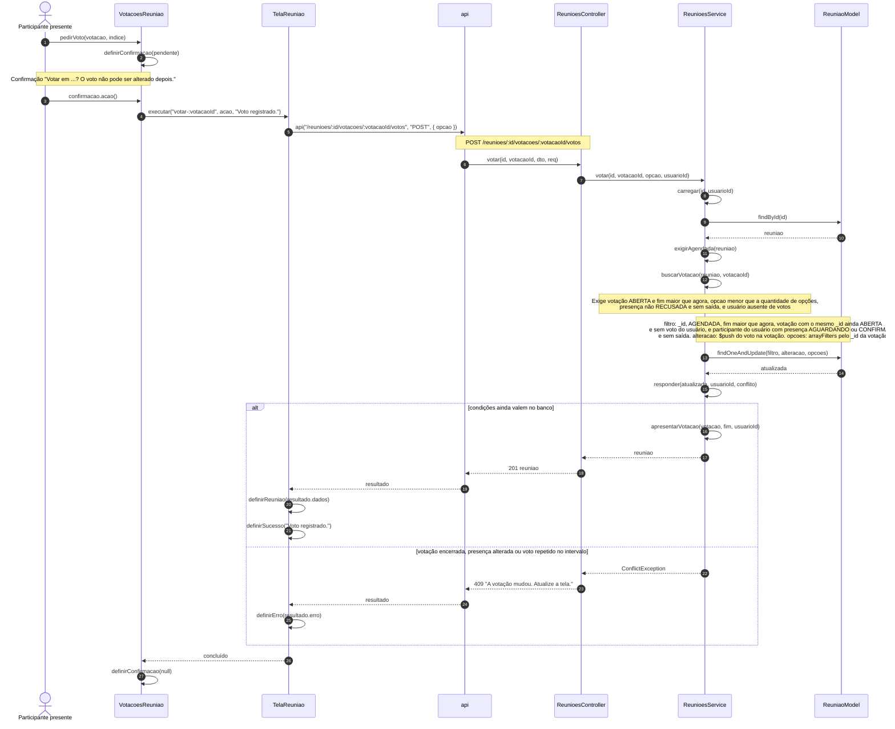
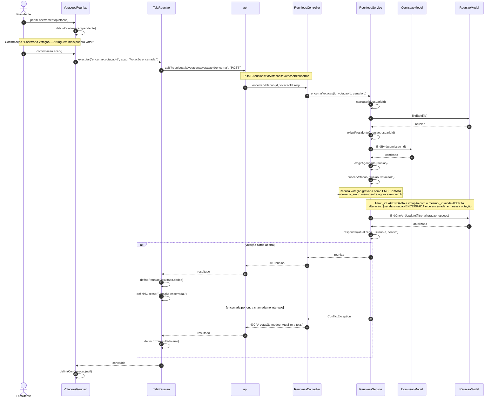
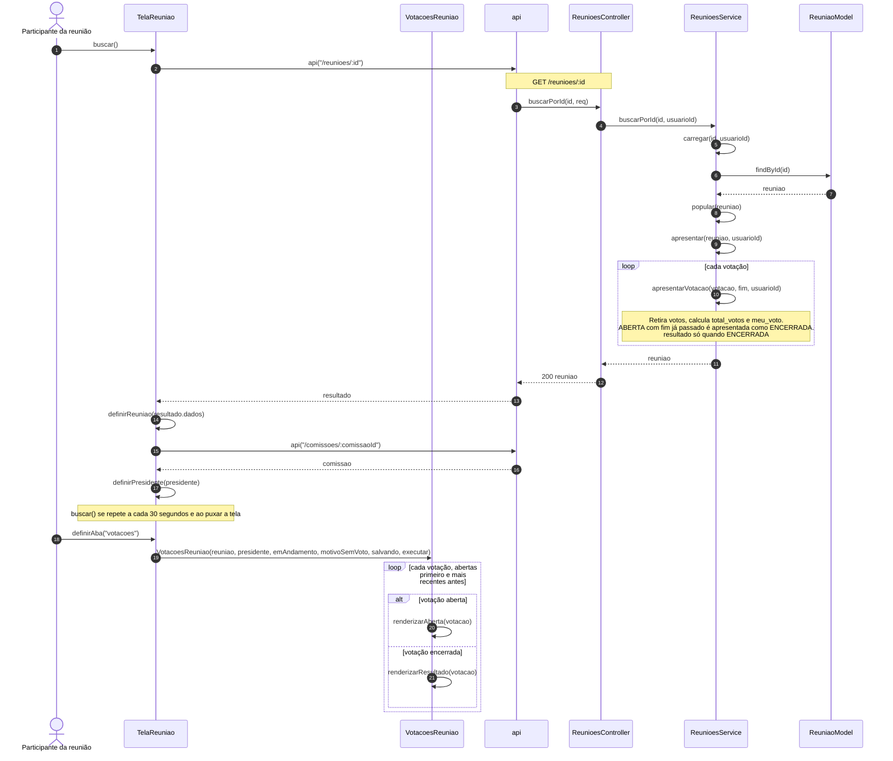

# Diagramas de sequência — Votação na reunião

> Padrão da disciplina · Módulo VOT · Revisado em 26/11/2026

## Resumo

Há um diagrama para cada requisito de [Requisitos funcionais](2%20-%20requisitos-funcionais-votacao.md), com o mesmo número. As linhas de vida são classes e módulos que existem no código: a tela `TelaReuniao`, o componente `VotacoesReuniao`, o módulo `api`, o `ReunioesController`, o `ReunioesService` e os models do Mongoose. Toda mensagem é a chamada de um método existente, com seus parâmetros, e as mensagens são numeradas na ordem em que acontecem. Os retornos voltam pela cadeia, na ordem inversa. Regras que não são métodos, como comparações de horário, e o conteúdo dos filtros e das alterações enviados ao banco aparecem em notas; nas mensagens, eles são os parâmetros `filtro`, `alteracao` e `opcoes`.

Em todos os diagramas, a chamada do módulo `api` ao controller é uma requisição HTTP que passa antes por `ApiKeyGuard`, `JwtAuthGuard` e `UsuarioComumGuard`; a rota está indicada na nota. O método `carregar(id, usuarioId)` aparece só com a leitura da reunião; antes dela, ele chama `validarId(id)` e `validarUsuario(usuarioId)`, que lê o usuário com `UsuarioModel.findById`.

## SD-VOT-01 — Abrir votação

## SD-VOT-02 — Votar

## SD-VOT-03 — Encerrar votação

## SD-VOT-04 — Consultar votações e resultado

## Rastreabilidade

SD-VOT-01 a SD-VOT-04 correspondem a RF-VOT-01 a RF-VOT-04 e aos casos de uso UC-VOT-01 a UC-VOT-04.
