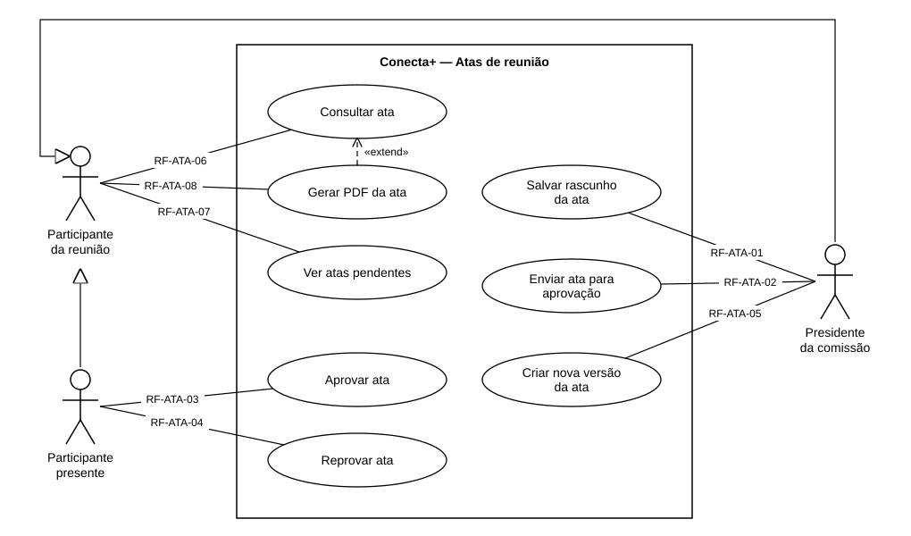

# Casos de uso — Atas de reunião

> Padrão da disciplina · Módulo ATA · Revisado em 10/11/2026

## Resumo

Este documento mostra quem usa as atas e o que cada pessoa pode fazer. Cada caso de uso é descrito em detalhe, como requisito funcional no formulário padrão, em [Requisitos funcionais](2%20-%20requisitos-funcionais-atas.md).

## Diagrama de casos de uso

Figura 1 — Diagrama de casos de uso das atas. Fonte: equipe Conecta+.

Cada linha entre um ator e um caso de uso leva o código do requisito funcional que o descreve.

## Atores

**Participante da reunião.** É qualquer usuário que consta na lista de participantes da reunião, tenha ele comparecido ou não. Pode abrir a ata, ver na tela inicial as atas que dependem dele e, quando a ata estiver aprovada, gerar o PDF. Não pode alterar a ata.

**Participante presente.** É o participante cuja presença terminou como `CONFIRMADA` (marcada por ele e confirmada pelo organizador, ou marcada pelo organizador). A seta de generalização indica que ele faz tudo o que o participante da reunião faz e, além disso, aprova ou reprova a ata. A lista de quem aprova é fixada no momento do envio: quem não estava presente não aprova.

**Presidente da comissão.** É o membro da comissão com papel `RESPONSAVEL`. Também é um participante da reunião (generalização). Só ele escreve, salva e envia a ata, e só ele cria a nova versão quando a ata é reprovada. Se o presidente esteve presente, ele também é um participante presente; nesse caso, enviar a ata já registra a aprovação dele.

## Relacionamentos entre casos de uso

- **«extend» de Gerar PDF da ata para Consultar ata:** gerar o PDF é uma opção que aparece dentro da consulta, e só quando a ata está aprovada.
- **Generalização entre atores:** participante presente e presidente herdam os casos de uso do participante da reunião (consultar a ata e ver pendências).

## Requisitos funcionais de usuário

| Caso de uso | Requisito | Nome                          | Ator principal          |
| ----------- | --------- | ----------------------------- | ----------------------- |
| UC-ATA-01   | RF-ATA-01 | Salvar rascunho da ata        | Presidente da comissão  |
| UC-ATA-02   | RF-ATA-02 | Enviar ata para aprovação     | Presidente da comissão  |
| UC-ATA-03   | RF-ATA-03 | Aprovar ata                   | Participante presente   |
| UC-ATA-04   | RF-ATA-04 | Reprovar ata                  | Participante presente   |
| UC-ATA-05   | RF-ATA-05 | Criar nova versão da ata      | Presidente da comissão  |
| UC-ATA-06   | RF-ATA-06 | Consultar ata                 | Participante da reunião |
| UC-ATA-07   | RF-ATA-07 | Ver atas pendentes            | Participante da reunião |
| UC-ATA-08   | RF-ATA-08 | Gerar PDF da ata              | Participante da reunião |

**Requisito RF-ATA-01 — Salvar rascunho da ata.** O sistema deve permitir ao presidente da comissão escrever a ata de uma reunião já encerrada e salvá-la como rascunho, quantas vezes quiser, antes de enviá-la.

**Requisito RF-ATA-02 — Enviar ata para aprovação.** O sistema deve permitir ao presidente enviar o rascunho aos participantes presentes, escolhendo um prazo de 24 horas, 3 dias ou 7 dias para a resposta. Depois do envio, o texto não pode mais ser alterado.

**Requisito RF-ATA-03 — Aprovar ata.** O sistema deve permitir a cada participante presente aprovar a ata enviada, confirmando sua identidade no aparelho. Quando todos os presentes aprovam, a ata fica aprovada e recebe um número na comissão.

**Requisito RF-ATA-04 — Reprovar ata.** O sistema deve permitir a cada participante presente reprovar a ata enviada, podendo apontar o parágrafo com problema e escrever uma justificativa. Uma reprovação devolve a ata ao presidente.

**Requisito RF-ATA-05 — Criar nova versão da ata.** O sistema deve permitir ao presidente transformar a ata reprovada em uma nova versão, com o mesmo texto, para corrigi-la e enviá-la de novo. A versão reprovada fica guardada como cancelada.

**Requisito RF-ATA-06 — Consultar ata.** O sistema deve permitir a qualquer participante da reunião ver a ata, sua situação, quem já aprovou ou reprovou, o que mudou desde a versão anterior e as versões canceladas.

**Requisito RF-ATA-07 — Ver atas pendentes.** O sistema deve mostrar na tela inicial as atas que esperam a aprovação do usuário e as atas que ele escreveu e foram reprovadas.

**Requisito RF-ATA-08 — Gerar PDF da ata.** O sistema deve permitir a qualquer participante gerar e compartilhar um PDF da ata aprovada, com o número, o texto e quem aprovou.
