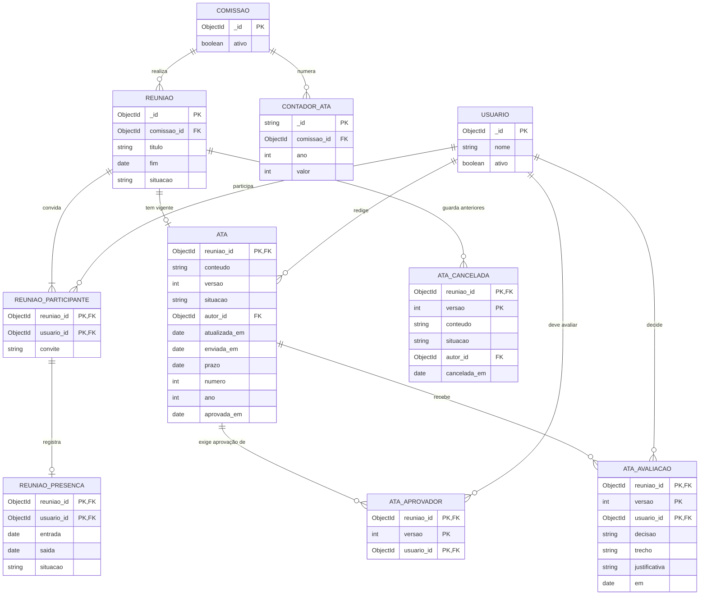

# Diagrama relacional — Atas de reunião

> Padrão da disciplina · Módulo ATA · Visão lógica dos documentos MongoDB · Revisado em 10/11/2026

## Resumo

O banco é o MongoDB, que não tem tabelas: a ata, as versões canceladas e as avaliações ficam dentro do documento da reunião, na coleção `reunioes`. O diagrama abaixo é uma **visão lógica**: ele separa esses dados em entidades para deixar claras as chaves, as cardinalidades e as restrições. A única entidade que corresponde a uma coleção própria, além de `REUNIAO`, é `CONTADOR_ATA`.

## Diagrama

Figura 3 — Visão lógica relacional das atas. Fonte: equipe Conecta+.

## Como as entidades lógicas viram documentos

| Entidade lógica        | Onde fica de verdade                               | Observação                                                                                     |
| ---------------------- | -------------------------------------------------- | ----------------------------------------------------------------------------------------------- |
| `REUNIAO`              | coleção `reunioes`                                 | Documento principal.                                                                             |
| `REUNIAO_PARTICIPANTE` | `reunioes.participantes[]`                         | Subdocumento; a chave lógica é a reunião mais o usuário.                                         |
| `REUNIAO_PRESENCA`     | `reunioes.participantes[].presenca`                | Subdocumento de um participante.                                                                 |
| `ATA`                  | `reunioes.ata`                                     | Versão vigente; no máximo uma por reunião.                                                      |
| `ATA_CANCELADA`        | `reunioes.atas_canceladas[]`                       | Mesmo formato da ata; `versao` distingue uma da outra.                                          |
| `ATA_APROVADOR`        | `reunioes.ata.aprovadores[]`                       | Lista de `ObjectId`; cada item é a chave estrangeira para `usuarios`.                           |
| `ATA_AVALIACAO`        | `reunioes.ata.avaliacoes[]`                        | Subdocumento com a decisão de um aprovador.                                                     |
| `CONTADOR_ATA`         | coleção `contadores`                               | `comissao_id` e `ano` não são campos: estão dentro do `_id`, no formato `atas:<comissão>:<ano>`. |

Como `ATA_APROVADOR` e `ATA_AVALIACAO` moram dentro da ata, a reunião e a versão aparecem no diagrama como parte da chave, mas não existem como campo gravado: eles vêm do documento que os contém.

## Regras de integridade

- um participante aparece uma única vez em `REUNIAO_PARTICIPANTE`;
- `ATA_APROVADOR` só recebe usuários cuja presença ficou `CONFIRMADA` no momento do envio;
- todo `ATA_AVALIACAO` tem um `ATA_APROVADOR` correspondente, com o mesmo usuário e versão;
- cada usuário tem no máximo uma avaliação por versão;
- `ATA.numero` e `ATA.ano` só existem quando `ATA.situacao` é `APROVADA`, e o par é único na comissão;
- a chave de `CONTADOR_ATA` garante uma sequência por comissão e ano; o incremento é atômico.

## Rastreabilidade

RF-ATA-01 a RF-ATA-08; detalhado em [Dicionário relacional](4%20-%20dicionario-dados-relacional-atas.md).
