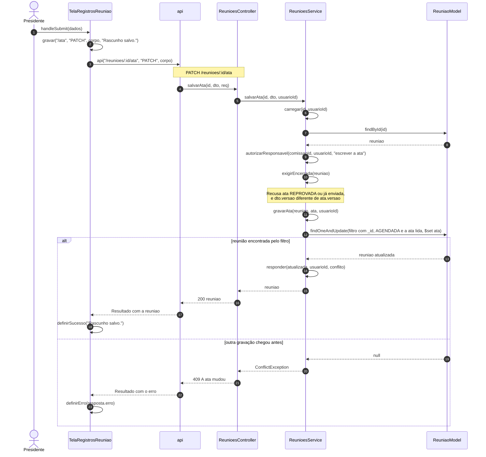
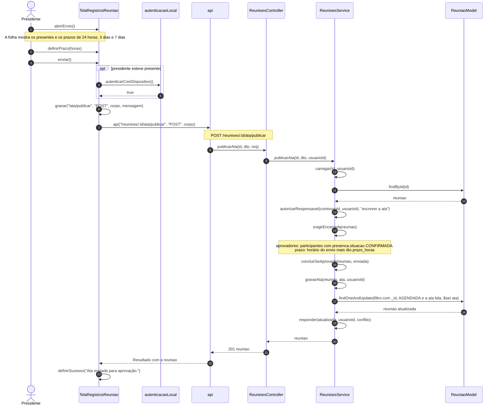
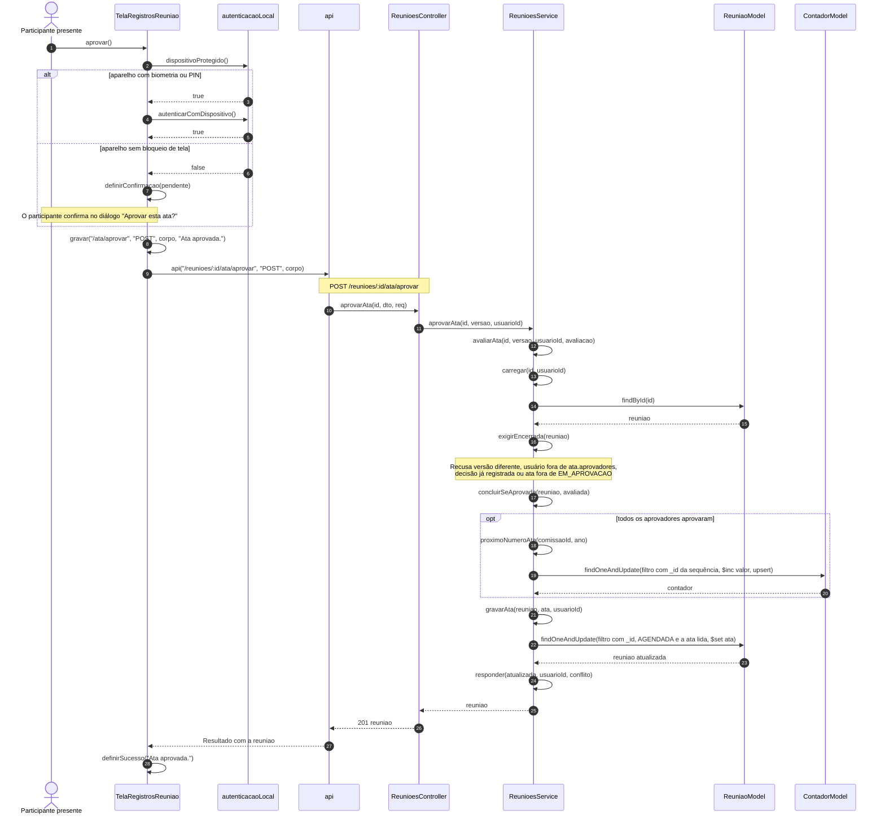
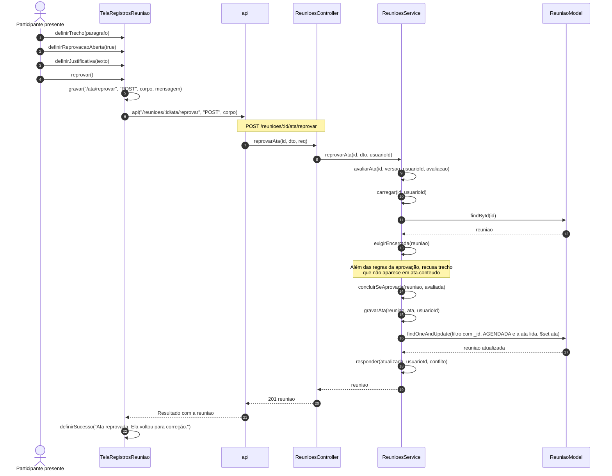
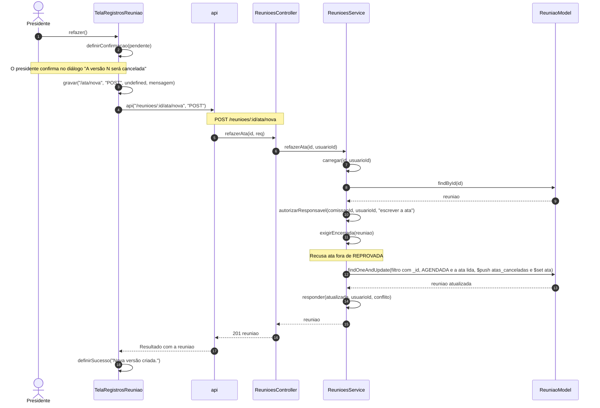
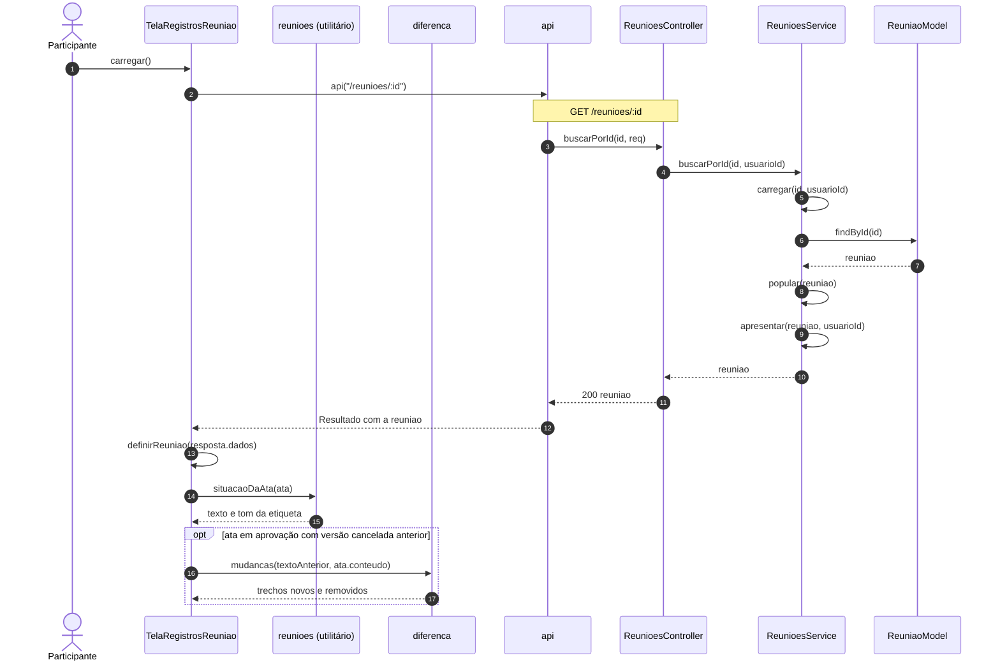
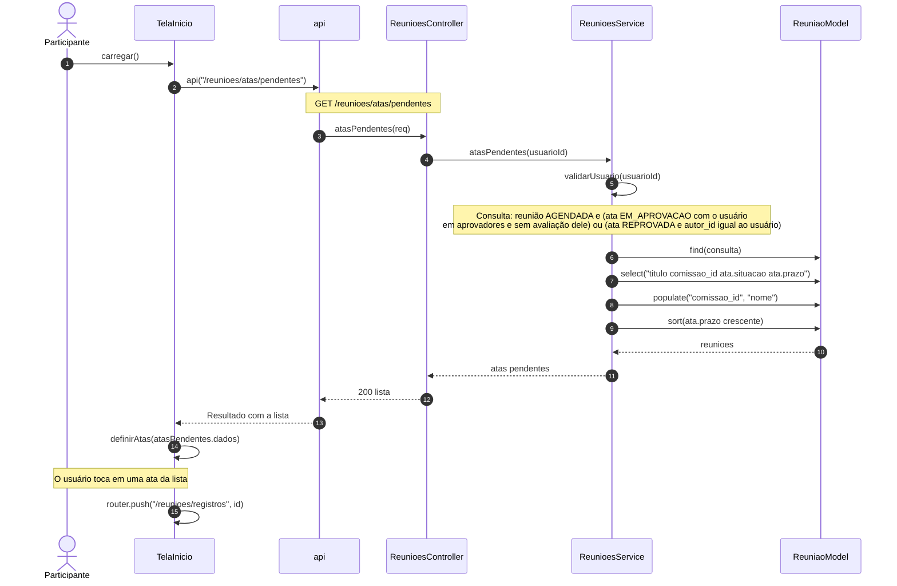
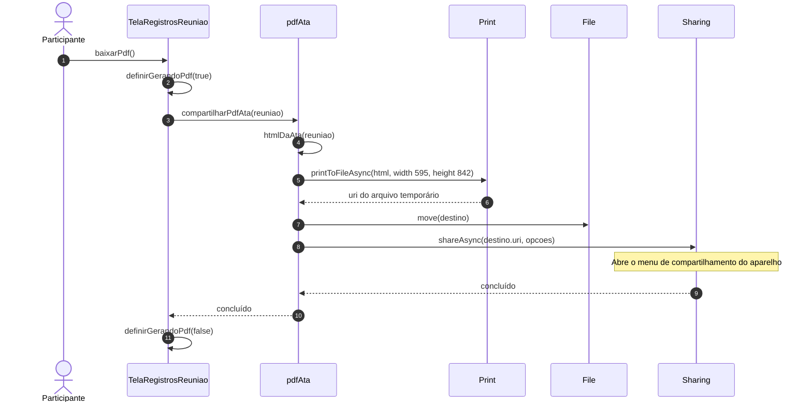

# Diagramas de sequência — Atas de reunião

> Padrão da disciplina · Módulo ATA · Revisado em 10/11/2026

## Resumo

Há um diagrama para cada requisito de [Requisitos funcionais](2%20-%20requisitos-funcionais-atas.md), com o mesmo número. As linhas de vida são classes e módulos que existem no código: as telas do aplicativo, o módulo `api`, o `ReunioesController`, o `ReunioesService` e os models do Mongoose. Toda mensagem é a chamada de um método existente, com seus parâmetros, e as mensagens são numeradas na ordem em que acontecem. Regras que não são métodos, como comparações de versão, aparecem em notas.

Em todos os diagramas, a chamada do módulo `api` ao controller é uma requisição HTTP que passa antes por `ApiKeyGuard`, `JwtAuthGuard` e `UsuarioComumGuard`; a rota está indicada na nota.

## SD-ATA-01 — Salvar rascunho da ata

## SD-ATA-02 — Enviar ata para aprovação

## SD-ATA-03 — Aprovar ata

## SD-ATA-04 — Reprovar ata

## SD-ATA-05 — Criar nova versão da ata

## SD-ATA-06 — Consultar ata

## SD-ATA-07 — Ver atas pendentes

## SD-ATA-08 — Gerar PDF da ata

## Rastreabilidade

SD-ATA-01 a SD-ATA-08 correspondem, na mesma ordem, a UC-ATA-01 a UC-ATA-08 e a RF-ATA-01 a RF-ATA-08.
