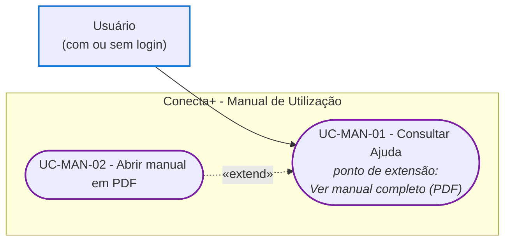

# Diagrama de Casos de Uso - Manual de Utilização (R4)

Este documento apresenta o ator e os casos de uso do requisito R4 do Incremento 3: o manual digital que orienta os usuários sobre como utilizar o sistema. O manual tem duas partes: a tela Ajuda, dentro do aplicativo, e o manual completo em PDF, que é aberto a partir dela.

---

## Ator

**Usuário:** qualquer pessoa que use o aplicativo, com ou sem login. A tela Ajuda fica fora das rotas protegidas (`src/app/_layout.tsx`). Por isso, quem não fez login a abre pelo link "Precisa de ajuda?" da tela Entrar, e quem fez login a abre pelo avatar, em Perfil → Suporte → Ajuda. Todos veem o mesmo conteúdo. O selo "Responsável" só indica que a pergunta trata de uma ação exclusiva do responsável da comissão; ele não esconde nem filtra perguntas.

---

## Visão Geral

### Casos de uso

| ID | Caso de uso | Ator | Resultado |
|---|---|---|---|
| UC-MAN-01 | Consultar Ajuda | Usuário | O usuário lê as perguntas frequentes por assunto. Ele pode abrir e fechar as respostas e buscar por palavra. |
| UC-MAN-02 | Abrir manual em PDF | Usuário | O manual completo, publicado na pasta `4 - Incremento3/manual-de-utilizacao/manual-usuario/` do repositório DOCUMENTATION, é aberto fora do aplicativo. |

---

## Relação entre os casos de uso: «extend»

"Abrir manual em PDF" **estende** "Consultar Ajuda". Não é **incluído** por ela. Os motivos:

1. **É opcional.** Uma inclusão («include») acontece toda vez que o caso base é executado. Aqui, o usuário pode consultar a Ajuda, achar a resposta e sair sem nunca abrir o PDF. "Consultar Ajuda" está completo sem o UC-MAN-02.
2. **Acontece em um ponto específico e depende de uma decisão do usuário.** O UC-MAN-02 só começa quando o usuário toca no botão "Ver manual completo (PDF)", no fim da tela Ajuda (`src/app/ajuda.tsx`). Esse botão é o ponto de extensão.
3. **Tem uma condição.** O botão só aparece quando a constante `URL_MANUAL_PDF` está preenchida (`src/constants/ajuda.ts`). Se ela estiver vazia, a extensão não está disponível, e a Ajuda continua funcionando.
4. **A seta aponta para o caso base.** No «extend», a seta sai do caso que estende (UC-MAN-02) e aponta para o caso estendido (UC-MAN-01). O UC-MAN-01 não depende do UC-MAN-02 nem o conhece.

O UC-MAN-02 também não é um caso de uso independente ligado direto ao ator. No aplicativo não há outro caminho até o PDF: ele só pode ser aberto de dentro da Ajuda.

| Elemento | Valor |
|---|---|
| Caso base | UC-MAN-01 - Consultar Ajuda |
| Caso que estende | UC-MAN-02 - Abrir manual em PDF |
| Ponto de extensão | Botão "Ver manual completo (PDF)", no fim da tela Ajuda |
| Condição | `URL_MANUAL_PDF` preenchida e o usuário toca no botão |

---

## Limitações conhecidas

- O UC-MAN-02 abre a página do arquivo no GitHub, que mostra o PDF no visualizador do site. Para baixá-lo, o usuário toca no botão de download do próprio GitHub.
- Se o link não abrir, o aplicativo não mostra mensagem nenhuma: o erro de `Linking.openURL` é ignorado (`src/app/ajuda.tsx`).
