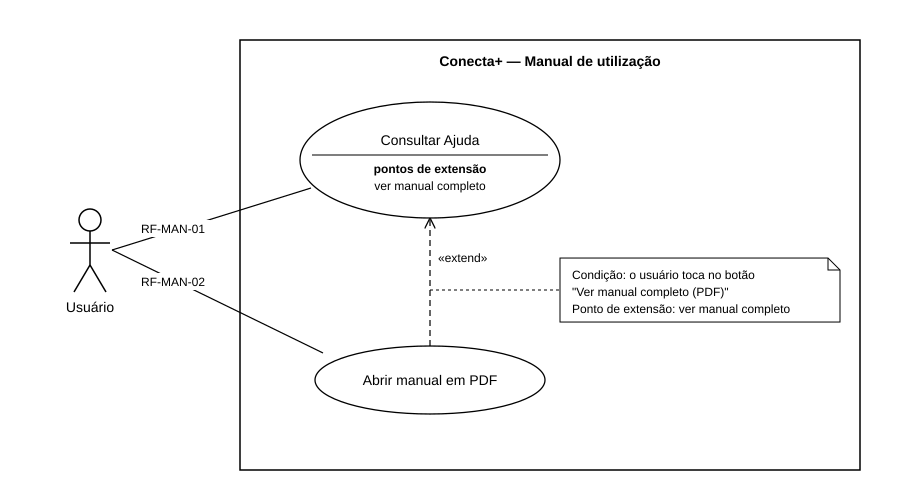

# Casos de uso — Manual de utilização

> Padrão da disciplina · Módulo MAN · Requisito R4 do Incremento 3 · Revisado em 13/11/2026

## Resumo

Este documento mostra quem usa o manual de utilização do Conecta+ e o que essa pessoa pode fazer. O manual tem duas partes: a tela Ajuda, dentro do aplicativo, e o manual completo em PDF, aberto a partir dela. Cada caso de uso é descrito em detalhe, como requisito funcional no formulário padrão, em [Requisitos funcionais](2%20-%20requisitos-funcionais-manual-de-utilizacao.md).

## Diagrama de casos de uso

Figura 1 — Diagrama de casos de uso do manual de utilização. Fonte: equipe Conecta+.

A linha entre o ator e o caso de uso leva o código do requisito funcional que o descreve. O caso de uso "Abrir manual em PDF" não tem linha própria com o ator porque só pode ser iniciado de dentro de "Consultar Ajuda"; o código do seu requisito aparece abaixo dele.

## Atores

**Usuário.** É qualquer pessoa que usa o aplicativo, tenha ou não entrado na conta. O papel dele neste módulo é consultar: ler as perguntas frequentes, abrir e fechar as respostas, buscar uma pergunta por palavra e abrir o manual completo em PDF. Quem ainda não entrou na conta chega à Ajuda pelo link "Precisa de ajuda?" da tela Entrar; quem já entrou chega tocando no avatar e depois em Ajuda, na seção Suporte do Perfil.

O usuário não pode alterar, incluir nem apagar perguntas, e não pode trocar o arquivo do manual: o conteúdo é o mesmo para todos e só muda quando a equipe publica uma nova versão.

Não existe um segundo ator. O membro, o responsável pela comissão e o administrador veem exatamente as mesmas perguntas. O selo "Responsável", exibido em 9 das 42 perguntas, apenas avisa que aquela pergunta trata de uma ação que só o responsável pela comissão consegue fazer no aplicativo; ele não esconde a pergunta de ninguém.

## Relacionamentos entre casos de uso

**«extend» de Abrir manual em PDF para Consultar Ajuda.** Abrir o manual é uma opção que aparece dentro da consulta à Ajuda. A relação é de extensão, e não de inclusão, pelos motivos abaixo:

1. **É opcional.** Uma inclusão acontece toda vez que o caso de uso base é executado. Aqui, o usuário pode consultar a Ajuda, achar a resposta e sair sem nunca abrir o PDF. "Consultar Ajuda" está completo sem "Abrir manual em PDF".
2. **Acontece em um ponto definido e depende de uma decisão do usuário.** O manual só é aberto quando o usuário toca no botão "Ver manual completo (PDF)", no fim da tela Ajuda. Esse botão é o ponto de extensão.
3. **Tem uma condição.** O botão só é exibido quando o endereço do manual está cadastrado no aplicativo. Sem o endereço, a extensão não fica disponível, e a Ajuda continua funcionando.
4. **A seta aponta para o caso de uso base.** Na extensão, a seta sai do caso de uso que estende (Abrir manual em PDF) e aponta para o caso de uso estendido (Consultar Ajuda), que não depende do outro.

| Elemento | Valor |
| --- | --- |
| Caso de uso base | UC-MAN-01 — Consultar Ajuda |
| Caso de uso que estende | UC-MAN-02 — Abrir manual em PDF |
| Ponto de extensão | Botão "Ver manual completo (PDF)", no fim da tela Ajuda |
| Condição | O endereço do manual está cadastrado e o usuário toca no botão |

## Requisitos funcionais de usuário

| Caso de uso | Requisito | Nome | Ator principal |
| --- | --- | --- | --- |
| UC-MAN-01 | RF-MAN-01 | Consultar Ajuda | Usuário |
| UC-MAN-02 | RF-MAN-02 | Abrir manual em PDF | Usuário |

**Requisito RF-MAN-01 — Consultar Ajuda.** O sistema deve permitir a qualquer usuário, mesmo sem entrar na conta e sem internet, ler perguntas frequentes sobre o uso do aplicativo, organizadas por assunto, abrir e fechar cada resposta e buscar uma pergunta por palavra.

**Requisito RF-MAN-02 — Abrir manual em PDF.** O sistema deve permitir ao usuário que está na tela Ajuda abrir o manual completo do aplicativo, em PDF, fora do aplicativo.

## Limitações conhecidas

- O manual é aberto na página do arquivo no site GitHub, que o mostra no visualizador do próprio site. Para guardar o arquivo no aparelho, o usuário usa o botão de download do site.
- Abrir o manual exige internet. Se o aparelho estiver sem conexão ou se nenhum aplicativo do aparelho conseguir abrir o endereço, o Conecta+ não mostra nenhum aviso: quem informa a falha é o navegador.
