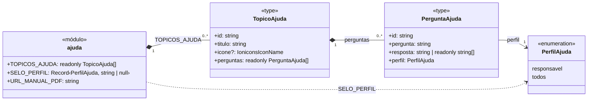
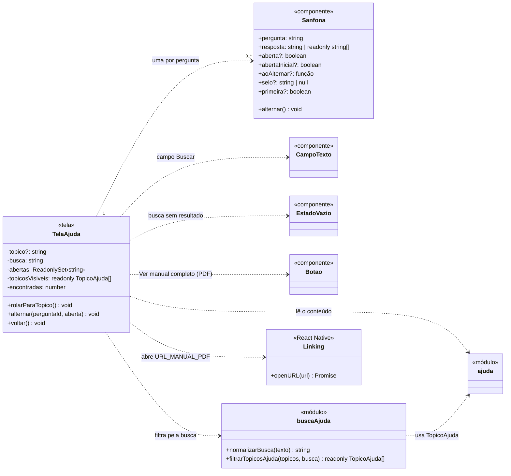

# Diagrama de Classes - Manual de Utilização (R4)

O conteúdo da Ajuda é estático: ele é escrito no próprio aplicativo, em `src/constants/ajuda.ts`, e não vem do servidor. Por isso o R4 não tem classes de dados no banco, controllers, services nem rotas da API. O diagrama está dividido em duas partes. A primeira mostra a estrutura do conteúdo, como está declarada em `ajuda.ts`. A segunda mostra as classes do aplicativo que leem esse conteúdo e o apresentam.

Os tipos são do TypeScript, como estão no código. `readonly T[]` é uma lista que não pode ser alterada, e `?` indica um campo opcional.

---

## 1. Estrutura do Conteúdo da Ajuda

A relação entre `TopicoAjuda` e `PerguntaAjuda` é uma composição, porque uma pergunta só existe dentro da lista `perguntas` do seu tópico. A multiplicidade `0..*` é a que o tipo `readonly PerguntaAjuda[]` permite. No conteúdo atual, cada tópico tem de 4 a 7 perguntas.

---

## 2. Classes do Aplicativo

| Classe no diagrama | Arquivo |
|---|---|
| `ajuda` | `src/constants/ajuda.ts` |
| `TelaAjuda` | `src/app/ajuda.tsx` |
| `Sanfona` | `src/components/Sanfona.tsx` |
| `CampoTexto`, `EstadoVazio`, `Botao` | `src/components/CampoTexto.tsx`, `EstadoVazio.tsx`, `Botao.tsx` |
| `buscaAjuda` | `src/utils/busca-ajuda.ts` (o hífen foi retirado do nome porque o diagrama não o aceita) |
| `Linking` | biblioteca `react-native` |

Os componentes `CampoTexto`, `EstadoVazio` e `Botao` são compartilhados com outras telas e não foram criados para o R4. Por isso aparecem sem atributos.
