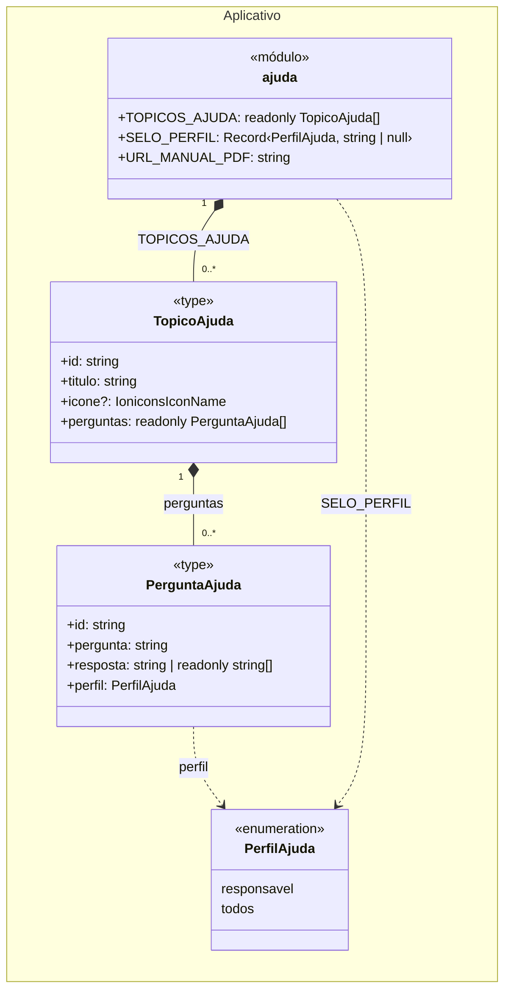
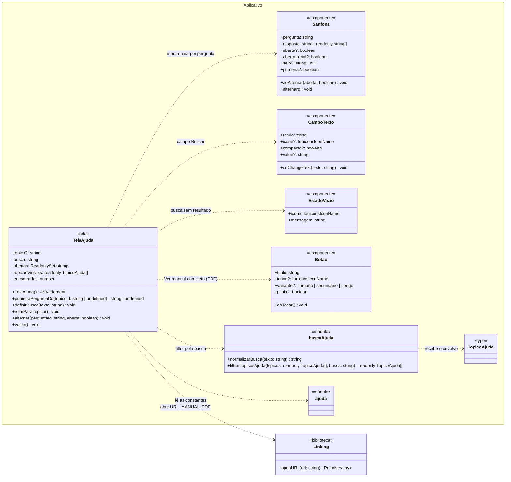

# Diagrama de classes — Manual de utilização

> Padrão da disciplina · Módulo MAN · Revisado em 13/11/2026

## Resumo

O conteúdo da Ajuda é estático: ele é escrito no próprio aplicativo, em `src/constants/ajuda.ts`, e não vem do servidor. Por isso o R4 só tem classes no pacote **Aplicativo**; os pacotes **API** e **Dados**, usados nos outros módulos, ficam vazios, porque não há controller, service, rota nem documento no banco. Cada atributo traz o seu tipo, e cada método traz o tipo dos parâmetros e do retorno. Toda classe e todo método do diagrama existem no código, e são os mesmos chamados nos [Diagramas de sequência](6%20-%20diagramas-sequencia-manual-de-utilizacao.md).

Os tipos são os do TypeScript. `readonly T[]` é uma lista que não pode ser alterada, e `?` indica um campo opcional.

## Diagrama

O diagrama está dividido em duas partes para que nenhuma linha passe por cima de uma classe. A primeira mostra a estrutura do conteúdo, como está declarada em `src/constants/ajuda.ts`. A segunda mostra a tela e os componentes que leem esse conteúdo e o apresentam; nela, `ajuda` e `TopicoAjuda` aparecem só com o nome, porque já estão detalhados na primeira.

### 1. Conteúdo da Ajuda

### 2. Tela e componentes

## Como ler as ligações

| Ligação | Significado | Exemplo no diagrama |
| --- | --- | --- |
| Losango cheio (composição) | A parte só existe dentro do todo e some junto com ele. | `TopicoAjuda *-- PerguntaAjuda`: a pergunta é escrita dentro da lista `perguntas` do seu tópico e não existe fora dela. |
| Seta tracejada (dependência) | Uma classe usa a outra em uma chamada, sem guardá-la como atributo. | `TelaAjuda ..> buscaAjuda`: a tela chama `filtrarTopicosAjuda` a cada mudança da busca. |

Os números nas pontas das composições são as multiplicidades: o módulo `ajuda` tem uma lista com qualquer quantidade de tópicos (hoje, 7), e cada tópico tem qualquer quantidade de perguntas (hoje, de 4 a 7). A multiplicidade `0..*` é a que os tipos `readonly TopicoAjuda[]` e `readonly PerguntaAjuda[]` permitem.

Este módulo não tem associação (seta cheia) nem herança (triângulo vazio): nenhuma classe guarda o identificador de um documento de outra coleção, e nenhuma classe estende outra.

## Onde está cada classe

| Classe no diagrama | Arquivo | Observação |
| --- | --- | --- |
| `TelaAjuda` | `src/app/ajuda.tsx` | `primeiraPerguntaDo` é uma função do mesmo arquivo, declarada fora do componente. `definirBusca` é a função que altera o estado `busca`. |
| `Sanfona` | `src/components/Sanfona.tsx` | Criada para o R4. |
| `CampoTexto`, `EstadoVazio`, `Botao` | `src/components/CampoTexto.tsx`, `EstadoVazio.tsx`, `Botao.tsx` | Compartilhados com outras telas. O diagrama mostra só as propriedades usadas pela tela Ajuda. |
| `buscaAjuda` | `src/utils/busca-ajuda.ts` | O hífen foi retirado do nome porque o diagrama não o aceita. |
| `ajuda`, `TopicoAjuda`, `PerguntaAjuda`, `PerfilAjuda` | `src/constants/ajuda.ts` | `PerfilAjuda` é declarado como o tipo `'responsavel' \| 'todos'`; aparece como enumeração porque só aceita esses dois valores. |
| `Linking` | biblioteca `react-native` | Fica fora do pacote Aplicativo porque não é código do projeto. |

## Rastreabilidade

| Requisito | Classes envolvidas |
| --- | --- |
| RF-MAN-01 — Consultar Ajuda | `TelaAjuda`, `ajuda`, `TopicoAjuda`, `PerguntaAjuda`, `PerfilAjuda`, `buscaAjuda`, `Sanfona`, `CampoTexto`, `EstadoVazio` |
| RF-MAN-02 — Abrir manual em PDF | `TelaAjuda`, `ajuda` (`URL_MANUAL_PDF`), `Botao`, `Linking` |
