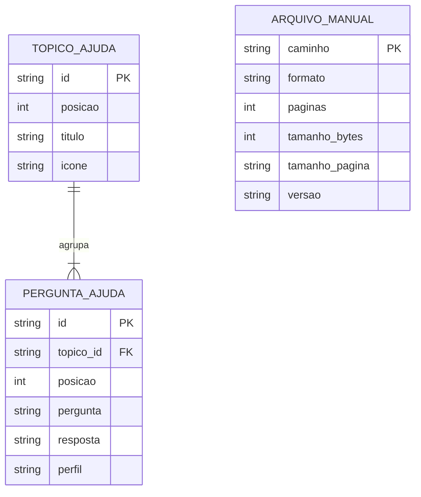

# Diagrama relacional — Manual de utilização

> Padrão da disciplina · Módulo MAN · Visão lógica do conteúdo guardado no aplicativo · Revisado em 26/11/2026

## Resumo

O R4 não lê nem grava dados em banco: não há coleção do MongoDB, rota da API nem dado salvo no aparelho. O conteúdo que ele mostra é fixo e faz parte do pacote do aplicativo: as perguntas da Ajuda, declaradas na constante `TOPICOS_AJUDA` de `src/constants/ajuda.ts`, e o arquivo do manual, `assets/manual/manual.pdf`. O diagrama abaixo é uma **visão lógica** desse conteúdo, como se fosse um banco, para deixar claras as chaves, as cardinalidades e as regras que quem escreve o conteúdo precisa seguir. O texto diz onde cada entidade fica de verdade.

## Diagrama

Figura 5 — Visão lógica do conteúdo do manual de utilização. Fonte: equipe Conecta+.

`ARQUIVO_MANUAL` não se liga às outras entidades: o manual não é dividido em perguntas, e o botão que o abre fica na tela Ajuda, não num tópico.

## Como as entidades lógicas viram dados

| Entidade lógica  | Onde fica de verdade                                                                 | Observação                                                                                                    |
| ---------------- | ------------------------------------------------------------------------------------ | ------------------------------------------------------------------------------------------------------------- |
| `TOPICO_AJUDA`   | Cada objeto da lista `TOPICOS_AJUDA`, em `src/constants/ajuda.ts`                     | `posicao` não é gravada: é a posição do objeto na lista, que define a ordem na tela.                         |
| `PERGUNTA_AJUDA` | Cada objeto da lista `perguntas` de um tópico                                         | `topico_id` não é gravado: a pergunta está dentro do tópico. `posicao` é a posição na lista `perguntas`.      |
| `ARQUIVO_MANUAL` | Arquivo `assets/manual/manual.pdf` do FRONTEND, com cópia em `manual-usuario/Manual-do-Usuario-Conecta.pdf` desta pasta | Entra no pacote do aplicativo como recurso; os atributos vêm das propriedades do arquivo.       |

| Dado                                   | Onde fica                                                    | Persistência em banco |
| -------------------------------------- | ------------------------------------------------------------ | --------------------- |
| Texto do selo "Responsável"            | `SELO_PERFIL`, em `src/constants/ajuda.ts`                   | Nenhuma               |
| Perguntas abertas e texto da busca     | Estado da tela `src/app/ajuda.tsx`, descartado ao sair       | Nenhuma               |
| Página HTML montada para mostrar o PDF | Memória do aplicativo, uma por cor de fundo, até ele fechar  | Nenhuma               |

As coleções do sistema (`usuarios`, `organizacoes`, `comissoes`, `reunioes`, `notificacoes` e `contadores`) pertencem aos outros módulos e não são usadas pelo R4.

## Regras de integridade

- o `id` de um tópico não se repete entre os tópicos, e o `id` de uma pergunta não se repete no arquivo inteiro;
- toda pergunta pertence a exatamente um tópico, e todo tópico tem ao menos uma pergunta;
- o tópico `conta` precisa existir com esse `id`, porque a tela Entrar abre a Ajuda nele;
- `perfil` só aceita `responsavel` ou `todos`;
- `ARQUIVO_MANUAL` tem páginas A4 e é o mesmo arquivo nas duas pastas.

Nenhuma dessas regras é conferida por banco: as três primeiras são conferidas por quem revisa `src/constants/ajuda.ts`; a quarta, pelo compilador TypeScript; a última, pela comparação dos arquivos registrada em [Testes](7%20-%20testes-manual-de-utilizacao.md).

## Rastreabilidade

RF-MAN-01 e RF-MAN-02; detalhado em [Dicionário relacional](4%20-%20dicionario-dados-relacional-manual-de-utilizacao.md).
