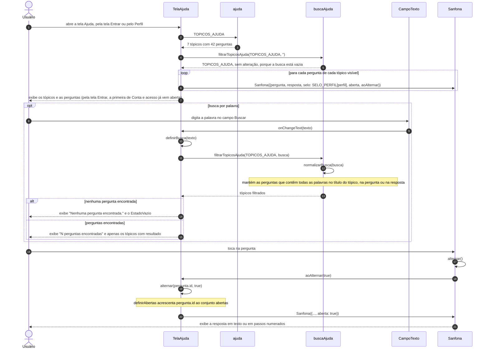
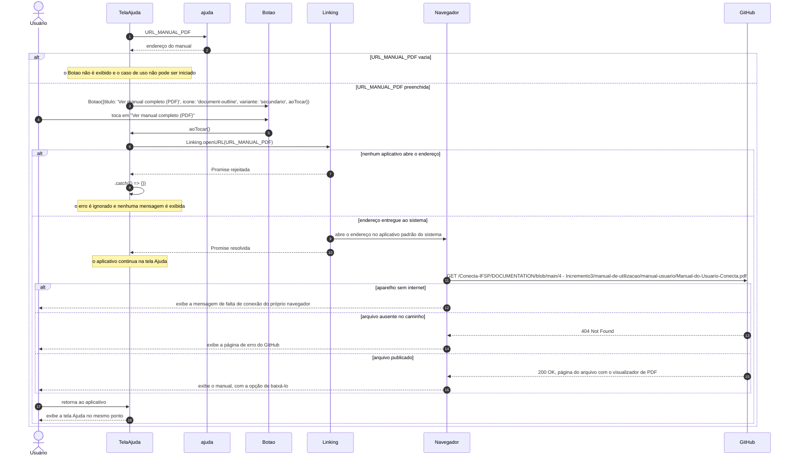

# Diagramas de Sequência - Manual de Utilização (R4)

Os participantes de cada diagrama são as telas, os componentes e os módulos do aplicativo, e as mensagens são as chamadas de funções entre eles. A tela Ajuda não envia requisições à API do Conecta+. Por isso, nenhum diagrama tem guards, controllers, services ou models: o conteúdo é lido de `TOPICOS_AJUDA`, no próprio aplicativo, e o manual em PDF é obtido pelo navegador diretamente do GitHub. As notas descrevem o processamento feito dentro de uma função.

| Participante | Origem |
|---|---|
| `TelaAjuda` | `src/app/ajuda.tsx` |
| `ajuda` | `src/constants/ajuda.ts` (`TOPICOS_AJUDA`, `SELO_PERFIL`, `URL_MANUAL_PDF`) |
| `buscaAjuda` | `src/utils/busca-ajuda.ts` (`filtrarTopicosAjuda`, `normalizarBusca`) |
| `CampoTexto` | `src/components/CampoTexto.tsx` |
| `Sanfona` | `src/components/Sanfona.tsx` |
| `Botao` | `src/components/Botao.tsx` |
| `Linking` | biblioteca `react-native` |
| Navegador | navegador ou leitor de PDF padrão do aparelho |
| GitHub | Pasta `4 - Incremento3/manual-de-utilizacao/manual-usuario/` do repositório `Conecta-IFSP/DOCUMENTATION`, branch `main` |

---

## SD-MAN-01 - Consultar Ajuda (RF-MAN-01)

Para fechar a resposta, o usuário toca de novo na pergunta. A sequência a partir do passo "toca na pergunta" se repete com `aoAlternar(false)` e `alternar(pergunta.id, false)`, que retira `pergunta.id` do conjunto `abertas`.

---

## SD-MAN-02 - Abrir manual em PDF (RF-MAN-02)

O aplicativo não verifica a conexão nem o resultado da abertura do arquivo: depois de `Linking.openURL`, o carregamento do PDF fica a cargo do navegador. No Android, o endereço é entregue ao sistema como uma intenção de visualização; no iOS, é aberto pelo sistema no Safari ou no aplicativo associado a PDFs.
