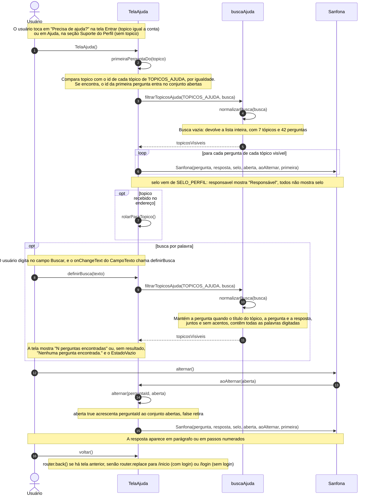
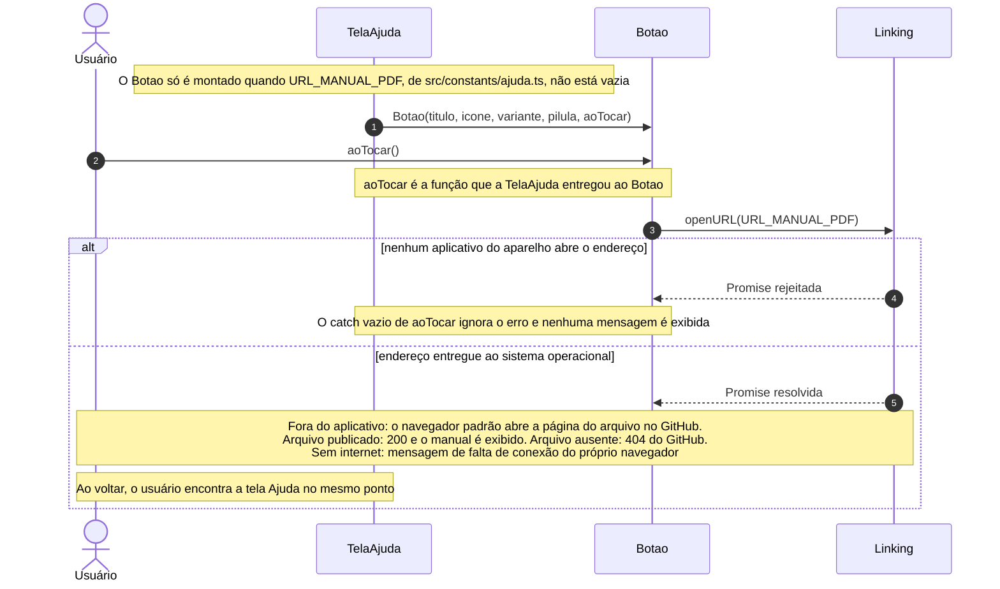

# Diagramas de sequência — Manual de utilização

> Padrão da disciplina · Módulo MAN · Revisado em 13/11/2026

## Resumo

Há um diagrama para cada requisito de [Requisitos funcionais](2%20-%20requisitos-funcionais-manual-de-utilizacao.md), com o mesmo número. As linhas de vida são telas, componentes e módulos que existem no código do aplicativo. Toda mensagem é a chamada de uma função existente, com seus parâmetros, e as mensagens são numeradas na ordem em que acontecem. O que não é uma função, como a leitura de uma constante, uma regra de comparação ou o que o navegador faz fora do aplicativo, aparece em notas. Todas as funções chamadas estão no [Diagrama de classes](3%20-%20diagrama-classes-manual-de-utilizacao.md), com os tipos dos parâmetros e do retorno.

A tela Ajuda não envia requisições à API do Conecta+. Por isso nenhum diagrama tem `api`, guards, controller, service ou model.

| Linha de vida | Origem no código |
| --- | --- |
| `TelaAjuda` | `src/app/ajuda.tsx` (`TelaAjuda`, `primeiraPerguntaDo`, `definirBusca`, `rolarParaTopico`, `alternar` e `voltar`) |
| `buscaAjuda` | `src/utils/busca-ajuda.ts` (`filtrarTopicosAjuda` e `normalizarBusca`) |
| `Sanfona` | `src/components/Sanfona.tsx` (`alternar` e a propriedade `aoAlternar`) |
| `Botao` | `src/components/Botao.tsx` (propriedade `aoTocar`) |
| `Linking` | biblioteca `react-native` (`openURL`) |

## SD-MAN-01 — Consultar Ajuda

Para fechar a resposta, o usuário toca de novo na pergunta: as mensagens a partir de `alternar()` se repetem com `aberta` igual a `false`.

## SD-MAN-02 — Abrir manual em PDF

O aplicativo não verifica a conexão nem o resultado do carregamento: depois de `openURL`, tudo fica a cargo do navegador, que busca o endereço `https://github.com/Conecta-IFSP/DOCUMENTATION/blob/main/4%20-%20Incremento3/manual-de-utilizacao/manual-usuario/Manual-do-Usuario-Conecta.pdf`.

## Rastreabilidade

SD-MAN-01 e SD-MAN-02 correspondem, na mesma ordem, a UC-MAN-01 e UC-MAN-02 e a RF-MAN-01 e RF-MAN-02.
