# Diagrama de classes — Relatório individual

> Padrão da disciplina · Módulo REL · Revisado em 26/11/2026

## Resumo

O diagrama mostra as classes que participam do relatório individual, agrupadas em três pacotes, um por camada do sistema: **Aplicativo** (tela, módulos, tipos do aplicativo e as bibliotecas do Expo e do navegador chamadas pela exportação), **API** (guards, controller, service e objeto de entrada) e **Dados** (documentos do MongoDB lidos pelo relatório). Cada atributo traz o seu tipo, e cada método traz o tipo dos parâmetros e do retorno. Toda classe e todo método do diagrama existem no código ou nas bibliotecas que ele chama; os módulos sem classe, como `api` e `relatorioIndividual`, aparecem com o estereótipo `<<module>>`, e os tipos TypeScript com `<<type>>`.

## Diagrama

```mermaid
classDiagram
    direction LR

    namespace Aplicativo {
        class TelaRelatorioIndividual {
            -periodo: PeriodoRelatorio
            -relatorio: RelatorioIndividual | null
            -carregando: boolean
            -erro: string
            -erroExportacao: string
            -exportando: pdf | csv | null
            -pedido: RefObject~number~
            -travaExportacao: RefObject~boolean~
            +carregar() Promise~void~
            +exportar(formato: pdf | csv) Promise~void~
            -definirPeriodo(valor: PeriodoRelatorio) void
            -definirCarregando(valor: boolean) void
            -definirRelatorio(valor: RelatorioIndividual | null) void
            -definirErro(valor: string) void
            -definirErroExportacao(valor: string) void
            -definirExportando(valor: pdf | csv | null) void
        }
        class api {
            <<module>>
            +api(caminho: string, metodo: string, corpo: unknown) Promise~Resultado~
            +removerToken() Promise~void~
        }
        class relatorioIndividual {
            <<module>>
            +consultaRelatorio(periodo: PeriodoRelatorio, agora: Date) string
            +horasRelatorio(minutos: number) string
            +dataRelatorio(data: string | null) string
            +periodoRelatorio(relatorio: RelatorioIndividual) string
            +htmlRelatorioIndividual(r: RelatorioIndividual, logo: string) string
            +celulaCsv(valor: string | number | null) string
            +csvRelatorioIndividual(r: RelatorioIndividual) string
            -escapar(texto: string) string
        }
        class exportarRelatorioIndividual {
            <<module>>
            +exportarRelatorioIndividual(relatorio: RelatorioIndividual, formato: pdf | csv) Promise~void~
            -logoDoRelatorio() Promise~string~
            -imprimirRelatorioWeb(relatorio: RelatorioIndividual) Promise~void~
        }
        class pdf {
            <<module>>
            +pdfPelaImpressao() boolean
        }
        class Print {
            <<expo-print>>
            +printAsync(opcoes: PrintOptions) Promise~void~
            +printToFileAsync(opcoes: FilePrintOptions) Promise~FilePrintResult~
        }
        class Sharing {
            <<expo-sharing>>
            +isAvailableAsync() Promise~boolean~
            +shareAsync(url: string, opcoes: SharingOptions) Promise~void~
        }
        class File {
            <<expo-file-system>>
            +uri: string
            +File(...uris: string[])
            +create() void
            +write(conteudo: string) Promise~void~
            +base64() Promise~string~
        }
        class window {
            <<navegador>>
            +document: Document
            +URL: URL
            +open(url: string, alvo: string) Window | null
            +focus() void
            +print() void
            +close() void
        }
        class RelatorioIndividual {
            <<type>>
            +usuario.nome: string
            +usuario.email: string
            +vinculos?.organizacoes[].id: string
            +vinculos?.organizacoes[].nome: string
            +vinculos?.organizacoes[].papel: ADMIN | MEMBRO
            +vinculos?.comissoes[].id: string
            +vinculos?.comissoes[].nome: string
            +vinculos?.comissoes[].organizacao_id: string
            +vinculos?.comissoes[].organizacao: string
            +vinculos?.comissoes[].papel: RESPONSAVEL | MEMBRO
            +gerada_em: string
            +periodo.de: string | null
            +periodo.ate: string | null
            +resumo.reunioes: number
            +resumo.minutos_registrados: number
            +resumo.registros_sem_duracao: number
            +reunioes: ParticipacaoIndividual[]
        }
        class ParticipacaoIndividual {
            <<type>>
            +reuniao_id: string
            +titulo: string
            +comissao: string
            +organizacao: string
            +local: string | null
            +inicio: string
            +fim: string
            +dia_inteiro: boolean
            +entrada: string
            +saida: string | null
            +saida_automatica?: boolean
            +minutos: number | null
        }
        class PeriodoRelatorio {
            <<type>>
            todos
            mes
            ano
        }
    }

    namespace API {
        class ApiKeyGuard {
            -configService: ConfigService
            +canActivate(context: ExecutionContext) boolean
        }
        class JwtAuthGuard {
            -jwtService: JwtService
            -usuarios: Model~UsuarioDocument~
            +canActivate(context: ExecutionContext) Promise~boolean~
        }
        class UsuarioComumGuard {
            +canActivate(context: ExecutionContext) boolean
        }
        class RelatoriosController {
            -relatorios: RelatoriosService
            +individual(req: RequisicaoAutenticada, filtros: RelatorioIndividualDto) Promise~RelatorioIndividual~
        }
        class RelatoriosService {
            -reunioes: Model~ReuniaoDocument~
            -usuarios: Model~UsuarioDocument~
            -organizacoes: Model~OrganizacaoDocument~
            -comissoes: Model~ComissaoDocument~
            +individual(usuarioId: string, filtros: RelatorioIndividualDto) Promise~RelatorioIndividual~
        }
        class RelatorioIndividualDto {
            +de?: string
            +ate?: string
        }
    }

    namespace Dados {
        class Usuario {
            +_id: ObjectId
            +nome: string
            +email: string
            +tipo: TipoUsuario
            +ativo: boolean
        }
        class Reuniao {
            +_id: ObjectId
            +comissao_id: ObjectId
            +titulo: string
            +local: string
            +inicio: Date
            +fim: Date
            +dia_inteiro: boolean
            +situacao: SituacaoReuniao
            +participantes: Participante[]
        }
        class Participante {
            +usuario_id: ObjectId
            +convite: RespostaConvite
            +presenca?: Presenca
        }
        class Presenca {
            +entrada: Date
            +saida?: Date
            +saida_automatica?: boolean
            +situacao: SituacaoPresenca
            +marcada_por: OrigemPresenca
        }
        class Organizacao {
            +_id: ObjectId
            +nome: string
            +status: StatusOrganizacao
            +membros: MembroOrganizacao[]
        }
        class MembroOrganizacao {
            +usuario_id: ObjectId
            +papel: PapelOrganizacao
            +status: StatusMembroOrganizacao
        }
        class Comissao {
            +_id: ObjectId
            +nome: string
            +organizacao_id: ObjectId
            +ativo: boolean
            +membros: MembroComissao[]
        }
        class MembroComissao {
            +usuario_id: ObjectId
            +papel: PapelComissao
        }
        class Model {
            <<mongoose>>
            +find(filtro: FilterQuery) Query
            +findById(id: string) Query
            +findOne(filtro: FilterQuery) Query
        }
        class Query {
            <<mongoose>>
            +select(campos: string) Query
            +populate(opcoes: PopulateOptions) Query
            +sort(ordem: object) Query
            +lean() Query
            +exec() Promise~unknown~
        }
        class SituacaoPresenca {
            <<enumeration>>
            AGUARDANDO
            CONFIRMADA
            RECUSADA
        }
        class StatusMembroOrganizacao {
            <<enumeration>>
            PENDENTE
            APROVADO
            REJEITADO
            CONVIDADO
        }
    }

    TelaRelatorioIndividual ..> api : consulta
    TelaRelatorioIndividual ..> relatorioIndividual : formata
    TelaRelatorioIndividual ..> exportarRelatorioIndividual : exporta
    TelaRelatorioIndividual ..> pdf : usa
    TelaRelatorioIndividual ..> RelatorioIndividual : mostra
    exportarRelatorioIndividual ..> relatorioIndividual : monta HTML e CSV
    exportarRelatorioIndividual ..> Print : usa
    exportarRelatorioIndividual ..> Sharing : usa
    exportarRelatorioIndividual ..> File : usa
    exportarRelatorioIndividual ..> window : usa na web
    RelatorioIndividual "1" *-- "0..*" ParticipacaoIndividual : reunioes
    api ..> RelatoriosController : requisição HTTP

    RelatoriosController ..> ApiKeyGuard : protegido por
    RelatoriosController ..> JwtAuthGuard : protegido por
    RelatoriosController ..> UsuarioComumGuard : protegido por
    RelatoriosController --> "1" RelatoriosService : relatorios
    RelatoriosController ..> RelatorioIndividualDto : recebe
    RelatoriosService ..> Usuario : lê
    RelatoriosService ..> Reuniao : lê
    RelatoriosService ..> Organizacao : lê
    RelatoriosService ..> Comissao : lê
    JwtAuthGuard ..> Usuario : confere a conta
    RelatoriosService ..> Model : consulta
    Model ..> Query : devolve

    Reuniao "1" *-- "0..*" Participante : participantes
    Participante "1" *-- "0..1" Presenca : presenca
    Organizacao "1" *-- "0..*" MembroOrganizacao : membros
    Comissao "1" *-- "1..*" MembroComissao : membros
    Participante "0..*" --> "1" Usuario : usuario_id
    MembroOrganizacao "0..*" --> "1" Usuario : usuario_id
    MembroComissao "0..*" --> "1" Usuario : usuario_id
    Reuniao "0..*" --> "1" Comissao : comissao_id
    Comissao "0..*" --> "1" Organizacao : organizacao_id
    Presenca ..> SituacaoPresenca : situacao
    MembroOrganizacao ..> StatusMembroOrganizacao : status
```

Figura 2 — Diagrama de classes do relatório individual, por camada. Fonte: equipe Conecta+.

## Como ler as ligações

| Ligação                      | Significado                                                             | Exemplo no diagrama                                                                                       |
| ---------------------------- | ----------------------------------------------------------------------- | --------------------------------------------------------------------------------------------------------- |
| Losango cheio (composição)   | A parte só existe dentro do todo e é apagada junto com ele.             | `Organizacao *-- MembroOrganizacao`: o vínculo é gravado dentro do documento da organização.              |
| Seta cheia (associação)      | Uma classe guarda uma referência a outra, que existe por conta própria. | `Comissao --> Organizacao`: `organizacao_id` guarda o identificador de um documento de `organizacoes`.    |
| Seta tracejada (dependência) | Uma classe usa a outra em uma chamada, sem guardá-la como atributo.     | `RelatoriosService ..> Comissao`: o serviço só lê as comissões.                                            |

Os números nas pontas são as multiplicidades. Por exemplo, uma `Comissao` tem pelo menos um membro (`1..*`), porque precisa ter exatamente um responsável; um `Participante` tem no máximo uma `Presenca` (`0..1`); e um relatório tem qualquer quantidade de participações (`0..*`), inclusive nenhuma.

`Model` e `Query` são as classes do Mongoose usadas nas leituras: os atributos `usuarios`, `reunioes`, `organizacoes` e `comissoes` do serviço são instâncias de `Model`, e `find`, `findById` e `findOne` devolvem uma `Query`, na qual são chamados `select`, `populate`, `sort`, `lean` e `exec`. Os métodos `definir…` da tela são as funções de atualização de estado criadas por `useState`.

O objeto devolvido pela API não tem classe própria no servidor: o tipo é deduzido pelo TypeScript a partir do que `RelatoriosService.individual` monta. O tipo `RelatorioIndividual` do aplicativo descreve exatamente esse objeto e por isso aparece como retorno do controller e do service. Os campos `usuario`, `vinculos`, `periodo` e `resumo` são objetos escritos dentro do próprio tipo, sem nome; no diagrama, eles aparecem com o caminho do campo, como `usuario.nome` e `vinculos?.organizacoes[].papel`, em que `[]` indica um item da lista. Os valores `pdf | csv` são os dois textos aceitos como formato de exportação. O `?` indica campo opcional: `vinculos` é opcional no aplicativo para que ele funcione com um servidor que ainda não envia vínculos. As enumerações não mostradas (`TipoUsuario`, `SituacaoReuniao`, `RespostaConvite`, `OrigemPresenca`, `StatusOrganizacao`, `PapelOrganizacao` e `PapelComissao`) estão no [dicionário de classes](3%20-%20dicionario-dados-classes-relatorio-individual.md).

## Rotas atendidas pelo controller

As rotas HTTP não são métodos; por isso ficam nesta tabela, e não no diagrama.

| Método do controller | Rota HTTP                              |
| -------------------- | -------------------------------------- |
| `individual`         | `GET /relatorios/individual?de=&ate=`  |

## Regras representadas

- o relatório só lê: nenhuma classe do pacote Dados é gravada por este módulo;
- o usuário do relatório vem sempre do token (`req.usuario.sub`); `RelatorioIndividualDto` não tem campo de usuário;
- `ParticipacaoIndividual` não existe no banco: é calculada a partir de uma `Reuniao` e da `Presenca` do usuário nela;
- os vínculos dependem de `Organizacao.status`, `MembroOrganizacao.status`, `Comissao.ativo` e da presença do usuário em `Comissao.membros`;
- a exportação usa só o objeto já carregado na tela; `Print`, `Sharing` e `File` são usados no celular e `window` na web.

## Rastreabilidade

RF-REL-01 a RF-REL-05; complementado por [Dicionário de classes](3%20-%20dicionario-dados-classes-relatorio-individual.md) e [Diagramas de sequência](6%20-%20diagramas-sequencia-relatorio-individual.md).
