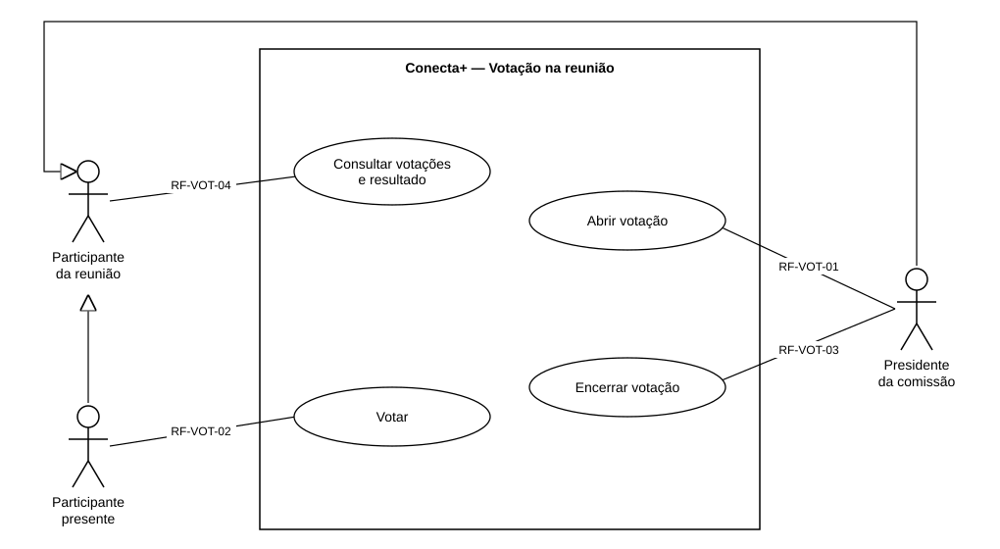

# Casos de uso — Votação na reunião

> Padrão da disciplina · Módulo VOT · Revisado em 13/11/2026

## Resumo

Este documento mostra quem usa a votação e o que cada pessoa pode fazer. Cada caso de uso é descrito em detalhe, como requisito funcional no formulário padrão, em [Requisitos funcionais](2%20-%20requisitos-funcionais-votacao.md).

## Diagrama de casos de uso

Figura 1 — Diagrama de casos de uso da votação. Fonte: equipe Conecta+.

Cada linha entre um ator e um caso de uso leva o código do requisito funcional que o descreve.

## Atores

**Participante da reunião.** É qualquer usuário que consta na lista de participantes da reunião, tenha ele comparecido ou não. Pode abrir a aba "Votações" da reunião, ver as votações abertas e encerradas e, nas encerradas, o resultado por opção. Não pode votar se não estiver presente.

**Participante presente.** É o participante que marcou entrada, cuja presença não foi recusada (`AGUARDANDO` ou `CONFIRMADA`) e que ainda não marcou saída. A seta de generalização indica que ele faz tudo o que o participante da reunião faz e, além disso, vota nas votações abertas. Quem marca saída deixa de votar.

**Presidente da comissão.** É o membro da comissão com papel `RESPONSAVEL`, em uma comissão ativa. Também é um participante da reunião (generalização). Só ele abre e encerra votações. Se marcou entrada, também é um participante presente e vota como os demais.

## Relacionamentos entre casos de uso

- **Generalização entre atores:** participante presente e presidente herdam o caso de uso do participante da reunião (consultar votações e resultado).
- **Encerramento automático:** quando a reunião termina, a votação aberta passa a ser apresentada como encerrada, sem ação de nenhum ator. Isso faz parte de RF-VOT-04, e não de "Encerrar votação", que é sempre uma ação do presidente.

## Requisitos funcionais de usuário

| Caso de uso | Requisito | Nome | Ator principal |
| --- | --- | --- | --- |
| UC-VOT-01 | RF-VOT-01 | Abrir votação | Presidente da comissão |
| UC-VOT-02 | RF-VOT-02 | Votar | Participante presente |
| UC-VOT-03 | RF-VOT-03 | Encerrar votação | Presidente da comissão |
| UC-VOT-04 | RF-VOT-04 | Consultar votações e resultado | Participante da reunião |

**Requisito RF-VOT-01 — Abrir votação.** O sistema deve permitir ao presidente da comissão abrir, enquanto a reunião acontece, uma votação com um assunto, uma descrição opcional e de 2 a 10 opções de voto diferentes entre si.

**Requisito RF-VOT-02 — Votar.** O sistema deve permitir a cada participante presente votar uma única vez em uma das opções de uma votação aberta. O voto não pode ser alterado depois de confirmado.

**Requisito RF-VOT-03 — Encerrar votação.** O sistema deve permitir ao presidente encerrar uma votação aberta. Depois do encerramento, ninguém mais vota e o resultado fica visível.

**Requisito RF-VOT-04 — Consultar votações e resultado.** O sistema deve mostrar a qualquer participante da reunião as votações abertas e encerradas, quantos votos cada uma recebeu e o seu próprio voto. O resultado por opção só aparece depois do encerramento, e ninguém vê em quem as outras pessoas votaram.
