# Diagrama de classes — Votação na reunião

> Padrão da disciplina · Módulo VOT · Revisado em 13/11/2026

## Resumo

O diagrama mostra as classes que participam da votação, agrupadas em três pacotes, um por camada do sistema: **Aplicativo** (tela, componente e módulo de acesso à API), **API** (controller, service e objetos de entrada) e **Dados** (documentos guardados no MongoDB). Cada atributo traz o seu tipo, e cada método traz o tipo dos parâmetros e do retorno. Toda classe e todo método do diagrama existem no código.

## Diagrama

```mermaid
classDiagram
  direction LR

  namespace Aplicativo {
    class TelaReuniao {
      -reuniao: Reuniao
      -aba: Aba
      -presidente: boolean
      -salvando: string
      +buscar() Promise~void~
      +executar(chave: string, acao: function, mensagem: string) Promise~boolean~
    }
    class VotacoesReuniao {
      -formulario: boolean
      -titulo: string
      -descricao: string
      -opcoes: string[]
      -confirmacao: Pendente
      +abrirFormulario() void
      +validar() string
      +enviar() Promise~void~
      +pedirVoto(votacao: VotacaoApresentada, indice: number) void
      +pedirEncerramento(votacao: VotacaoApresentada) void
      +renderizarAberta(votacao: VotacaoApresentada) Element
      +renderizarResultado(votacao: VotacaoApresentada) Element
    }
    class api {
      <<module>>
      +api(caminho: string, metodo: string, corpo: unknown) Promise~Resultado~
    }
  }

  namespace API {
    class ReunioesController {
      -reunioesService: ReunioesService
      +abrirVotacao(id: string, dto: AbrirVotacaoDto, req: RequisicaoAutenticada) Promise~Reuniao~
      +votar(id: string, votacaoId: string, dto: VotarDto, req: RequisicaoAutenticada) Promise~Reuniao~
      +encerrarVotacao(id: string, votacaoId: string, req: RequisicaoAutenticada) Promise~Reuniao~
      +buscarPorId(id: string, req: RequisicaoAutenticada) Promise~Reuniao~
    }
    class ReunioesService {
      -reuniaoModel: Model~Reuniao~
      -comissaoModel: Model~Comissao~
      +abrirVotacao(id: string, dto: AbrirVotacaoDto, usuarioId: string) Promise~Reuniao~
      +votar(id: string, votacaoId: string, opcao: number, usuarioId: string) Promise~Reuniao~
      +encerrarVotacao(id: string, votacaoId: string, usuarioId: string) Promise~Reuniao~
      +buscarPorId(id: string, usuarioId: string) Promise~Reuniao~
      -exigirPresidente(reuniao: Reuniao, usuarioId: string) Promise~void~
      -buscarVotacao(reuniao: Reuniao, votacaoId: string) Votacao
      -apresentarVotacao(votacao: Votacao, fim: Date, usuarioId: string) VotacaoApresentada
      -carregar(id: string, usuarioId: string) Promise~Carga~
      -exigirAgendada(reuniao: Reuniao) void
    }
    class AbrirVotacaoDto {
      +titulo: string
      +descricao: string
      +opcoes: string[]
    }
    class VotarDto {
      +opcao: number
    }
    class VotacaoApresentada {
      <<interface>>
      +_id: ObjectId
      +titulo: string
      +descricao: string
      +opcoes: string[]
      +situacao: SituacaoVotacao
      +aberta_em: Date
      +encerrada_em: Date
      +total_votos: number
      +meu_voto: number
      +resultado: number[]
    }
  }

  namespace Dados {
    class Reuniao {
      +_id: ObjectId
      +comissao_id: ObjectId
      +inicio: Date
      +fim: Date
      +situacao: SituacaoReuniao
      +participantes: Participante[]
      +votacoes: Votacao[]
    }
    class Votacao {
      +_id: ObjectId
      +titulo: string
      +descricao: string
      +opcoes: string[]
      +situacao: SituacaoVotacao
      +aberta_por: ObjectId
      +aberta_em: Date
      +encerrada_em: Date
      +votos: Voto[]
    }
    class Voto {
      +usuario_id: ObjectId
      +opcao: number
      +votado_em: Date
    }
    class Participante {
      +usuario_id: ObjectId
      +convite: RespostaConvite
      +presenca: Presenca
    }
    class Presenca {
      +entrada: Date
      +saida: Date
      +situacao: SituacaoPresenca
    }
    class Comissao {
      +_id: ObjectId
      +ativo: boolean
      +membros: MembroComissao[]
    }
    class Usuario {
      +_id: ObjectId
      +nome: string
      +ativo: boolean
    }
    class SituacaoVotacao {
      <<enumeration>>
      ABERTA
      ENCERRADA
    }
  }

  TelaReuniao *-- VotacoesReuniao : aba Votações
  TelaReuniao ..> api : usa
  VotacoesReuniao ..> api : usa
  api ..> ReunioesController : requisição HTTP

  ReunioesController --> "1" ReunioesService : reunioesService
  ReunioesController ..> AbrirVotacaoDto : recebe
  ReunioesController ..> VotarDto : recebe
  ReunioesService ..> VotacaoApresentada : devolve
  ReunioesService ..> Reuniao : lê e grava
  ReunioesService ..> Comissao : confere o presidente
  ReunioesService ..> Usuario : confere a conta

  Reuniao "1" *-- "0..*" Votacao : votacoes
  Votacao "1" *-- "0..*" Voto : votos
  Reuniao "1" *-- "1..*" Participante : participantes
  Participante "1" *-- "0..1" Presenca : presenca
  Reuniao "0..*" --> "1" Comissao : comissao_id
  Votacao "0..*" --> "1" Usuario : aberta_por
  Voto "0..*" --> "1" Usuario : usuario_id
  Participante "0..*" --> "1" Usuario : usuario_id
  Votacao ..> SituacaoVotacao : situacao
```

Figura 2 — Diagrama de classes da votação, por camada. Fonte: equipe Conecta+.

## Como ler as ligações

| Ligação | Significado | Exemplo no diagrama |
| --- | --- | --- |
| Losango cheio (composição) | A parte só existe dentro do todo e é apagada junto com ele. | `Reuniao *-- Votacao`: a votação é gravada dentro do documento da reunião. `Votacao *-- Voto`: o voto é gravado dentro da votação. |
| Seta cheia (associação) | Uma classe guarda uma referência a outra, que existe por conta própria. | `Voto --> Usuario`: `usuario_id` guarda o identificador de um documento de `usuarios`. |
| Seta tracejada (dependência) | Uma classe usa a outra em uma chamada, sem guardá-la como atributo. | `ReunioesService ..> Comissao`: o serviço lê a comissão para saber quem é o presidente. |

Os números nas pontas são as multiplicidades. Por exemplo, uma `Reuniao` tem qualquer quantidade de votações (`0..*`) e cada `Votacao` tem de nenhum a vários votos (`0..*`), no máximo um por usuário.

`VotacaoApresentada` não é gravada: é o formato que `apresentarVotacao` monta para a resposta da API, sem a lista de votos. Ela aparece como `Votacao` no tipo do aplicativo (`FRONTEND/src/services/api.ts`).

No código, os atributos opcionais são `encerrada_em`, em `Votacao`; `descricao`, em `AbrirVotacaoDto`; e `presenca` e `saida`. A obrigatoriedade de cada um está no [dicionário de classes](3%20-%20dicionario-dados-classes-votacao.md).

## Rotas atendidas pelo controller

As rotas HTTP não são métodos; por isso ficam nesta tabela, e não no diagrama.

| Método do controller | Rota HTTP |
| --- | --- |
| `abrirVotacao` | `POST /reunioes/:id/votacoes` |
| `votar` | `POST /reunioes/:id/votacoes/:votacaoId/votos` |
| `encerrarVotacao` | `POST /reunioes/:id/votacoes/:votacaoId/encerrar` |
| `buscarPorId` | `GET /reunioes/:id` |

## Regras representadas

- `Votacao` e `Voto` não existem fora de `Reuniao`;
- cada usuário tem no máximo um `Voto` por `Votacao`;
- `Voto.opcao` é a posição da opção em `Votacao.opcoes`, começando em 0;
- só o presidente (membro `RESPONSAVEL` da `Comissao` da reunião) abre e encerra votações;
- a lista `votos` nunca sai da API; o aplicativo recebe só o total, o próprio voto e o resultado depois do encerramento;
- o aplicativo nunca decide se a votação está encerrada: ele mostra a situação que a API devolve.

## Rastreabilidade

RF-VOT-01 a RF-VOT-04; complementado por [Dicionário de classes](3%20-%20dicionario-dados-classes-votacao.md) e [Diagramas de sequência](6%20-%20diagramas-sequencia-votacao.md).
