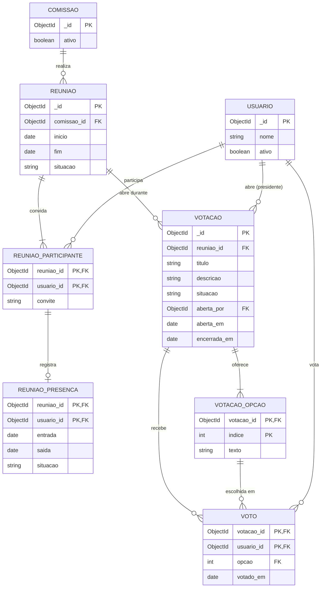

# Diagrama relacional — Votação na reunião

> Padrão da disciplina · Módulo VOT · Visão lógica dos documentos MongoDB · Revisado em 13/11/2026

## Resumo

O banco é o MongoDB, que não tem tabelas: as votações, suas opções e os votos ficam dentro do documento da reunião, na coleção `reunioes`. O diagrama abaixo é uma **visão lógica**: ele separa esses dados em entidades para deixar claras as chaves, as cardinalidades e as restrições. A votação não cria nenhuma coleção nova.

## Diagrama

Figura 3 — Visão lógica relacional da votação. Fonte: equipe Conecta+.

## Como as entidades lógicas viram documentos

| Entidade lógica | Onde fica de verdade | Observação |
| --- | --- | --- |
| `REUNIAO` | coleção `reunioes` | Documento principal. |
| `REUNIAO_PARTICIPANTE` | `reunioes.participantes[]` | Subdocumento; a chave lógica é a reunião mais o usuário. |
| `REUNIAO_PRESENCA` | `reunioes.participantes[].presenca` | Subdocumento de um participante; define quem pode votar. |
| `VOTACAO` | `reunioes.votacoes[]` | Subdocumento com `_id` próprio. `reuniao_id` não é gravado: vem do documento que contém a votação. |
| `VOTACAO_OPCAO` | `reunioes.votacoes[].opcoes[]` | Lista de textos. `indice` não é gravado: é a posição do texto na lista, começando em 0. |
| `VOTO` | `reunioes.votacoes[].votos[]` | Subdocumento sem `_id`. `votacao_id` vem da votação que o contém; `opcao` é o `indice` da opção escolhida. |

## Regras de integridade

- um usuário aparece no máximo uma vez em `VOTO` para cada `VOTACAO`; a gravação só acontece se o filtro `votos.usuario_id` diferente do usuário for verdadeiro no mesmo comando;
- `VOTO.opcao` é sempre menor que a quantidade de `VOTACAO_OPCAO` da votação;
- `VOTO.usuario_id` precisa estar em `REUNIAO_PARTICIPANTE`, com `REUNIAO_PRESENCA.situacao` igual a `AGUARDANDO` ou `CONFIRMADA` e sem `saida`, no instante do voto;
- os textos de `VOTACAO_OPCAO` não se repetem na mesma votação, ignorando maiúsculas e minúsculas;
- `VOTACAO.aberta_por` é membro `RESPONSAVEL` da comissão da reunião no instante da abertura;
- `VOTACAO.aberta_em` fica entre `REUNIAO.inicio` e `REUNIAO.fim`;
- `VOTACAO.encerrada_em` só existe com `situacao = ENCERRADA` e nunca passa de `REUNIAO.fim`;
- nenhum dado de votação é alterado em uma reunião `CANCELADA`.

## Rastreabilidade

RF-VOT-01 a RF-VOT-04; detalhado em [Dicionário relacional](4%20-%20dicionario-dados-relacional-votacao.md).
