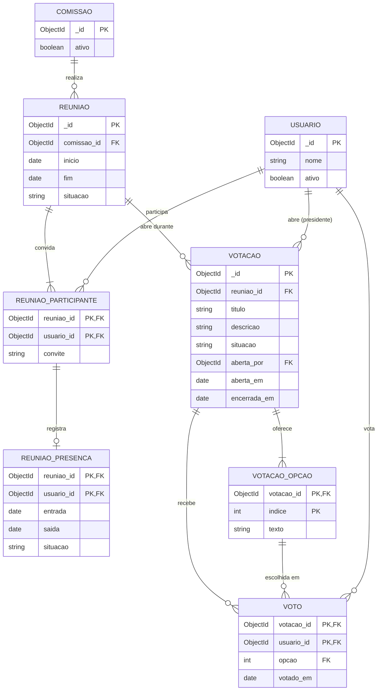

# Diagrama relacional — Votação na reunião

> Padrão da disciplina · Módulo VOT · Visão lógica dos documentos MongoDB · Revisado em 26/11/2026

## Resumo

O banco é o MongoDB, que não tem tabelas: as votações, suas opções e os votos ficam dentro do documento da reunião, na coleção `reunioes`. O diagrama abaixo é uma **visão lógica**: ele separa esses dados em entidades para deixar claras as chaves, as cardinalidades e as restrições. A votação não cria nenhuma coleção nova; ela lê a presença, que pertence ao módulo de [Reuniões](../../3%20-%20Incremento2/reunioes/4%20-%20diagrama-relacional-reunioes.md), para decidir quem vota.

## Diagrama

Figura 3 — Visão lógica relacional da votação. Fonte: equipe Conecta+.

## Como as entidades lógicas viram documentos

| Entidade lógica        | Onde fica de verdade                         | Observação                                                                                               |
| ---------------------- | -------------------------------------------- | -------------------------------------------------------------------------------------------------------- |
| `REUNIAO`              | coleção `reunioes`                           | Documento principal.                                                                                     |
| `REUNIAO_PARTICIPANTE` | `reunioes.participantes[]`                   | Subdocumento; a chave lógica é a reunião mais o usuário.                                                 |
| `REUNIAO_PRESENCA`     | `reunioes.participantes[].presenca`          | Subdocumento de um participante; define quem pode votar.                                                 |
| `VOTACAO`              | `reunioes.votacoes[]`                        | Subdocumento com `_id` próprio. `reuniao_id` não é gravado: vem do documento que contém a votação.       |
| `VOTACAO_OPCAO`        | `reunioes.votacoes[].opcoes[]`               | Lista de textos. `indice` não é gravado: é a posição do texto na lista, começando em 0.                  |
| `VOTO`                 | `reunioes.votacoes[].votos[]`                | Subdocumento sem `_id`. `votacao_id` vem da votação que o contém; `opcao` é o `indice` da opção escolhida. |
| `COMISSAO`, `USUARIO`  | coleções `comissoes` e `usuarios`            | Descritas nos módulos do Incremento 1; aqui só os campos usados.                                         |

## Regras de integridade

- **Voto único.** Cada pessoa vota uma vez em cada votação. O serviço confere isso antes de gravar e, além disso, o comando de gravação só acrescenta o voto se a pessoa ainda não estiver na lista de votos daquela votação; assim, dois envios ao mesmo tempo não geram dois votos.
- **Opção existente.** O número da opção escolhida precisa apontar para uma opção da própria votação: a validação de entrada recusa número negativo ou não inteiro, e o serviço recusa número maior ou igual à quantidade de opções.
- **Só vota quem está presente.** O voto só é aceito de quem é participante, tem a entrada registrada e não recusada e ainda não saiu. O serviço confere antes, e o comando de gravação confere de novo no banco, para o caso de a presença mudar no intervalo.
- **Opções diferentes.** Os textos das opções de uma votação não se repetem, sem diferenciar maiúsculas de minúsculas. O formulário avisa antes do envio, e o serviço recusa ao abrir a votação.
- **Quem abre é o presidente.** `aberta_por` é sempre o membro com papel `RESPONSAVEL` da comissão da reunião, conferido pelo serviço no momento da abertura.
- **Votação dentro do horário.** A votação só é aberta e só recebe votos entre o início e o término da reunião; o comando de gravação repete a condição do término.
- **Encerramento uma única vez.** `encerrada_em` só existe com a votação `ENCERRADA` e nunca passa do término da reunião; o comando de gravação só encerra votação que ainda está aberta.
- **Reunião cancelada.** Nenhum dado de votação muda numa reunião `CANCELADA`.

## Rastreabilidade

RF-VOT-01 a RF-VOT-04; detalhado em [Dicionário relacional](4%20-%20dicionario-dados-relacional-votacao.md).
