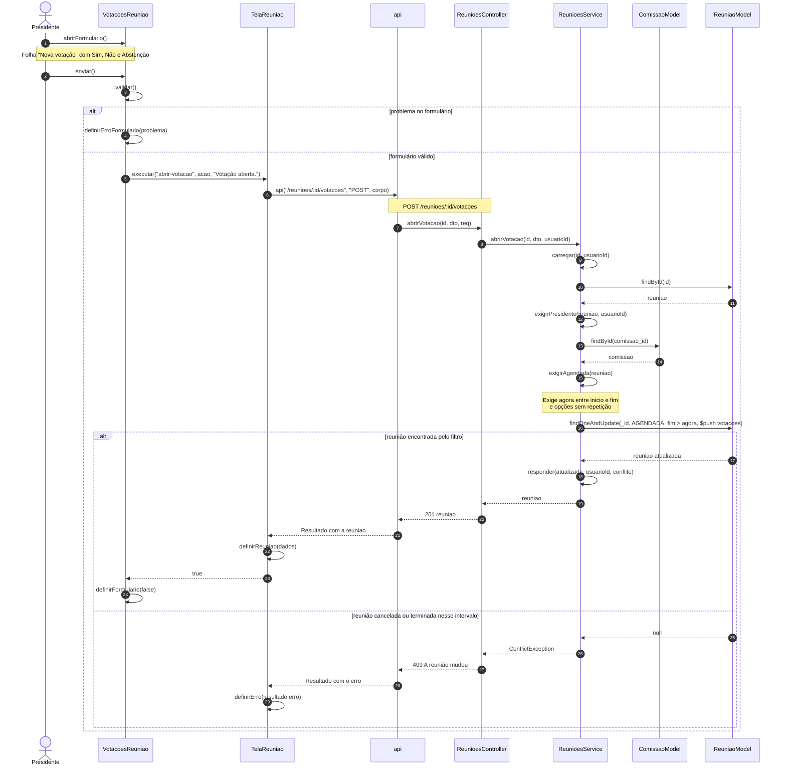
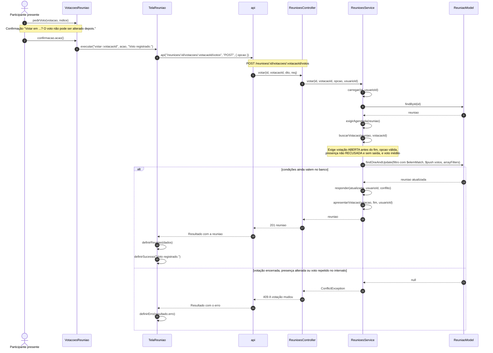

# Diagramas de sequência — Votação na reunião

> Padrão da disciplina · Módulo VOT · Revisado em 13/11/2026

## Resumo

Há um diagrama para cada requisito de [Requisitos funcionais](2%20-%20requisitos-funcionais-votacao.md), com o mesmo número. As linhas de vida são classes e módulos que existem no código: a tela `TelaReuniao`, o componente `VotacoesReuniao`, o módulo `api`, o `ReunioesController`, o `ReunioesService` e os models do Mongoose. Toda mensagem é a chamada de um método existente, com seus parâmetros, e as mensagens são numeradas na ordem em que acontecem. Regras que não são métodos, como comparações de horário, aparecem em notas.

Em todos os diagramas, a chamada do módulo `api` ao controller é uma requisição HTTP que passa antes por `ApiKeyGuard`, `JwtAuthGuard` e `UsuarioComumGuard`; a rota está indicada na nota.

## SD-VOT-01 — Abrir votação



## SD-VOT-02 — Votar



## SD-VOT-03 — Encerrar votação

```mermaid
sequenceDiagram
  autonumber
  actor U as Presidente
  participant V as VotacoesReuniao
  participant T as TelaReuniao
  participant A as api
  participant C as ReunioesController
  participant S as ReunioesService
  participant CM as ComissaoModel
  participant M as ReuniaoModel
  U->>V: pedirEncerramento(votacao)
  Note over U,V: Confirmação "Encerrar a votação ...? Ninguém mais poderá votar."
  U->>V: confirmacao.acao()
  V->>T: executar("encerrar-:votacaoId", acao, "Votação encerrada.")
  T->>A: api("/reunioes/:id/votacoes/:votacaoId/encerrar", "POST")
  Note over A,C: POST /reunioes/:id/votacoes/:votacaoId/encerrar
  A->>C: encerrarVotacao(id, votacaoId, req)
  C->>S: encerrarVotacao(id, votacaoId, usuarioId)
  S->>S: carregar(id, usuarioId)
  S->>M: findById(id)
  M-->>S: reuniao
  S->>S: exigirPresidente(reuniao, usuarioId)
  S->>CM: findById(comissao_id)
  CM-->>S: comissao
  S->>S: exigirAgendada(reuniao)
  S->>S: buscarVotacao(reuniao, votacaoId)
  Note over S: Recusa votação já ENCERRADA;<br/>encerrada_em = menor entre agora e fim
  S->>M: findOneAndUpdate(votação ABERTA, $set situacao e encerrada_em)
  alt votação ainda aberta
    M-->>S: reuniao atualizada
    S->>S: responder(atualizada, usuarioId, conflito)
    S-->>C: reuniao com resultado
    C-->>A: 201 reuniao
    A-->>T: Resultado com a reuniao
    T->>T: definirReuniao(dados)
    T->>T: definirSucesso("Votação encerrada.")
  else encerrada por outra chamada no intervalo
    M-->>S: null
    S-->>C: ConflictException
    C-->>A: 409 A votação mudou
    A-->>T: Resultado com o erro
    T->>T: definirErro(resultado.erro)
  end
```

## SD-VOT-04 — Consultar votações e resultado

```mermaid
sequenceDiagram
  autonumber
  actor U as Participante da reunião
  participant T as TelaReuniao
  participant V as VotacoesReuniao
  participant A as api
  participant C as ReunioesController
  participant S as ReunioesService
  participant M as ReuniaoModel
  U->>T: abre a tela da reunião
  loop ao abrir e a cada 30 segundos
    T->>T: buscar()
    T->>A: api("/reunioes/:id")
    Note over A,C: GET /reunioes/:id
    A->>C: buscarPorId(id, req)
    C->>S: buscarPorId(id, usuarioId)
    S->>S: carregar(id, usuarioId)
    S->>M: findById(id)
    M-->>S: reuniao
    S->>S: popular(reuniao)
    S->>S: apresentar(reuniao, usuarioId)
    loop cada votação
      S->>S: apresentarVotacao(votacao, fim, usuarioId)
      Note over S: Remove votos; calcula total_votos e meu_voto;<br/>ABERTA com fim passado vira ENCERRADA;<br/>resultado só quando ENCERRADA
    end
    S-->>C: reuniao
    C-->>A: 200 reuniao
    A-->>T: Resultado com a reuniao
    T->>T: definirReuniao(dados)
    T->>A: api("/comissoes/:comissaoId")
    A-->>T: comissão com membros
    T->>T: definirPresidente(RESPONSAVEL e comissão ativa)
  end
  U->>T: definirAba("votacoes")
  T->>V: reuniao, presidente, emAndamento, motivoSemVoto
  alt votação aberta
    V->>V: renderizarAberta(votacao)
  else votação encerrada
    V->>V: renderizarResultado(votacao)
  end
```

## Rastreabilidade

SD-VOT-01 a SD-VOT-04 correspondem a RF-VOT-01 a RF-VOT-04 e aos casos de uso UC-VOT-01 a UC-VOT-04.
