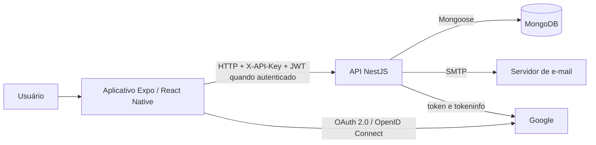

# Arquitetura e tecnologias

## 1. Arquitetura

O frontend é uma aplicação React Native com Expo Router. O backend é uma API REST NestJS. O MongoDB persiste `usuarios`, `organizacoes`, `comissoes` e `reunioes`; vínculos, participantes, presenças e atas são subdocumentos embutidos.w

## 2. Camadas do frontend

| Camada | Responsabilidade | Exemplos |
|---|---|---|
| Rotas/telas | interação, formulários e navegação | `src/app/login`, `src/app/(abas)`, `src/app/reunioes` |
| Componentes | elementos reutilizáveis e responsivos | `CampoTexto`, `Confirmacao`, `TelaComCabecalho`, `FolhaInferior` |
| Contextos | sessão, tema e mensagens | `SessaoContext`, `TemaContext`, `ToastContext` |
| Serviços | HTTP, OAuth e autenticação local | `api.ts`, `google.ts`, `autenticacao-local.ts` |
| Utilitários | validações e regras de apresentação | `validacao.ts`, `reunioes.ts`, `sugestoes-horario.ts` |

Os formulários usam `react-hook-form`; a tela principal usa `react-native-keyboard-controller` para evitar que o teclado cubra campos no Android. Telas com dados mutáveis usam `useFocusEffect` para recarregar ao receber foco.

## 3. Camadas do backend

| Camada | Responsabilidade |
|---|---|
| Controllers | mapear rotas, DTOs, parâmetros e guards |
| DTOs | validar e transformar entradas com `class-validator` e `class-transformer` |
| Services | aplicar regras de negócio e coordenar persistência |
| Schemas/Models | definir documentos e operações Mongoose |
| Guards | validar chave da API, JWT, tipo de usuário e vínculo |

O `ValidationPipe` global usa `whitelist: true` e `transform: true`: propriedades sem decoradores são removidas e valores compatíveis podem ser transformados antes do controller.

## 4. Proteção das requisições

1. `ApiKeyGuard` global exige `X-API-Key` em todas as requisições, exceto `OPTIONS` e os dois callbacks GET do Google.
2. Rotas privadas aplicam `JwtAuthGuard`, que valida o Bearer JWT, o `sub`, a existência e o estado ativo da conta.
3. `AdminSistemaGuard` e `UsuarioComumGuard` restringem o tipo de conta.
4. Os services validam autorização de domínio, como ser administrador aprovado da organização ou responsável da comissão.

O JWT expira em **1 hora**. No aplicativo nativo ele é salvo por `expo-secure-store`; na web, por `localStorage`. A sessão é revalidada ao abrir o aplicativo, ao voltar ao primeiro plano e a cada 30 segundos.

> Limite conhecido: `EXPO_PUBLIC_API_ACCESS_TOKEN` é incorporado ao aplicativo e não deve ser tratado como credencial secreta. Ele bloqueia clientes sem a chave configurada, mas não substitui JWT, autorização por papel nem TLS.

## 5. Bibliotecas do frontend

Versões resolvidas pelo `package-lock.json` da branch `homolog`, commit `792fab4`:

| Biblioteca | Versão | Uso no projeto |
|---|---:|---|
| Expo | 57.0.31 | runtime, bundler e ferramentas do aplicativo |
| React | 19.2.3 | componentes e estado |
| React Native | 0.86.3 | interface nativa Android/iOS |
| Expo Router | 57.0.29 | rotas por arquivos e proteção de telas |
| React Hook Form | 7.90.0 | estado, validação e envio dos formulários |
| React Native Keyboard Controller | 1.21.9 | ajuste da tela ao teclado, principalmente Android |
| Expo Secure Store | 57.0.4 | JWT e preferência de tema no dispositivo |
| Expo Local Authentication | 57.0.3 | biometria ou credencial do aparelho em ações de conta |
| Expo Auth Session | 57.0.16 | fluxo OAuth no navegador |
| Google Sign-In | 16.1.5 | login Google nativo |
| Expo Linking | 57.0.13 | deep links e callbacks |
| Expo Constants | 57.0.22 | configuração Expo e descoberta do host local |
| Expo Clipboard | 57.0.2 | cópia do código de acesso da organização |
| Expo Linear Gradient | 57.0.2 | fundos visuais |
| Expo Font | 57.0.4 | carregamento das fontes |
| Poppins para Expo | 0.4.1 | família tipográfica |
| Ionicons para React Native | 14.0.0 | ícones |
| Gesture Handler | 2.32.0 | gestos nativos |
| Reanimated | 4.5.1 | animações nativas |
| Safe Area Context | 5.7.0 | respeito às áreas seguras do aparelho |
| React Native Screens | 4.26.2 | telas nativas usadas pela navegação |
| React Native Web | 0.21.2 | execução no navegador |
| TypeScript | 6.0.3 | tipagem e verificação estática |
| ESLint | 9.39.5 | análise de estilo e problemas de código |

## 6. Bibliotecas do backend

Versões resolvidas pelo `package-lock.json` da branch `homolog`, commit `6f2ffc4`:

| Biblioteca | Versão | Uso no projeto |
|---|---:|---|
| NestJS Common/Core | 12.0.1 | framework e injeção de dependências |
| NestJS Platform Express | 12.0.1 | servidor HTTP Express |
| NestJS Config | 12.0.0 | variáveis de ambiente |
| NestJS JWT | 12.0.1 | assinatura e validação do JWT |
| NestJS Mongoose | 12.0.0 | integração com MongoDB |
| Mongoose | 9.9.5 | schemas, consultas e persistência |
| bcrypt | 6.0.0 | hash e comparação de senhas, custo 10 |
| class-validator | 0.15.1 | validação declarativa dos DTOs |
| class-transformer | 0.5.1 | transformação de entradas |
| Nodemailer | 10.0.10 | envio de códigos de confirmação e recuperação |
| RxJS | 7.8.2 | infraestrutura reativa usada pelo NestJS |
| Vitest | 4.1.11 | testes automatizados |
| Supertest | 7.2.2 | testes HTTP |
| Oxlint | 1.82.0 | análise estática |
| Prettier | 3.9.6 | formatação |
| TypeScript | 6.0.3 | compilação e tipagem |

O backend usa também os módulos nativos `node:crypto` para códigos, tokens e comparação temporal segura, `node:os` para métricas do servidor e `fetch` do Node para endpoints OAuth do Google.

## 7. Variáveis de ambiente

| Aplicação | Variável | Finalidade | Sensível? |
|---|---|---|---|
| Frontend | `EXPO_PUBLIC_API_URL` | endereço base da API | Não |
| Frontend | `EXPO_PUBLIC_API_ACCESS_TOKEN` | valor enviado em `X-API-Key` | Público no bundle; não usar como segredo |
| Frontend | `EXPO_PUBLIC_GOOGLE_*` | IDs e URIs públicas do OAuth | Não são segredos |
| Backend | `MONGODB_URI` | conexão MongoDB | Sim quando contém credenciais |
| Backend | `JWT_SECRET` | assinatura dos JWTs | Sim |
| Backend | `API_ACCESS_TOKEN` | valor esperado pelo `ApiKeyGuard` | Sim no servidor |
| Backend | `ROOT_USER_*` | administrador inicial | Sim para a senha |
| Backend | `MAIL_*` | conexão SMTP e remetente | Sim para usuário/senha |
| Backend | `GOOGLE_CLIENT_ID` e IDs móveis | clientes OAuth permitidos | Não são segredo |
| Backend | `GOOGLE_CLIENT_SECRET` | segredo OAuth web | Sim |
| Backend | `FRONTEND_URL` | origem/callback web autorizado | Não |
| Backend | `TEST_USER_*` e `TEST_USERS_PASSWORD` | massa criada por `/sistema/popular-teste` | Senha é sensível |

## 8. Verificação da base

Em 23/10/2026, com Node.js 24.11.0 e npm 11.6.1:

- backend: `npm run build` concluído; `npm test` com **13 arquivos e 182 testes aprovados**;
- frontend: 9 testes Node aprovados e lint sem diagnóstico após instalar dependências;
- frontend: `npm run typecheck` aponta rotas ausentes no arquivo gerado de typed routes do Expo. Como o arquivo é gerado pelo ambiente Expo, o resultado deve ser repetido após regenerar `.expo/types`; até isso ocorrer, a verificação de tipos não pode ser registrada como aprovada.

Nenhum resultado de desempenho foi medido nesta revisão. Metas de tempo presentes nos RNFs são critérios de aceitação, não evidência de medição.
